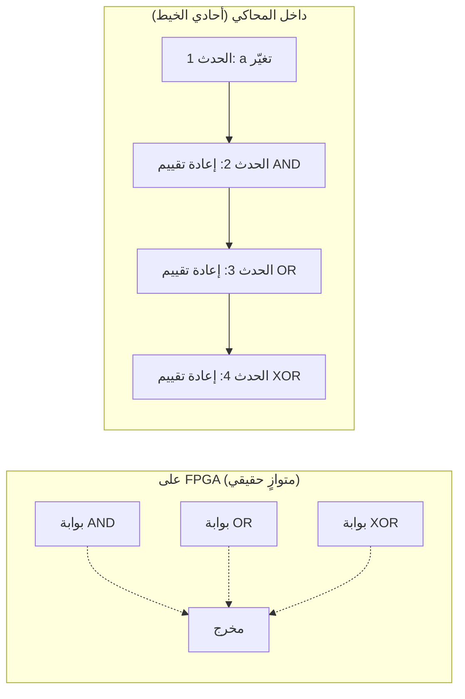

# لماذا لا يستطيع VHDL تنفيذ توازٍ حقيقي

لقد رأيت الآن نموذجين:

- **التسلسلي** — الجمل تُنفَّذ الواحدة تلو الأخرى داخل `process`.
- **المتزامن** — الجمل خارج أي `process` «تنطلق كلها معًا» في نفس دورة الدلتا.

لا أيّ منهما مماثل لـ **المتوازي**. فماذا يعني «المتوازي» فعلًا؟

> **متوازٍ** = أشياء متعدِّدة تحدث *في اللحظة نفسها من الوقت الحقيقي*.

عندما تضع كود VHDL على شريحة FPGA حقيقية، هذا بالضبط ما يحدث. كل بوَّابة
في التصميم تستقرّ على مخرجها بمجرد أن تستقرّ مدخلاتها. ليس هناك «خطوة 1،
خطوة 2، خطوة 3» — تتدفَّق الإلكترونات عبر السيليكون، وبعد بضع نانو ثانية
تكون الدائرة كلها في حالتها الجديدة.

لكن عندما تضغط **Run** في Kmila، أنت لست على FPGA. أنت داخل **محاكي**،
يعمل على وحدة معالجة مركزية أُحادية الخيط. على المحاكي أن *يتظاهر* بأن
الدائرة متوازية، لكنه في الحقيقة يمشي عبر طابور أحداث حدثًا واحدًا في
كل مرة.

مهمّة المحاكي أن يعطيك نتيجة **تُطابق** ما سيفعله العتاد، لا أن يشغِّل
الأشياء فعلًا بالتوازي. **دورات الدلتا** هي حيلة المحاكي: تسمح له بمعالجة
عدّة أحداث «في نفس الوقت المحاكى» بأن يمنح كل إشارة فرصة واحدة كي تستقرّ
قبل أن يتقدَّم الوقت رسميًا.

## النماذج الثلاثة، جنبًا إلى جنب

| النموذج | أين يعيش | «في اللحظة نفسها»؟ |
|---|---|---|
| تسلسلي | داخل جسم `process` | لا — جملة، ثم التالية. |
| متزامن | خارج أي `process`، بين `begin` و`end` | نعم — نفس دورة الدلتا. |
| متوازٍ | **على العتاد الحقيقي فقط.** | نعم — نفس النانو ثانية من الوقت الحقيقي. |

## ماذا عن المحاكيات متعدِّدة النواة؟

بعض محاكيات VHDL المتقدِّمة *تستخدم* عدَّة خيوط CPU لتقييم التصاميم الكبيرة
بشكل أسرع. لكن ذلك **توازٍ من أجل السرعة**، وليس توازيًا في دلالات اللغة.
من وجهة نظر كود VHDL، تظل المحاكاة أُحادية الخيط؛ التخييط تفصيل تنفيذي
غير مرئي لك.

## لماذا نهتمّ بتعليم هذا

يكتب المبتدئون كودًا «يُفترض أن يعمل بالتوازي» — ثم يُفاجَؤون عندما
يعطي المحاكي إجابة مختلفة عمّا توقَّعوا. الدرسان التاليان يشرحان بالضبط
*لماذا*: كل شيء يعود إلى **قوائم الحساسية** و**دورات الدلتا**.
