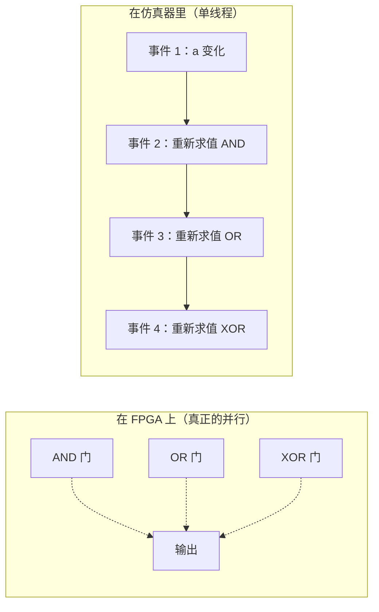

# 为什么 VHDL 做不到真正的并行

你已经见过两种模型：

- **顺序**——语句在 process 内部一条接一条地执行。
- **并发**——process 之外的语句在同一个 delta 周期里「一起触发」。

这两者都不等同于**并行**。那么并行到底是什么意思？

> **并行** = 多件事在*同一瞬间的墙上时钟时间*同时发生。

当你把 VHDL 放到真实的 FPGA 上时，发生的就是这件事。设计里的每一个门只要输入稳定，输出就会立刻稳定下来。没有「第一步、第二步、第三步」——电子在硅片里流动，几纳秒之后，整个电路就进入了新的状态。

但当你在 Kmila 里按下 **Run** 时，你并不在 FPGA 上。你在一个**仿真器**里，跑在一颗单线程 CPU 上。仿真器不得不 *假装*电路是并行的，但它其实是在一个事件队列里一次处理一个事件。

仿真器的任务是给你一个**匹配**硬件行为的结果，而不是真的把事情并行地跑起来。**delta 周期**就是仿真器的那个小把戏：它让仿真器可以「在同一仿真时刻」处理许多事件，方法是让每条信号都在时间正式推进之前有一次稳定的机会。

<!-- exec-fig:start -->
## 在餐厅里：一名服务员 vs 五名

单个服务员能做到最好的就是听铃声的策略（**1 <svg width="1em" height="1em" viewBox="0 0 16 16" fill="none" stroke="currentColor" stroke-width="1.6" stroke-linecap="round" stroke-linejoin="round" style="vertical-align:-0.15em" aria-hidden="true"><path d="M3 12H13M4.6 12C4.6 6 5.8 3 8 3S11.4 6 11.4 12M6.6 14.2A1.5 1.5 0 0 0 9.4 14.2"/></svg>**），这正是仿真器的做法。真正的并行需要更多服务员（**5 ‖**）：

<iframe src="/_content/Kmila.Shared/anatomia/exec-restaurant.html?modes=bell,par&mode=bell" title="餐厅：仿真器的唯一服务员 vs 五名服务员" loading="lazy"></iframe>

让两次运行都跑完，比较图表上的虚线终点线。仿真器只能通过给事件排序来 **假装** 一切同时发生。 FPGA 不用假装：每个门都是自己的服务员，所以所有桌子真的同时被服务。
<!-- exec-fig:end -->

<!-- exec-fig2:start -->
## 传送带 vs 水管

当 `a` 改变时，这张工作台的两半计算的是同样三个门：

<iframe src="/_content/Kmila.Shared/anatomia/exec-conveyor.html" title="仿真器的传送带和唯一的机械臂 vs 硬件的水管" loading="lazy" style="aspect-ratio:640/340"></iframe>

- **后半（仿真器）：** 这个变化变成传送带上的 **事件箱**；唯一的机械臂 **一个接一个** 地处理（先 AND，再 OR，再 XOR）。仿真时钟仍然显示 **0 ns**：它们都算同一时刻。
- **前半（硬件）：** 打开阀门 `a`，水同时流进三条水道，三个门 **一起** 亮起。这才是真正的并行。
<!-- exec-fig2:end -->

## 三种模型并排比较

| 模型 | 出现在哪里 | 「同时发生」？ |
|---|---|---|
| 顺序 | `process` 主体内部 | 否——一条语句，接着下一条。 |
| 并发 | 任何 process 之外，`begin` 与 `end` 之间 | 是——同一个 delta 周期。 |
| 并行 | **只在真实硬件上。** | 是——同一纳秒的墙上时钟时间。 |

## 那多核仿真器呢？

少数高端 VHDL 仿真器*确实*会用多颗 CPU 线程来加速大型设计的求值。但那属于**为了速度而做的并行**，并不是语言语义层面的并行。从 VHDL 代码的视角看，仿真依然是单线程的；多线程只是一个对你不可见的实现细节。

## 为什么值得费心讲这些

初学者写出「按理应该并行工作」的代码，然后当仿真器给出和他们预期不同的结果时就困惑了。接下来两节课会精确解释 *为什么*：一切都归结于**敏感信号列表**和 **delta 周期**。
