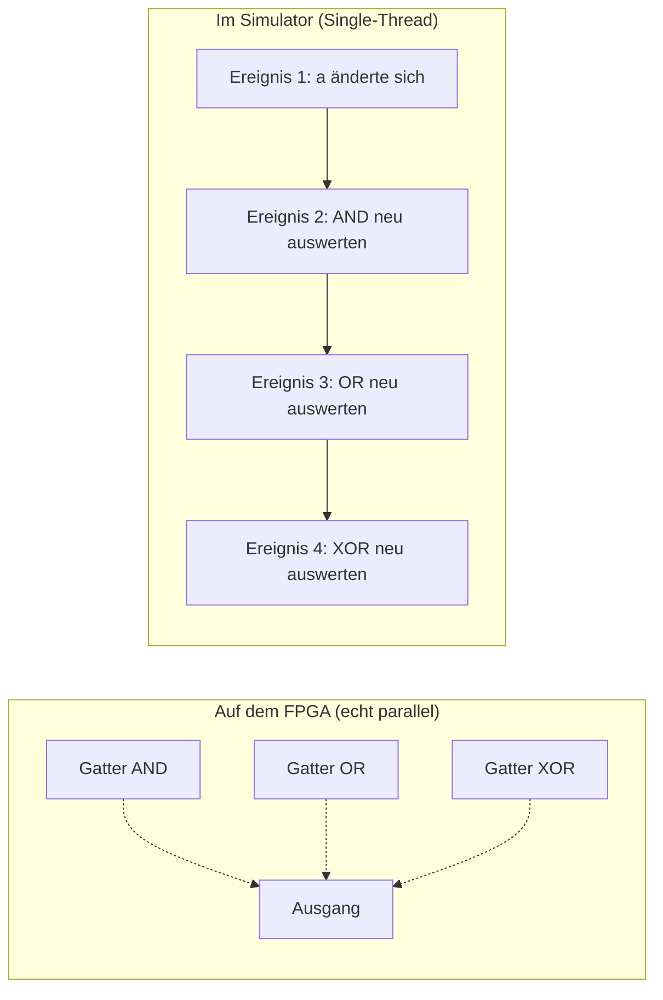

# Warum VHDL keine echte Parallelität kann

Du hast jetzt zwei Modelle gesehen:

- **Sequenziell** — Anweisungen laufen nacheinander innerhalb eines `process`.
- **Nebenläufig** — Anweisungen außerhalb eines `process` „feuern zusammen" im selben Delta-Zyklus.

Keins davon ist dasselbe wie **parallel**. Was heißt parallel also wirklich?

> **Parallel** = mehrere Dinge passieren *im selben Augenblick der Wanduhrzeit*.

Wenn du dein VHDL auf ein echtes FPGA bringst, ist das genau das, was passiert. Jedes Gatter im Design lässt seinen Ausgang einschwingen, sobald seine Eingänge stabil sind. Es gibt kein „Schritt 1, Schritt 2, Schritt 3" — Elektronen fließen durchs Silizium, und nach ein paar Nanosekunden ist die ganze Schaltung in ihrem neuen Zustand.

Aber wenn du in Kmila **Run** drückst, bist du nicht auf einem FPGA. Du bist in einem **Simulator**, der auf einer Single-Thread-CPU läuft. Der Simulator muss *so tun*, als wäre die Schaltung parallel, geht in Wirklichkeit aber eine Ereigniswarteschlange Ereignis für Ereignis durch.

Die Aufgabe des Simulators ist, dir ein Ergebnis zu liefern, das dem **entspricht**, was die Hardware machen würde, nicht Dinge wirklich parallel laufen zu lassen. **Delta-Zyklen** sind der Trick des Simulators: sie erlauben ihm, viele Ereignisse „zur selben Simulationszeit" zu verarbeiten, indem jedes Signal einmal die Chance kriegt, sich einzuschwingen, bevor die Zeit offiziell weiterrückt.

<!-- exec-fig:start -->
## Im Restaurant: eine Kellnerin gegen fünf

Das Beste, was eine einzelne Kellnerin tun kann, ist die Klingel-Strategie (**1 <svg width="1em" height="1em" viewBox="0 0 16 16" fill="none" stroke="currentColor" stroke-width="1.6" stroke-linecap="round" stroke-linejoin="round" style="vertical-align:-0.15em" aria-hidden="true"><path d="M3 12H13M4.6 12C4.6 6 5.8 3 8 3S11.4 6 11.4 12M6.6 14.2A1.5 1.5 0 0 0 9.4 14.2"/></svg>**), und genau das macht der Simulator. Echte Parallelität braucht mehr Kellnerinnen (**5 ‖**):

<iframe src="/_content/Kmila.Shared/anatomia/exec-restaurant.html?modes=bell,par&mode=bell" title="Restaurant: die einzige Kellnerin des Simulators gegen fünf Kellnerinnen" loading="lazy"></iframe>

Lass beide Durchläufe fertig laufen und vergleiche die gestrichelten Ziellinien im Diagramm. Der Simulator kann nur **so tun**, als passiere alles gleichzeitig, indem er Ereignisse in eine Reihenfolge bringt. Das FPGA tut nicht nur so: Jedes Gatter ist seine eigene Kellnerin, also werden alle Tische wirklich gleichzeitig bedient.
<!-- exec-fig:end -->

<!-- exec-fig2:start -->
## Das Förderband gegen die Wasserrohre

Beide Hälften dieser Werkbank berechnen dieselben drei Gatter, wenn sich `a` ändert:

<iframe src="/_content/Kmila.Shared/anatomia/exec-conveyor.html" title="Förderband des Simulators mit einem Roboterarm gegen die Wasserrohre der Hardware" loading="lazy" style="aspect-ratio:640/340"></iframe>

- **Hinten (Simulator):** Die Änderung wird zu **Ereigniskisten** auf einem Förderband; ein einzelner Roboterarm arbeitet sie **nacheinander** ab (AND, dann OR, dann XOR). Die Simulationsuhr zeigt weiter **0 ns**: Sie zählen alle als derselbe Moment.
- **Vorne (Hardware):** Öffnet man das Ventil `a`, fließt das Wasser gleichzeitig durch alle drei Kanäle, und die drei Gatter leuchten **zusammen** auf. Das ist echte Parallelität.
<!-- exec-fig2:end -->

## Die drei Modelle nebeneinander

| Modell | Wo es lebt | „Zur selben Zeit"? |
|---|---|---|
| Sequenziell | Innerhalb eines `process`-Körpers | Nein — eine Anweisung, dann die nächste. |
| Nebenläufig | Außerhalb jedes `process`, zwischen `begin` und `end` | Ja — selber Delta-Zyklus. |
| Parallel | **Nur auf echter Hardware.** | Ja — selbe Wanduhr-Nanosekunde. |

## Was ist mit Multi-Core-Simulatoren?

Ein paar High-End-VHDL-Simulatoren *nutzen* tatsächlich mehrere CPU-Threads, um große Designs schneller auszuwerten. Aber das ist **Parallelität für Geschwindigkeit**, keine Parallelität in der Sprachsemantik. Aus Sicht des VHDL-Codes ist die Simulation immer noch Single-Thread; das Threading ist ein Implementierungsdetail, das für dich unsichtbar bleibt.

## Warum wir uns die Mühe machen, das zu erklären

Anfänger schreiben Code, der „parallel funktionieren sollte" — und sind dann überrascht, wenn der Simulator eine andere Antwort gibt als erwartet. Die nächsten zwei Lektionen erklären genau *warum*: alles läuft auf **Sensitivitätslisten** und **Delta-Zyklen** hinaus.
