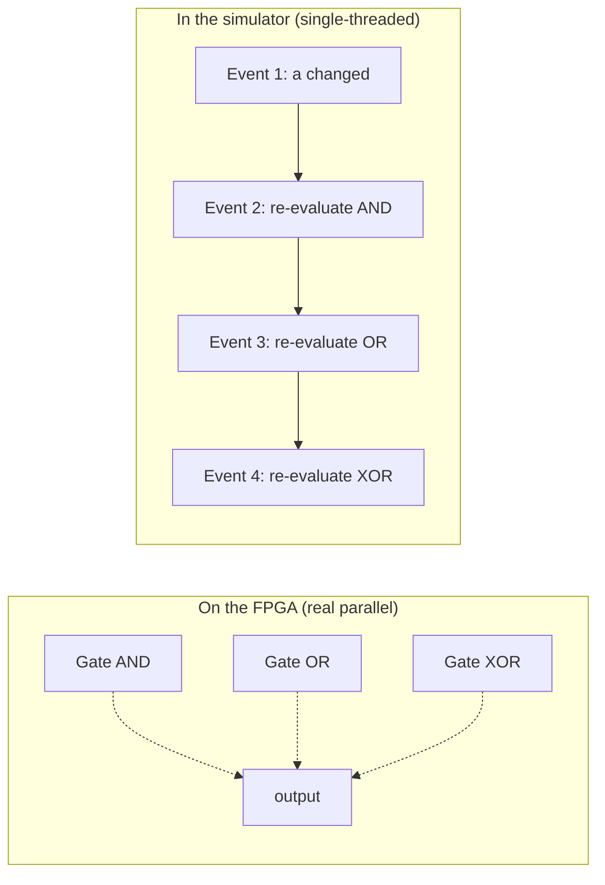

# Why VHDL can't do true parallel

You've now seen two models:

- **Sequential** — statements run one after another inside a process.
- **Concurrent** — statements outside a process all "fire together" in the same delta cycle.

Neither of those is the same as **parallel**. So what does parallel really mean?

> **Parallel** = multiple things happening *at the same instant of
> wall-clock time*.

When you put your VHDL on a real FPGA, that's exactly what happens.
Every gate in the design settles its output as soon as its inputs are
stable. There's no "step 1, step 2, step 3" — electrons flow through the
silicon, and after a few nanoseconds the whole circuit is in its new
state.

But when you press **Run** in Kmila, you're not on an FPGA. You're in a
**simulator**, running on a single-threaded CPU. The simulator has to
*pretend* the circuit is parallel, but it actually walks an event queue
one event at a time.

The simulator's job is to give you a result that **matches** what the
hardware would do, not to actually run things in parallel. **Delta
cycles** are the simulator's trick: they let it process many events
"at the same simulation time" by giving every signal one chance to
settle before time officially advances.

## The three models, lined up

| Model | Where it lives | "At the same time"? |
|---|---|---|
| Sequential | Inside a `process` body | No — one statement, then the next. |
| Concurrent | Outside any process, between `begin` and `end` | Yes — same delta cycle. |
| Parallel | **On real hardware only.** | Yes — same wall-clock nanosecond. |

## What about multicore simulators?

A few high-end VHDL simulators *do* use multiple CPU threads to evaluate
large designs faster. But that's **parallelism for speed**, not
parallelism in the language semantics. From the VHDL code's point of
view, simulation is still single-threaded; the threading is an
implementation detail invisible to you.

## Why we bother teaching this

Beginners write code that "should work in parallel" — and then they're
surprised when the simulator gives a different answer than they
expected. The next two lessons explain exactly *why*: it all comes
down to **sensitivity lists** and **delta cycles**.
