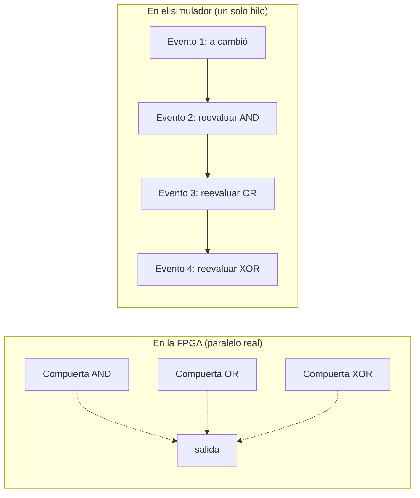

# Por qué VHDL no puede hacer paralelismo real

Ya has visto dos modelos:

- **Secuencial** — las sentencias se ejecutan una tras otra dentro de un proceso.
- **Concurrente** — las sentencias fuera de un proceso "se disparan juntas" en el mismo ciclo delta.

Ninguno de esos es lo mismo que **paralelo**. Entonces, ¿qué significa realmente paralelo?

> **Paralelo** = varias cosas sucediendo *al mismo instante de tiempo real*.

Cuando pones tu VHDL en una FPGA real, eso es exactamente lo que pasa.
Cada compuerta del diseño asienta su salida tan pronto como sus entradas
son estables. No hay "paso 1, paso 2, paso 3" — los electrones fluyen
por el silicio, y después de unos nanosegundos todo el circuito está en
su nuevo estado.

Pero cuando presionas **Ejecutar** en Kmila, no estás en una FPGA. Estás
en un **simulador**, corriendo en un CPU de un solo hilo. El simulador
tiene que *fingir* que el circuito es paralelo, pero en realidad
recorre una cola de eventos uno a la vez.

El trabajo del simulador es darte un resultado que **coincida** con lo
que haría el hardware, no ejecutar las cosas en paralelo de verdad. Los
**ciclos delta** son el truco del simulador: le permiten procesar muchos
eventos "al mismo tiempo de simulación" dándole a cada señal una
oportunidad de asentarse antes de que el tiempo avance oficialmente.

## Los tres modelos, alineados

| Modelo | Dónde vive | ¿"Al mismo tiempo"? |
|---|---|---|
| Secuencial | Dentro del cuerpo de un `process` | No — una sentencia, luego la siguiente. |
| Concurrente | Fuera de cualquier proceso, entre `begin` y `end` | Sí — mismo ciclo delta. |
| Paralelo | **Solo en hardware real.** | Sí — mismo nanosegundo real. |

## ¿Y los simuladores multinúcleo?

Algunos simuladores VHDL de gama alta *sí* usan varios hilos de CPU
para evaluar diseños grandes más rápido. Pero eso es **paralelismo
por velocidad**, no paralelismo en la semántica del lenguaje. Desde el
punto de vista del código VHDL, la simulación sigue siendo de un solo
hilo; los hilos son un detalle de implementación invisible para ti.

## Por qué nos molestamos en enseñar esto

Los principiantes escriben código que "debería funcionar en paralelo" —
y luego se sorprenden cuando el simulador da una respuesta distinta a
la que esperaban. Las próximas dos lecciones explican exactamente
*por qué*: todo se reduce a las **listas de sensibilidad** y los
**ciclos delta**.
