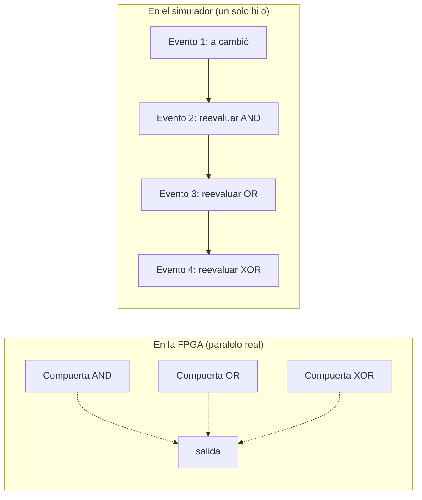

# Por qué VHDL no puede hacer paralelismo real

Ya has visto dos modelos:

- **Secuencial** — las sentencias se ejecutan una tras otra dentro de un proceso.
- **Concurrente** — las sentencias fuera de un proceso "se disparan juntas" en el mismo ciclo delta.

Ninguno de esos es lo mismo que **paralelo**. Entonces, ¿qué significa realmente paralelo?

> **Paralelo** = varias cosas sucediendo *al mismo instante de tiempo real*.

Cuando pones tu VHDL en una FPGA real, eso es exactamente lo que pasa. Cada compuerta del diseño asienta su salida tan pronto como sus entradas son estables. No hay "paso 1, paso 2, paso 3" — los electrones fluyen por el silicio, y después de unos nanosegundos todo el circuito está en su nuevo estado.

Pero cuando presionas **Ejecutar** en Kmila, no estás en una FPGA. Estás en un **simulador**, corriendo en un CPU de un solo hilo. El simulador tiene que *fingir* que el circuito es paralelo, pero en realidad recorre una cola de eventos uno a la vez.

El trabajo del simulador es darte un resultado que **coincida** con lo que haría el hardware, no ejecutar las cosas en paralelo de verdad. Los **ciclos delta** son el truco del simulador: le permiten procesar muchos eventos "al mismo tiempo de simulación" dándole a cada señal una oportunidad de asentarse antes de que el tiempo avance oficialmente.

<!-- exec-fig:start -->
## En el restaurante: una mesera vs cinco

Lo mejor que puede hacer una sola mesera es la estrategia de las campanas (**1 <svg width="1em" height="1em" viewBox="0 0 16 16" fill="none" stroke="currentColor" stroke-width="1.6" stroke-linecap="round" stroke-linejoin="round" style="vertical-align:-0.15em" aria-hidden="true"><path d="M3 12H13M4.6 12C4.6 6 5.8 3 8 3S11.4 6 11.4 12M6.6 14.2A1.5 1.5 0 0 0 9.4 14.2"/></svg>**), y eso es justo lo que hace el simulador. El paralelismo real necesita más meseras (**5 ‖**):

<iframe src="/_content/Kmila.Shared/anatomia/exec-restaurant.html?modes=bell,par&mode=bell" title="Restaurante: la única mesera del simulador vs cinco meseras" loading="lazy"></iframe>

Deja que ambas corridas terminen y compara las líneas punteadas de meta en la gráfica. El simulador solo puede **fingir** que todo pasa a la vez, ordenando los eventos. La FPGA no finge: cada compuerta es su propia mesera, así que todas las mesas se atienden de verdad al mismo tiempo.
<!-- exec-fig:end -->

<!-- exec-fig2:start -->
## La banda transportadora vs las tuberías de agua

Las dos mitades de este banco calculan las mismas tres compuertas cuando cambia `a`:

<iframe src="/_content/Kmila.Shared/anatomia/exec-conveyor.html" title="Banda del simulador con un solo brazo robótico vs tuberías de agua del hardware" loading="lazy" style="aspect-ratio:640/340"></iframe>

- **Atrás (simulador):** el cambio se convierte en **cajas de eventos** sobre una banda; un solo brazo robótico las atiende **una por una** (AND, luego OR, luego XOR). El reloj de simulación sigue marcando **0 ns**: todas cuentan como el mismo instante.
- **Al frente (hardware):** al abrir la válvula `a` el agua baja por los tres canales a la vez y las tres compuertas se encienden **juntas**. Eso es paralelismo real.
<!-- exec-fig2:end -->

## Los tres modelos, alineados

| Modelo | Dónde vive | ¿"Al mismo tiempo"? |
|---|---|---|
| Secuencial | Dentro del cuerpo de un `process` | No — una sentencia, luego la siguiente. |
| Concurrente | Fuera de cualquier proceso, entre `begin` y `end` | Sí — mismo ciclo delta. |
| Paralelo | **Solo en hardware real.** | Sí — mismo nanosegundo real. |

## ¿Y los simuladores multinúcleo?

Algunos simuladores VHDL de gama alta *sí* usan varios hilos de CPU para evaluar diseños grandes más rápido. Pero eso es **paralelismo por velocidad**, no paralelismo en la semántica del lenguaje. Desde el punto de vista del código VHDL, la simulación sigue siendo de un solo hilo; los hilos son un detalle de implementación invisible para ti.

## Por qué nos molestamos en enseñar esto

Los principiantes escriben código que "debería funcionar en paralelo" — y luego se sorprenden cuando el simulador da una respuesta distinta a la que esperaban. Las próximas dos lecciones explican exactamente *por qué*: todo se reduce a las **listas de sensibilidad** y los **ciclos delta**.
