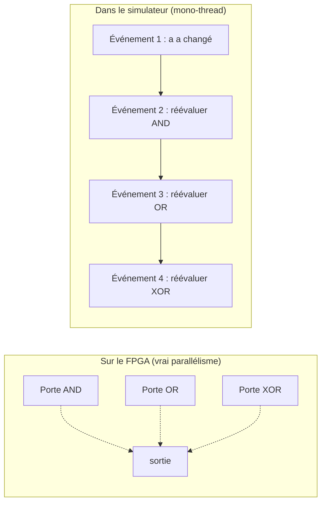

# Pourquoi VHDL ne fait pas de vrai parallélisme

Tu as maintenant vu deux modèles :

- **Séquentiel** — les sentences s'exécutent l'une après l'autre à l'intérieur d'un `process`.
- **Concurrent** — les sentences hors d'un `process` « se déclenchent ensemble » dans le même cycle delta.

Aucun des deux n'est équivalent au **parallèle**. Alors, que veut vraiment dire parallèle ?

> **Parallèle** = plusieurs choses qui se produisent *au même instant de temps réel (wall-clock)*.

Quand tu poses ton VHDL sur un vrai FPGA, c'est exactement ce qui se passe. Chaque porte du design stabilise sa sortie dès que ses entrées sont stables. Il n'y a pas de « étape 1, étape 2, étape 3 » — les électrons circulent dans le silicium et, quelques nanosecondes plus tard, tout le circuit est dans son nouvel état.

Mais quand tu appuies sur **Run** dans Kmila, tu n'es pas sur un FPGA. Tu es dans un **simulateur**, qui tourne sur un CPU mono-thread. Le simulateur doit *faire semblant* que le circuit est parallèle, mais en réalité il parcourt une file d'événements un événement à la fois.

Le boulot du simulateur est de te donner un résultat qui **correspond** à ce que ferait le matériel, pas de vraiment tout exécuter en parallèle. Les **cycles delta** sont son astuce : ils lui permettent de traiter plein d'événements « au même temps de simulation » en donnant à chaque signal une chance de se stabiliser avant que le temps n'avance officiellement.

<!-- exec-fig:start -->
## Au restaurant : une serveuse contre cinq

Le mieux qu'une serveuse seule puisse faire, c'est la stratégie des sonnettes (**1 <svg width="1em" height="1em" viewBox="0 0 16 16" fill="none" stroke="currentColor" stroke-width="1.6" stroke-linecap="round" stroke-linejoin="round" style="vertical-align:-0.15em" aria-hidden="true"><path d="M3 12H13M4.6 12C4.6 6 5.8 3 8 3S11.4 6 11.4 12M6.6 14.2A1.5 1.5 0 0 0 9.4 14.2"/></svg>**), et c'est exactement ce que fait le simulateur. Le vrai parallélisme demande plus de serveuses (**5 ‖**) :

<iframe src="/_content/Kmila.Shared/anatomia/exec-restaurant.html?modes=bell,par&mode=bell" title="Restaurant : la serveuse unique du simulateur contre cinq serveuses" loading="lazy"></iframe>

Laisse les deux exécutions se terminer et compare les lignes d'arrivée en pointillé. Le simulateur ne peut que **faire semblant** que tout arrive en même temps, en mettant les événements en ordre. Le FPGA ne fait pas semblant : chaque porte est sa propre serveuse, donc toutes les tables sont vraiment servies en même temps.
<!-- exec-fig:end -->

<!-- exec-fig2:start -->
## Le tapis roulant contre les tuyaux d'eau

Les deux moitiés de cet établi calculent les trois mêmes portes quand `a` change :

<iframe src="/_content/Kmila.Shared/anatomia/exec-conveyor.html" title="Tapis du simulateur avec un seul bras robot contre les tuyaux d'eau du matériel" loading="lazy" style="aspect-ratio:640/340"></iframe>

- **Au fond (simulateur) :** le changement devient des **caisses d'événements** sur un tapis ; un seul bras robot les traite **une par une** (AND, puis OR, puis XOR). L'horloge de simulation affiche toujours **0 ns** : elles comptent toutes comme le même instant.
- **Devant (matériel) :** ouvrir la vanne `a` envoie l'eau dans les trois canaux à la fois, et les trois portes s'allument **ensemble**. Ça, c'est du vrai parallélisme.
<!-- exec-fig2:end -->

## Les trois modèles, alignés

| Modèle | Où il vit | « Au même instant » ? |
|---|---|---|
| Séquentiel | Dans le corps d'un `process` | Non — une sentence, puis la suivante. |
| Concurrent | Hors de tout `process`, entre `begin` et `end` | Oui — même cycle delta. |
| Parallèle | **Sur du matériel réel uniquement.** | Oui — même nanoseconde de temps réel. |

## Et les simulateurs multi-cœurs ?

Quelques simulateurs VHDL haut de gamme *utilisent* plusieurs threads CPU pour évaluer les gros designs plus vite. Mais c'est du **parallélisme pour la vitesse**, pas du parallélisme dans la sémantique du langage. Du point de vue du code VHDL, la simulation reste mono-thread ; le threading est un détail d'implémentation invisible pour toi.

## Pourquoi on prend la peine d'enseigner ça

Les débutants écrivent du code qui « devrait marcher en parallèle » — puis ils sont surpris quand le simulateur leur donne une réponse différente de celle attendue. Les deux prochaines leçons expliquent exactement *pourquoi* : tout se ramène aux **listes de sensibilité** et aux **cycles delta**.
