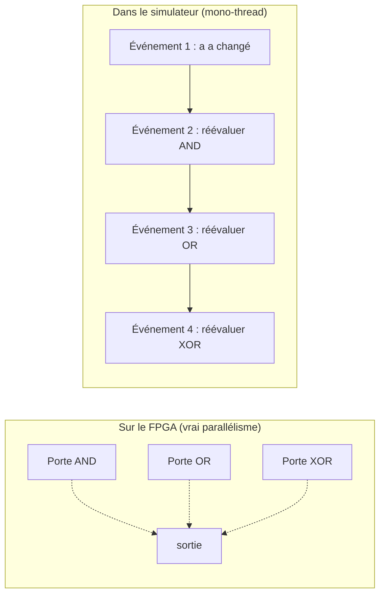

# Pourquoi VHDL ne fait pas de vrai parallélisme

Tu as maintenant vu deux modèles :

- **Séquentiel** — les sentences s'exécutent l'une après l'autre à l'intérieur d'un `process`.
- **Concurrent** — les sentences hors d'un `process` « se déclenchent ensemble » dans le même cycle delta.

Aucun des deux n'est équivalent au **parallèle**. Alors, que veut vraiment dire parallèle ?

> **Parallèle** = plusieurs choses qui se produisent *au même instant de
> temps réel (wall-clock)*.

Quand tu poses ton VHDL sur un vrai FPGA, c'est exactement ce qui se
passe. Chaque porte du design stabilise sa sortie dès que ses entrées
sont stables. Il n'y a pas de « étape 1, étape 2, étape 3 » — les
électrons circulent dans le silicium et, quelques nanosecondes plus
tard, tout le circuit est dans son nouvel état.

Mais quand tu appuies sur **Run** dans Kmila, tu n'es pas sur un FPGA. Tu
es dans un **simulateur**, qui tourne sur un CPU mono-thread. Le
simulateur doit *faire semblant* que le circuit est parallèle, mais en
réalité il parcourt une file d'événements un événement à la fois.

Le boulot du simulateur est de te donner un résultat qui **correspond** à
ce que ferait le matériel, pas de vraiment tout exécuter en parallèle.
Les **cycles delta** sont son astuce : ils lui permettent de traiter
plein d'événements « au même temps de simulation » en donnant à chaque
signal une chance de se stabiliser avant que le temps n'avance
officiellement.

## Les trois modèles, alignés

| Modèle | Où il vit | « Au même instant » ? |
|---|---|---|
| Séquentiel | Dans le corps d'un `process` | Non — une sentence, puis la suivante. |
| Concurrent | Hors de tout `process`, entre `begin` et `end` | Oui — même cycle delta. |
| Parallèle | **Sur du matériel réel uniquement.** | Oui — même nanoseconde de temps réel. |

## Et les simulateurs multi-cœurs ?

Quelques simulateurs VHDL haut de gamme *utilisent* plusieurs threads CPU
pour évaluer les gros designs plus vite. Mais c'est du **parallélisme
pour la vitesse**, pas du parallélisme dans la sémantique du langage. Du
point de vue du code VHDL, la simulation reste mono-thread ; le
threading est un détail d'implémentation invisible pour toi.

## Pourquoi on prend la peine d'enseigner ça

Les débutants écrivent du code qui « devrait marcher en parallèle » —
puis ils sont surpris quand le simulateur leur donne une réponse
différente de celle attendue. Les deux prochaines leçons expliquent
exactement *pourquoi* : tout se ramène aux **listes de sensibilité** et
aux **cycles delta**.
