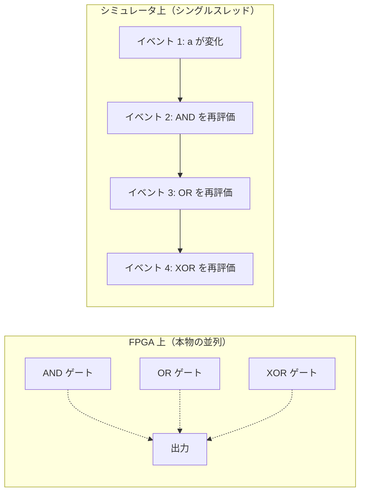

# なぜ VHDL は真の並列にならないのか

ここまでで 2 つのモデルを見てきた。

- **順次** — 文は `process` の中で次々に実行される。
- **並行** — `process` の外にある文は、同じデルタサイクルで「一斉に発火」する。

どちらも **並列** とは違う。では並列とはいったい何なのか？

> **並列 (Parallel)** = 実際の *壁時計時間の同じ瞬間* に複数のことが起こること。

VHDL を本物の FPGA に載せると、まさにそれが起こる。設計中のすべてのゲートは、入力が安定した瞬間に自分の出力を確定させる。「ステップ 1、ステップ 2、ステップ 3」はない — 電子がシリコンを流れ、数ナノ秒後には回路全体が新しい状態になっている。

でも Kmila で **Run** を押すとき、あなたは FPGA の上にいるわけではない。**シミュレータ** の上、シングルスレッドの CPU で動いている。シミュレータは回路が並列であるかのように *ふりをする* しかない — 実際にはイベントキューを 1 件ずつたどっているだけだ。

シミュレータの仕事はハードウェアと **一致する** 結果を出すことであって、実際に並列で走らせることではない。**デルタサイクル** はそのためのトリックで、公式に時間を進める前に各信号に安定する機会を 1 度与えることで、多くのイベントを「同じシミュレーション時刻」で処理できるようにする。

<!-- exec-fig:start -->
## レストランでは：ウェイトレス 1 人 vs 5 人

1 人のウェイトレスにできる最善はベル方式（**1 <svg width="1em" height="1em" viewBox="0 0 16 16" fill="none" stroke="currentColor" stroke-width="1.6" stroke-linecap="round" stroke-linejoin="round" style="vertical-align:-0.15em" aria-hidden="true"><path d="M3 12H13M4.6 12C4.6 6 5.8 3 8 3S11.4 6 11.4 12M6.6 14.2A1.5 1.5 0 0 0 9.4 14.2"/></svg>**）で、シミュレータがやっているのはまさにそれ。本当の並列にはウェイトレスを増やすしかない（**5 ‖**）：

<iframe src="/_content/Kmila.Shared/anatomia/exec-restaurant.html?modes=bell,par&mode=bell" title="レストラン：シミュレータのウェイトレス 1 人 vs 5 人" loading="lazy"></iframe>

両方の実行を最後まで流して、グラフの点線のゴールラインを比べよう。シミュレータはイベントを順番に並べることで、すべてが同時に起きたように **見せかける** ことしかできない。FPGA は見せかけない。ゲート 1 つ 1 つが自分のウェイトレスなので、全卓が本当に同時に対応される。
<!-- exec-fig:end -->

<!-- exec-fig2:start -->
## ベルトコンベア vs 水道管

`a` が変わると、この作業台の 2 つの半分は同じ 3 つのゲートを計算する：

<iframe src="/_content/Kmila.Shared/anatomia/exec-conveyor.html" title="シミュレータのコンベアと 1 本のロボットアーム vs ハードウェアの水道管" loading="lazy" style="aspect-ratio:640/340"></iframe>

- **奥（シミュレータ）：** 変化はコンベア上の **イベントの箱** になり、1 本のロボットアームが **1 つずつ** 処理する（AND、次に OR、次に XOR）。シミュレーション時計は **0 ns** のまま。すべて同じ瞬間として数えられる。
- **手前（ハードウェア）：** バルブ `a` を開くと水が 3 本の水路に同時に流れ、3 つのゲートが **一緒に** 点灯する。これが本当の並列だ。
<!-- exec-fig2:end -->

## 3 つのモデルを並べて

| モデル | どこに存在する | 「同じ時刻」？ |
|---|---|---|
| 順次 | `process` の本体の中 | いいえ — 1 文ずつ順番に。 |
| 並行 | `process` の外、`begin` と `end` の間 | はい — 同じデルタサイクル。 |
| 並列 | **本物のハードウェア上のみ。** | はい — 同じ壁時計上のナノ秒。 |

## マルチコアシミュレータはどうなの？

一部のハイエンドな VHDL シミュレータは、大規模設計を高速化するために複数の CPU スレッドを *使う*。ただしそれは **速度のための並列性** であって、言語意味論の並列性ではない。VHDL コードから見れば、シミュレーションは相変わらずシングルスレッドで、スレッド化は目に見えない実装詳細だ。

## なぜこの話をわざわざするのか

初心者は「並列で動くはずだ」というコードを書いて、シミュレータが期待と違う答えを返すと驚く。次の 2 つのレッスンで、その *なぜ* を正確に説明する — すべては **感度リスト** と **デルタサイクル** に行き着く。
