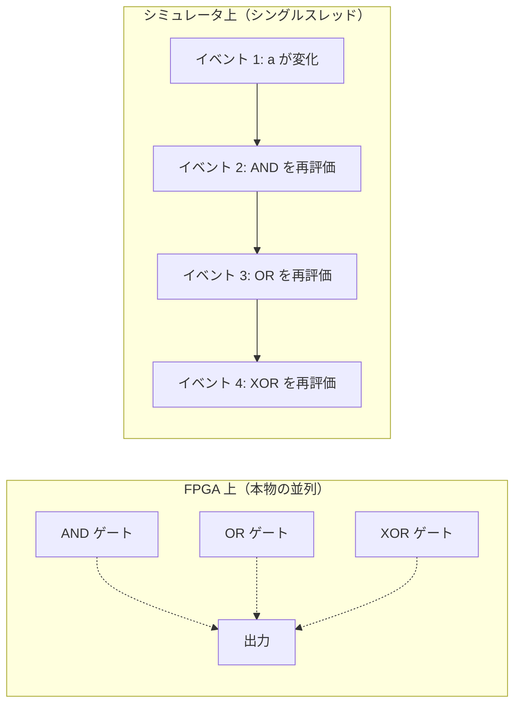

# なぜ VHDL は真の並列にならないのか

ここまでで 2 つのモデルを見てきた。

- **順次** — 文は `process` の中で次々に実行される。
- **並行** — `process` の外にある文は、同じデルタサイクルで「一斉に発火」する。

どちらも **並列** とは違う。では並列とはいったい何なのか？

> **並列 (Parallel)** = 実際の *壁時計時間の同じ瞬間* に複数のことが起こること。

VHDL を本物の FPGA に載せると、まさにそれが起こる。設計中のすべてのゲートは、入力が安定した瞬間に自分の出力を確定させる。「ステップ 1、ステップ 2、ステップ 3」はない — 電子がシリコンを流れ、数ナノ秒後には回路全体が新しい状態になっている。

でも Kmila で **Run** を押すとき、あなたは FPGA の上にいるわけではない。**シミュレータ** の上、シングルスレッドの CPU で動いている。シミュレータは回路が並列であるかのように *ふりをする* しかない — 実際にはイベントキューを 1 件ずつたどっているだけだ。

シミュレータの仕事はハードウェアと **一致する** 結果を出すことであって、実際に並列で走らせることではない。**デルタサイクル** はそのためのトリックで、公式に時間を進める前に各信号に安定する機会を 1 度与えることで、多くのイベントを「同じシミュレーション時刻」で処理できるようにする。

## 3 つのモデルを並べて

| モデル | どこに存在する | 「同じ時刻」？ |
|---|---|---|
| 順次 | `process` の本体の中 | いいえ — 1 文ずつ順番に。 |
| 並行 | `process` の外、`begin` と `end` の間 | はい — 同じデルタサイクル。 |
| 並列 | **本物のハードウェア上のみ。** | はい — 同じ壁時計上のナノ秒。 |

## マルチコアシミュレータはどうなの？

一部のハイエンドな VHDL シミュレータは、大規模設計を高速化するために複数の CPU スレッドを *使う*。ただしそれは **速度のための並列性** であって、言語意味論の並列性ではない。VHDL コードから見れば、シミュレーションは相変わらずシングルスレッドで、スレッド化は目に見えない実装詳細だ。

## なぜこの話をわざわざするのか

初心者は「並列で動くはずだ」というコードを書いて、シミュレータが期待と違う答えを返すと驚く。次の 2 つのレッスンで、その *なぜ* を正確に説明する — すべては **感度リスト** と **デルタサイクル** に行き着く。
