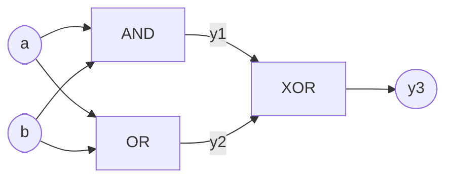

# العتاد متوازٍ

الطلَّاب القادمون من C أو Python أو JavaScript جميعًا متوحِّدون على النموذج الذهني نفسه: «الشفرة تجري من الأعلى للأسفل، تعليمة في كل مرَّة». ستعاقبك VHDL على هذا الافتراض حتى تبني النموذج الصحيح. هذه أكبر قفزة مفاهيميَّة منفردة في وحدة HDL كلها، فتستحقُّ أن نتمهَّل عندها.

## التحوُّل الكبير

انظر إلى هذه الـ architecture:

```vhdl
architecture rtl of demo is
begin
  y1 <= a and b;
  y2 <= a or  b;
  y3 <= y1 xor y2;
end architecture rtl;
```

في لغة برمجيَّة، تقرأها كثلاث خطوات تتابعيَّة. في VHDL، تصف السطور الثلاثة كلها **أسلاكًا موجودة في آنٍ واحد**. لا تُنفَّذ بالترتيب — بل هي موجودة.

يبني المُخلِّق:



البوابات الثلاث كلها مُغذَّاة بالطاقة في الوقت نفسه. حين يتغيَّر `a` أو `b`، يستقرُّ `y3` على قيمته الجديدة بعد تأخير انتشار صغير عبر أطول مسار. لا يوجد «أوَّل» و«ثانٍ».

## لماذا لا يهمُّ الترتيب

يمكنك كتابة السطور الثلاثة بأي ترتيب:

```vhdl
y3 <= y1 xor y2;   -- "إشارة قبل التصريح"؟
y1 <= a and b;
y2 <= a or  b;
```

لا يزال هذا VHDL صحيحًا ويُنتج الدائرة ذاتها. الإسنادات الثلاثة تصف ثلاثة أسلاك، والأسلاك لا تهتمُّ بأي ترتيب رسمت به المخطَّط. تقرأ الأداة الثلاثة وتوصِّلها.

## المحرِّك المُحرَّك بالأحداث خلف ذلك

فكيف يُحاكي حاسوب *تتابعي* كل هذا «دفعة واحدة»؟ يتصرَّف كل إسناد تزامني كمعالجة صغيرة لها قائمة حساسيَّة ضمنيَّة: فهو **يُعاد تقييمه كلَّما تغيَّرت أيُّ إشارة في طرفه الأيمن**. يحتفظ المحاكي بطابور من الأحداث المعلَّقة؛ وحين تتغيَّر `a` يوقظ كل إسناد يقرأ `a`، فتُعيد تلك الإسنادات الحساب وقد تُجدوِل أحداثًا جديدة، وهكذا حتى تهدأ الدائرة. هذا «الاستقرار» هو سبب كون التزامن حتميًّا لا فوضويًّا — وهي نقطة يجعلها الدرس التالي (دورات دلتا) دقيقة.

## أين يتسلَّل «التتابعي» عائدًا

داخل `process`، تكون الأمور تتابعيَّة **فعلًا** — داخل تلك المعالجة، تُنفَّذ التعليمات واحدة في كل مرَّة، من الأعلى للأسفل. لكن المعالجة *ككل* لا تزال مجرَّد وحدة تزامنيَّة أخرى جالسة بجانب البقيَّة.

```vhdl
architecture rtl of demo is
begin

  -- تزامني 1
  y1 <= a and b;

  -- تزامني 2 (معالجة، وهي داخليًّا تتابعيَّة)
  process(clk)
  begin
    if rising_edge(clk) then
      counter <= counter + 1;
    end if;
  end process;

  -- تزامني 3
  y2 <= a or b;

end architecture rtl;
```

الوحدات التزامنيَّة الثلاث كلها حيَّة في الوقت نفسه. كل واحدة تجري كلَّما تغيَّرت مداخلها. داخل المعالجة يُقرأ الجسم بالترتيب، لكن تلك خاصِّيَّة محلِّيَّة بالمعالجة، لا بالـ architecture. في الواقع، الإسناد التزامني للإشارة هو *بالضبط* اختصار لمعالجة من سطر واحد — فالاثنان متبادلان.

## نتيجة ملموسة: الحلقات التوافقيَّة

هذا التصميم به خلل خفي:

```vhdl
architecture wrong of demo is
  signal a, b : std_logic;
begin
  a <= not b;
  b <= not a;
end architecture wrong;
```

قراءته كبرمجيَّات تبدو كـ «اضبط `a` على not-b، ثم اضبط `b` على not-a» — لا مشكلة. قراءته كعتاد: مُعكِّسان موصولان في حلقة بلا مسجِّل يكسرها. تلك **حلقة توافقيَّة**: خاتم من التغذية الراجعة لا يستقرُّ أبدًا. وبحسب التأخيرات، إمَّا تتذبذب وإمَّا تنغلق على حالة لا يمكن التنبُّؤ بها. ستدور المحاكاة عبر دورات دلتا (وقد تُبلِّغ عن خطأ حدِّ التكرار)، وستُحذِّر أدوات التخليق من حلقة توافقيَّة، وستُهلوس اللوحة.

> الإصلاح واحد دائمًا: اكسر التغذية الراجعة بمسجِّل. إن كنت *تريد* ذاكرة، مرِّر الحلقة عبر معالجة متزامنة (هكذا يُبنى القلَّاب). وإن لم ترد، فلديك خطأ تصميم.

## عُدَّ العتاد

عادة مفيدة بينما تُعيد توصيل عقلك: اقرأ architecture وأحصِ البوابات. المثال الأوَّل ثلاث بوابات (AND وOR وXOR). وهذا —

```vhdl
y <= (a and b) or (c and d) or (e and f);
```

— ثلاث بوابات AND تُغذِّي بوابة OR واحدة بثلاثة مداخل، كلها حيَّة دفعة واحدة. لم تعد تعدُّ *خطوات*؛ صرت تعدُّ *قطعًا*.

## إعادة التوصيل في رأسك

- توقَّف عن التفكير في «ما الذي يجري أوَّلًا؟»
- ابدأ بالتفكير في «أيُّ أسلاك موجودة، وما الذي يُغذِّي ماذا؟»
- داخل المعالجة يعود النموذج القديم «واحد في كل مرَّة» — لكن داخل تلك المعالجة فقط.
- لا تغلق أبدًا مسارًا توافقيًّا على نفسه دون مسجِّل.

حين تفهم ذلك، تتوقَّف VHDL عن مقاومتك. ستقرأ architecture وترى فورًا المخطَّط الذي تُمثِّله، لا «تنفيذ البرنامج» الذي اعتدت تخيُّله.

## ما يجب تذكُّره

- العبارات التزامنيَّة تصف أسلاكًا موجودة كلها دفعة واحدة؛ وترتيبها في الملف غير ذي أهمِّيَّة.
- يُزيِّف المحاكي ذلك بطابور أحداث — تُعاد الإسنادات كلَّما تغيَّر مدخل.
- الـ `process` وحدة تزامنيَّة واحدة؛ والشفرة تتابعيَّة *داخلها* فقط.
- حلقة تغذية راجعة توافقيَّة بلا مسجِّل خطأ — اكسرها بمعالجة متزامنة.
