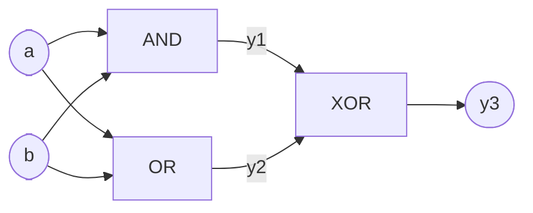

# العتاد متوازٍ

الطلَّاب القادمون من C أو Python أو JavaScript جميعًا متوحِّدون على نموذج ذهني واحد: «الشفرة تجري من الأعلى للأسفل، تعليمة في كل مرَّة». ستعاقبك VHDL على هذا الافتراض حتى تبني النموذج الصحيح.

## التحوُّل الكبير

انظر إلى هذه الهيكليَّة:

```vhdl
architecture rtl of demo is
begin
  y1 <= a and b;
  y2 <= a or  b;
  y3 <= y1 xor y2;
end architecture rtl;
```

في لغة برمجة، تقرأها كثلاث خطوات تتابعيَّة. في VHDL، السطور الثلاثة كلها تصف **أسلاكًا موجودة في آن واحد**. لا تُنفَّذ بالترتيب — فهي موجودة.

يبني المُركِّب:



البوابات الثلاث كلها مُغذَّاة بالطاقة في نفس الوقت. حين يتغيَّر `a` أو `b`، يستقرُّ خرج `y3` على قيمته الجديدة بعد تأخير انتشار صغير عبر أيِّ مسار أطول. لا يوجد «أوَّل» و«ثانٍ».

## لماذا لا يهمُّ الترتيب

يمكنك كتابة السطور الثلاثة بأي ترتيب:

```vhdl
y3 <= y1 xor y2;   -- إشارة قبل «التصريح»؟
y1 <= a and b;
y2 <= a or  b;
```

لا يزال VHDL صحيحًا. الإسنادات الثلاثة تصف ثلاثة أسلاك، والأسلاك لا تهتمُّ بأي ترتيب رسمت به المخطَّط. تقرأ الأداة الثلاثة وتربطها.

## أين يتسلَّل «التتابعي» للعودة

داخل `process`، الأمور **تكون** تتابعيَّة فعلًا — داخل ذلك process، تعليمة في كل مرَّة من الأعلى للأسفل. لكن المعالجة ككل لا تزال وحدة تزامنيَّة أخرى مع البقيَّة.

```vhdl
architecture rtl of demo is
begin

  -- تزامني 1
  y1 <= a and b;

  -- تزامني 2 (process، داخليًّا تتابعي)
  process(clk)
  begin
    if rising_edge(clk) then
      counter <= counter + 1;
    end if;
  end process;

  -- تزامني 3
  y2 <= a or b;

end architecture rtl;
```

الوحدات التزامنيَّة الثلاث كلها حيَّة في نفس الوقت. كل واحدة تجري كلَّما تغيَّر دخلها. داخل المعالجة، يُقرأ الجسم بترتيب، لكن تلك خاصِّيَّة محلِّيَّة بالمعالجة، لا بالهيكليَّة.

## نتيجة ملموسة

هذا التصميم به سباق خفي:

```vhdl
architecture wrong of demo is
  signal a, b : std_logic;
begin
  a <= not b;
  b <= not a;
end architecture wrong;
```

قراءته كبرمجيَّات تبدو كـ «اضبط `a` على not-b، ثم اضبط `b` على not-a» — لا مشكلة. قراءته كعتاد: مُعكِّسان موصولان في حلقة. ذلك **مذبذب** — حلقة تغذية لا تستقرُّ أبدًا. ستشتكي المحاكاة، وقد يُحسِّنها التركيب أحيانًا، واللوحة ستُهلوس بشكل غير قابل للتنبُّؤ.

## إعادة الربط في رأسك

- توقَّف عن التفكير «ما الذي يجري أوَّلًا؟»
- ابدأ بالتفكير «أيُّ أسلاك موجودة؟»
- داخل المعالجة يعود نموذج «واحد في المرَّة» — لكن داخل تلك المعالجة فقط.

حين يفهم عقلك ذلك، تتوقَّف VHDL عن مقاومتك. ستقرأ هيكليَّة وترى المخطَّط الذي تُمثِّله مباشرة، لا «تنفيذ البرنامج» الذي اعتدت تخيُّله.
