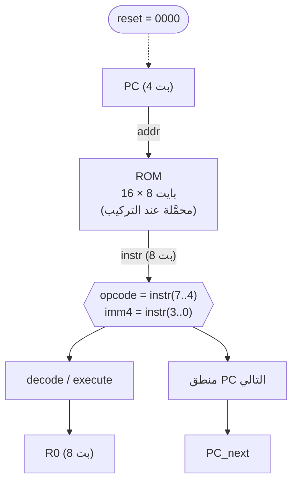

# مشروع: معالج 8 بت أحادي الدورة

هذه التتويج. ستُجمِّع كل ما سبق من الوحدات — ROM، سجل، ALU، تحكُّمًا شبيهًا بـ FSM — في آلة صغيرة تُشغِّل برامج فعلًا.

## الآلة



## ما يمنحك إيَّاه الهيكل

معالج كامل عامل. اقرأ البداية بعناية:

```vhdl
process(clk, reset)
begin
  if reset = '1' then
    pc   <= (others => '0');
    r0   <= (others => '0');
    halt <= '0';
  elsif rising_edge(clk) then
    if halt = '0' then
      case instr(7 downto 4) is
        when "0000" => r0 <= resize(unsigned(instr(3 downto 0)), 8); pc <= pc + 1;
        when "0001" => r0 <= r0 + resize(unsigned(instr(3 downto 0)), 8); pc <= pc + 1;
        when "0010" => pc <= unsigned(instr(3 downto 0));
        when "1111" => halt <= '1';
        when others => pc <= pc + 1;
      end case;
    end if;
  end if;
end process;
```

ينفِّذ بالفعل:

- LOAD (`0000`)
- ADD  (`0001`)
- JUMP (`0010`)
- HALT (`1111`)

تُشغِّل ROM المُحمَّلة `R0 = 3; R0 += 4; R0 += 2; HALT`.

## مهمَّتك

شغِّله كما هو أوَّلًا. حاكِ لـ 200 µs مع تحفيز الساعة + reset المرفق. في تبويب أشكال الموجة يجب أن ترى `r0_out` يخطو عبر `3 → 7 → 9`، ثم يرتفع `halted` ويبقى مرتفعًا.

حالما يعمل الأساس، **وسِّع** ISA:

### المهمة 1: SUB

opcode `0011`. `R0 <= R0 - imm4`. تغيير سطر واحد.

### المهمة 2: قفزة شرطيَّة

opcode `0100`: `JZ addr` — اقفز إلى `addr` إذا `R0 = 0`، وإلَّا `pc <= pc + 1` فقط.

اكتب برنامجًا صغيرًا يَعدُّ تنازليًّا من قيمة ما ويقفز عند الانتهاء. استخدم `JZ` كمخرج من الحلقة.

### المهمة 3: سجل ثانٍ

أضف `r1` كسجل 8 بت ثانٍ. عرِّف `LOAD R1, #i` كـ opcode `0101` و`ADD R0, R1` (بلا قيمة فوريَّة) كـ opcode `0110`. ستحتاج توسيع case فكّ الترميز وإضافة منفذ خرج ثانٍ للإظهار.

### المهمة 4: ذاكرة بيانات خارجيَّة

اربط وحدة RAM من مسار الذواكر بهذا المعالج. أضف opcodes `LOAD R0, [addr]` و`STORE R0, [addr]`. حذارٍ: تصميم أحادي الدورة يتطلَّب أن يكون خرج منفذ قراءة الذاكرة صالحًا في نفس الدورة التي تُصدِر فيها العنوان — استخدم قراءة توافقيَّة لـ ROM وقراءة بمسجِّل لـ RAM، وخطِّط خطّ الأنابيب بعناية.

## لماذا تفعل ذلك؟

لأن أوَّل مرَّة تشاهد فيها معالجك يخطو عبر برنامج كتبته (بالبايتات التي كتبتها أنت في ROM)، شيءٌ ينقر في الذهن. كل تجريد فوقه — المُجمِّع، المُترجم، نظام التشغيل — يقف على هذه الآليَّة بالضبط. وكلٌّ منها، حتى متصفِّح الويب الذي يُشغِّل JavaScript الذي كتبتَه الأسبوع الماضي، هو الحيلة ذاتها مكرَّرة على مقياس أكبر.

## للمضي أبعد

- نفِّذ خطّ الأنابيب الكلاسيكي بخمس مراحل على ISA ذاته. أضف اكتشاف الأخطار ووحدة تمرير. ستحصل الآن على نسخة مصغَّرة ممَّا تُعلِّمه كتب RISC-V.
- أعد توجيه ROM: بدلًا من الثوابت، حمِّلها من ملف خارجي وقت المحاكاة، ثم ابنِ سلسلة أدوات تُجمِّع النصّ إلى تلك البايتات.
- ضع UART TX من المشروع السابق واجعل المعالج يطبع `'HI'` في شكل الموجة. مبارك — لديك SoC.
