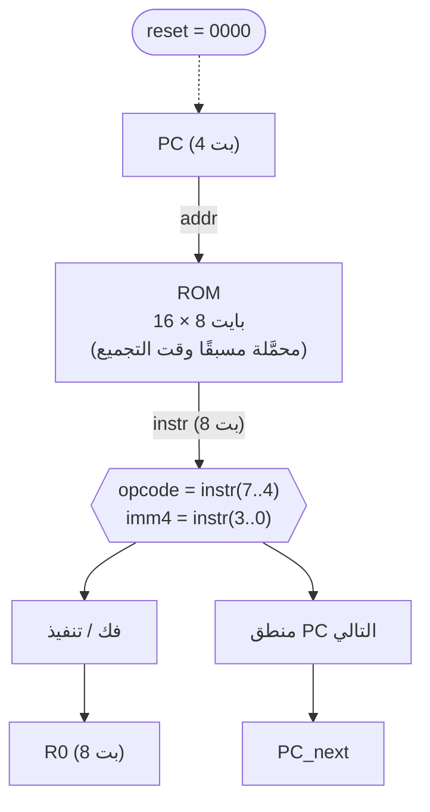

# مشروع: CPU أحادي الدورة بعرض 8 بت

هذا هو المشروع الختامي. ستُركِّب كل شيء من الوحدات السابقة — ROM وسجل وALU وتحكّم شبيه بـ FSM — في آلة صغيرة تُشغِّل البرامج فعلًا.

## الآلة



## ما الذي يعطيك الهيكل

CPU كامل وعامل. اقرأ القالب المبدئي بعناية:

```vhdl
process(clk, reset)
begin
  if reset = '1' then
    pc   <= (others => '0');
    r0   <= (others => '0');
    halt <= '0';
  elsif rising_edge(clk) then
    if halt = '0' then
      case instr(7 downto 4) is
        when "0000" => r0 <= resize(unsigned(instr(3 downto 0)), 8); pc <= pc + 1;
        when "0001" => r0 <= r0 + resize(unsigned(instr(3 downto 0)), 8); pc <= pc + 1;
        when "0010" => pc <= unsigned(instr(3 downto 0));
        when "1111" => halt <= '1';
        when others => pc <= pc + 1;
      end case;
    end if;
  end if;
end process;
```

هو بالفعل ينفّذ:

- LOAD (`0000`)
- ADD  (`0001`)
- JUMP (`0010`)
- HALT (`1111`)

ذاكرة ROM المحمَّلة مسبقًا تشغّل `R0 = 3; R0 += 4; R0 += 2; HALT`.

## مهمتك

شغّله كما هو أولًا. حاكِ لمدة 200 ميكروثانية بمنبّه الساعة وإعادة التعيين المرفقَين. في تبويب Waveforms ينبغي أن ترى `r0_out` يخطو عبر `3 → 7 → 9`، ثم ترتفع `halted` وتبقى مرتفعة.

بعد أن يعمل الأساس، **وسّع** مجموعة التعليمات ISA:

### المهمة 1: SUB

رمز العملية `0011`. `R0 <= R0 - imm4`. تغيير من سطر واحد.

### المهمة 2: قفزة شرطية

رمز العملية `0100`: `JZ addr` — اقفز إلى `addr` إذا كان `R0 = 0`، وإلا فقط `pc <= pc + 1`.

اكتب برنامجًا صغيرًا يعدّ تنازليًا من قيمة ما ويقفز إلى الصفر عند الانتهاء. استخدم `JZ` كمخرج الحلقة.

### المهمة 3: سجل ثانٍ

أضف `r1` كسجل 8 بت ثانٍ. عرّف `LOAD R1, #i` كرمز عملية `0101` و`ADD R0, R1` (بلا فورية) كرمز عملية `0110`. ستحتاج لتوسيع حالة فك الترميز وإضافة منفذ خرج ثانٍ لأجل الرؤية.

### المهمة 4: ذاكرة بيانات خارجية

اربط وحدة RAM من مسار الذاكرات إلى هذا CPU. أضف رمزَي عملية `LOAD R0, [addr]` و`STORE R0, [addr]`. انتبه: التصميم أحادي الدورة يتطلب أن يكون منفذ القراءة للذاكرة له خرجه صالحًا ضمن الدورة نفسها التي تُصدِر فيها العنوان — استخدم قراءة توافقية لـ ROM وقراءة مسجّلة لـ RAM البيانات، وخطّط لخط الأنابيب بحرص.

## لماذا تفعل هذا؟

لأن أول مرة ترى فيها CPU الخاص بك يخطو عبر برنامج كتبته (بالبايتات التي كتبتها في ROM)، ينقر شيء في ذهنك. كل تجريد فوقه — مجمّع، مترجم، نظام تشغيل — يقف على هذه الآلية بالضبط. وكل واحد منها، حتى متصفح الويب الذي يشغّل JavaScript الذي كتبته الأسبوع الماضي، هو الحيلة نفسها مكررة على نطاق أكبر.

## للتعمق أكثر

- نفّذ خط الأنابيب الكلاسيكي ذا المراحل الخمس على ISA نفسها. أضف كشف المخاطر ووحدة تمرير. الآن لديك نسخة مصغّرة مما تُدرِّسه كتب RISC-V.
- غيِّر هدف ROM: بدلًا من الثوابت، حمِّلها من ملف خارجي وقت المحاكاة، ثم ابنِ سلسلة أدوات تُجمِّع نصًا إلى تلك البايتات.
- أسقط UART TX من المشروع السابق واجعل CPU يطبع `'HI'` على الموجة. تهانينا — لديك SoC.
