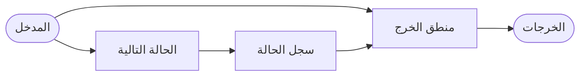

# آلات Mealy مقابل Moore

آلة الحالات المنتهية (FSM) هي منطق تحكّم يتذكّر ما يفعله حاليًا. كل FSM لديها:

- **سجل حالة** (مجموعة من القلّابات).
- **منطق الحالة التالية** (توافقي، يقرّر ماذا ستكون الحالة عند حافة الساعة التالية).
- **منطق الخرج** (توافقي، يقرّر ما هي الخرجات الآن).

أين يبحث منطق الخرج عن مدخلاته يقسم آلات FSM إلى عائلتين.

## Moore: الخرجات تعتمد على الحالة فقط


بمعرفة الحالة، يكون الخرج ثابتًا. إذا كنت في `S_GREEN`، فإن `green = '1'`. دائمًا. بغض النظر عن شكل المدخل.

**الإيجابيات**
- الخرجات لا تتغير إلا عند حواف الساعة → لا ارتعاشات.
- من السهل التفكير فيها وتنقيح أخطائها والتحقق منها.

**السلبيات**
- دورة ساعة واحدة على الأقل من زمن الاستجابة بين المدخل والخرج (على الحالة أن تنتقل أولًا).
- أحيانًا تحتاج مزيدًا من الحالات لترميز السلوك نفسه الذي تعطيه آلة Mealy.

## Mealy: الخرجات تعتمد على الحالة + المدخل



الخرجات دالة في الحالة الحالية **وكذلك** المدخل الحالي. ويمكنها أن تتغير بين حواف الساعة.

**الإيجابيات**
- أسرع — يمكن للخرجات أن تتفاعل مع المدخل في الدورة نفسها، لا في التي تليها.
- عادةً تحتاج حالات أقل.

**السلبيات**
- الخرجات قد ترتعش (تتبع المدخل التوافقي).
- أصعب في التنقيح حين لا تصطف الخرجات مع حواف الساعة.

## أيّهما تستخدم؟

**الافتراضي: Moore.** غياب الارتعاش ومحاذاة الحواف يجعل التصاميم قابلة للتوقّع. لمنطق التحكّم داخل CPU أو متحكم ذاكرة أو أي شيء متعلّق بالسلامة، Moore هو الخيار الأأمن.

**لجأ إلى Mealy عندما** تحتاج للتفاعل ضمن دورة الساعة نفسها، أو عندما تُفجِّر الحالات الإضافية لـ Moore حجم التصميم. محركات UART والبروتوكولات غالبًا ينتهيان Mealy لحجة زمن الاستجابة.

## كيف يدعمهما Kmila

كلا الأسلوبين يندرجان في **نمط العمليتين** نفسه الذي ستراه في عيّنة إشارة المرور:

```vhdl
-- العملية 1: سجل الحالة (آمنة دائمًا لنمط Moore)
process(clk, reset)
begin
  if reset = '1' then
    state <= S_IDLE;
  elsif rising_edge(clk) then
    state <= next_state;
  end if;
end process;

-- العملية 2: حالة تالية + خرجات توافقية
process(state, input)
begin
  ...
end process;
```

لآلة Moore، تنظر الخرجات إلى `state` فقط. لآلة Mealy، تنظر إلى `state` و`input`.

## ما الذي يجب تذكره

- Moore: الخرج دالة في الحالة فقط. بلا ارتعاشات.
- Mealy: الخرج دالة في الحالة + المدخل. أسرع.
- ابدأ بـ Moore؛ انتقل إلى Mealy عندما يكون لديك سبب محدد.
