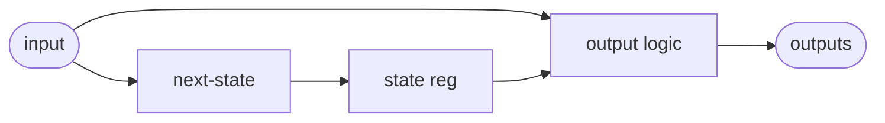

# آلات Mealy مقابل Moore

آلة الحالات المنتهية (FSM) منطق تحكُّم يتذكَّر ما يفعله الآن. لكل FSM:

- **سجل حالة** (مجموعة قلَّابات).
- **منطق الحالة التالية** (توافقي، يُقرِّر ما الحالة عند الحافة القادمة للساعة).
- **منطق الخرج** (توافقي، يُقرِّر ما هي الخرجات الآن).

أين يبحث منطق الخرج عن مداخله هو ما يقسم FSMs إلى عائلتَين.

## Moore: الخرجات تعتمد على الحالة فقط


عند حالة معطاة، الخرج ثابت. إن كنت في `S_GREEN`، فـ `green = '1'`. دائمًا. بغضِّ النظر عمَّا يبدو عليه الدخل.

**المزايا**
- لا تتغيَّر الخرجات إلَّا عند حافات الساعة → لا قفزات.
- سهل التفكير فيها، سهلة التنقيح، سهلة التحقُّق.

**العيوب**
- دورة ساعة واحدة على الأقل من زمن الكُمون بين الدخل والخرج (الحالة يجب أن تتحوَّل أوَّلًا).
- أحيانًا تحتاج حالات أكثر لتُرمِّز السلوك ذاته الذي تُرمِّزه Mealy.

## Mealy: الخرجات تعتمد على الحالة + الدخل



الخرجات دالة في الحالة الحاليَّة **وَ** الدخل الحالي. يمكن أن تتغيَّر بين حافات الساعة.

**المزايا**
- أسرع — يمكن أن تستجيب الخرجات لدخل في نفس الدورة، لا في التالية.
- تحتاج عادةً حالات أقلّ.

**العيوب**
- يمكن أن تقفز الخرجات (تتبع الدخل التوافقي).
- أصعب في التنقيح حين لا تتوافق الخرجات مع حافات الساعة.

## أيُّهما تستخدم؟

**الافتراضي: Moore.** خلوّها من القفزات وخرجاتها المحاذية للحافات تجعل التصاميم متوقَّعة. لمنطق التحكُّم داخل معالج أو متحكِّم ذاكرة أو أي شيء يتعلَّق بالسلامة، Moore هو الخيار الأكثر أمانًا.

**اقترب من Mealy حين** تحتاج الاستجابة داخل نفس دورة الساعة، أو حين تنتفخ حالات Moore الإضافيَّة بالتصميم. UART ومحرِّكات البروتوكولات تنتهي في Mealy في الغالب لحجَّة زمن الاستجابة.

## كيف يدعمهما Kmila

كلا الأسلوبَين ينزلان في **نمط المعالجَين** الذي ستراه في مثال إشارة المرور:

```vhdl
-- المعالج 1: سجل الحالة (آمن دومًا لـ Moore)
process(clk, reset)
begin
  if reset = '1' then
    state <= S_IDLE;
  elsif rising_edge(clk) then
    state <= next_state;
  end if;
end process;

-- المعالج 2: الحالة التالية التوافقيَّة + الخرجات
process(state, input)
begin
  ...
end process;
```

لآلة Moore تنظر الخرجات إلى `state` فقط. لآلة Mealy تنظر إلى `state` و`input`.

## ما يجب تذكُّره

- Moore: الخرج دالة في الحالة وحدها. بلا قفزات.
- Mealy: الخرج دالة في الحالة + الدخل. أسرع.
- ابدأ بـ Moore؛ انتقل إلى Mealy حين يكون لديك سبب محدَّد.
