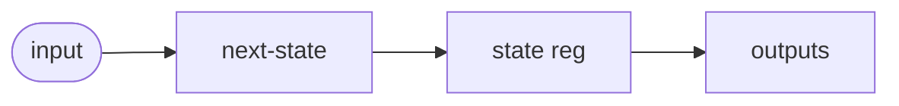

# آلات Mealy مقابل Moore

آلة الحالات المنتهية (FSM) هي منطق تحكُّم يتذكَّر ما يفعله الآن. صوريًّا هي مؤتمتة (automaton) حتميَّة: مجموعة منتهية من الحالات، ودالة انتقال تختار الحالة التالية من الحالة الحاليَّة والمداخل، ودالة خرج. كل آلة حالات متزامنة تبنيها لها ثلاثة أجزاء:

- **سجل حالة** (مجموعة قلَّابات) — الشيء الوحيد الذي يملك ذاكرة.
- **منطق الحالة التالية** (توافقي، يُقرِّر ما ستكون عليه الحالة عند حافة الساعة القادمة).
- **منطق الخرج** (توافقي، يُقرِّر ما هي الخرجات الآن).

أين يبحث منطق الخرج عن مداخله هو ما يقسم آلات الحالات إلى عائلتَين.

## Moore: الخرجات تعتمد على الحالة فقط



عند حالة معطاة، الخرج ثابت. إن كنت في `S_GREEN`، فـ `green = '1'`. دائمًا. بغضِّ النظر عمَّا يبدو عليه الدخل.

**المزايا**
- لا تتغيَّر الخرجات إلَّا عند حافات الساعة → لا قفزات (glitches).
- سهل التفكير فيها، سهلة التنقيح، سهلة التحقُّق.

**العيوب**
- دورة ساعة واحدة على الأقلّ من زمن الكُمون بين الدخل والخرج (الحالة يجب أن تتحوَّل أوَّلًا).
- أحيانًا تحتاج حالات أكثر لتُرمِّز السلوك ذاته الذي تُرمِّزه آلة Mealy.

## Mealy: الخرجات تعتمد على الحالة + الدخل


الخرجات دالة في الحالة الحاليَّة **وَ** الدخل الحالي. يمكن أن تتغيَّر بين حافات الساعة.

**المزايا**
- أسرع — يمكن أن تستجيب الخرجات لدخل في نفس الدورة، لا في التالية.
- تحتاج عادةً حالات أقلّ.

**العيوب**
- يمكن أن تقفز الخرجات (تتبع الدخل التوافقي).
- أصعب في التنقيح حين لا تتوافق الخرجات مع حافات الساعة.

طريقة سريعة لتحسّ الفرق: مهمَّة «اكتشاف `1` على الدخل» نفسها تحتاج حالة واحدة في Mealy (أكِّد الخرج على الانتقال الذي *يرى* الـ `1`)، لكنها تحتاج حالة إضافيَّة «رأيتُ 1 توًّا» في Moore (كي يُربط الخرج بكونك *داخل* تلك الحالة). السلوك نفسه، عدد حالات مختلف، وفارق دورة واحدة في التوقيت.

## معالجة واحدة أو اثنتان أو ثلاث

يمنحك VHDL بضع طرق لكتابة الآلة ذاتها. تُركَّب كلُّها إلى العتاد نفسه؛ وتختلف في قابليَّة القراءة وفي سهولة الوقوع في الخطأ.

- **معالجة واحدة:** سجل الحالة *و* الخرجات يعيشان في معالجة واحدة مُساعَة بالساعة. ينتهي كل شيء مُسجَّلًا، فالخرجات خالية من القفزات طبيعيًّا (بأسلوب Moore المُسجَّل). مُكتنز، لكن منطق الحالة التالية والخرج متشابكان معًا.
- **معالجتان (الافتراضي المُوصى به):** معالجة مُساعَة بالساعة تحمل سجل الحالة؛ ومعالجة توافقيَّة تحسب `next_state` والخرجات. هذا هو النمط الذي تستخدمه أمثلة Kmila — ويُطابق بنظافة الصورة ثلاثيَّة الأجزاء أعلاه.
- **ثلاث معالجات:** سجل الحالة ومنطق الحالة التالية ومنطق الخرج، كلٌّ في معالجته. الأكثر إسهابًا، لكن الفصل فيه أوضح ويصعب كسره بالخطأ.

## الفخّ الوحيد الذي يعضُّ الجميع: المزاليج المُستنتَجة

في معالجة *توافقيَّة*، كل إشارة تقودها يجب أن تحصل على قيمة على **كل** مسار يمرُّ عبر المعالجة. فإن نسي فرعٌ من `case` أو `if` إسناد `next_state` (أو خرجًا)، كان على التركيب أن *يتذكَّر* القيمة القديمة — والشيء الوحيد الذي يتذكَّر في المنطق التوافقي هو **مِزلاج (latch)**. والمزاليج شيء لا تريده أبدًا تقريبًا: فهي حسَّاسة للمستوى، وصعبة التوقيت، ومصدر كلاسيكي لـ «يعمل في المحاكاة، يفشل على السيليكون».

العلاج سطر واحد: أسنِد قيمة **افتراضيَّة** لكل إشارة في أعلى المعالجة، قبل `case`.

```vhdl
process(state, input)
begin
  next_state <= state;   -- الافتراضي: ابقَ مكانك
  green      <= '0';     -- أعطِ كل خرج قيمة افتراضيَّة أيضًا
  case state is
    when S_IDLE  => if input = '1' then next_state <= S_RUN; end if;
    when S_RUN   => green <= '1';
                    next_state <= S_IDLE;
  end case;
end process;
```

الآن حتَّى لو «نسي» فرعٌ إسنادًا، يُغطِّيه الافتراضي — لا مِزلاج. (لاحِظ أنَّ VHDL يتطلَّب أن تكون خيارات `case` شاملة، فستضيف غالبًا `when others =>`؛ وذلك يُرضي المُترجم، لكنَّ *الإسناد الافتراضي* هو ما يُنقذك فعلًا من المزاليج.)

## ترميز الحالات

تكتب الحالات المسمَّاة بنوع تعدادي، وتترك الأداة تختار البتات:

```vhdl
type state_t is (S_IDLE, S_RUN, S_DONE);
signal state, next_state : state_t;
```

يختار المُركِّب ترميزًا — **ثنائيًّا** (أقلّ قلَّابات)، أو **one-hot** (قلَّاب لكل حالة، سريع وصديق لـ FPGA)، أو **Gray** (بت واحد يتغيَّر لكل خطوة، جيد للانتقالات منخفضة الضجيج). على FPGA غالبًا ما يكون one-hot هو الافتراضي لأنَّ القلَّابات وفيرة ولأنَّه يُبقي منطق الحالة التالية ضحلًا. نادرًا ما تحتاج للترميز اليدوي؛ دَع الأداة تُقرِّر ما لم يكن لديك سبب لغير ذلك.

## أيُّهما تستخدم؟

**الافتراضي: Moore.** خلوّها من القفزات وخرجاتها المحاذية للحافات تجعل التصاميم متوقَّعة. لمنطق التحكُّم داخل معالج أو متحكِّم ذاكرة أو أي شيء يتعلَّق بالسلامة، Moore هو الخيار الأكثر أمانًا.

**اقترب من Mealy حين** تحتاج الاستجابة داخل نفس دورة الساعة، أو حين تنتفخ حالات Moore الإضافيَّة بالتصميم. UART ومحرِّكات البروتوكولات تنتهي في Mealy في الغالب لحجَّة زمن الاستجابة. وإن أعجبك عدد حالات Mealy لكنَّك أردت توقيت Moore النظيف، فـ **سجِّل خرجات Mealy** (مرِّرها عبر قلَّاب إضافي) — تستعيد خرجات خالية من القفزات، بثمن دورة الكُمون الواحدة التي كنت تحاول تجنُّبها.

## الصلة بالمساق

هذا هو قلب الوحدة الثانية، *تصميم الأنظمة الرقميَّة*: المؤتمتة الحتميَّة بخرج وبدون خرج، ونموذجا Mealy وMoore، ووصفهما بلغة وصف العتاد. على الورق ستبني هذه أيضًا من قلَّابات JK / SR / T / D وتُقلِّصها بطرائق اختزال الحالات (المُحتوى الأوَّلي / الجدوليَّة) — وأسلوب النوع التعدادي هنا هو نظير HDL لمخطَّط الحالات ذاته.

## ما يجب تذكُّره

- Moore: الخرج دالة في الحالة وحدها. بلا قفزات، بدورة كُمون واحدة.
- Mealy: الخرج دالة في الحالة + الدخل. أسرع، ويمكن أن يقفز — سجِّل الخرجات إن كان ذلك يهمّ.
- استخدم نمط المعالجتَين، و**أعطِ كل إشارة قيمة افتراضيَّة** في أعلى المعالجة التوافقيَّة لتتجنَّب المزاليج المُستنتَجة.
- دَع الأداة تختار ترميز الحالات (one-hot شائع على FPGA)؛ ابدأ بـ Moore وانتقل إلى Mealy لسبب محدَّد.
