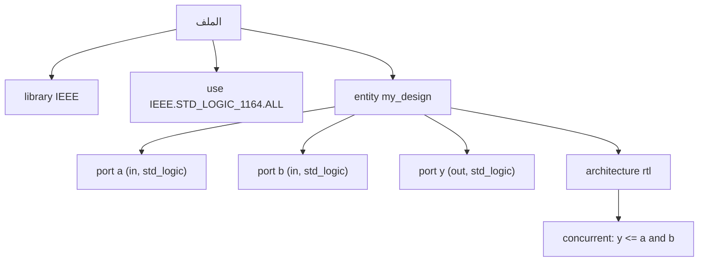

# تشريح ملف VHDL

كل ملف VHDL له نفس الأقسام الأربعة، دائمًا بالترتيب ذاته. حالما تتعرَّف على الشكل، تتوقَّف قراءة شفرة غير مألوفة عن أن تكون مُخيفة — ستعرف ببساطة أين تبحث عن كل قطعة.

## الأقسام الأربعة

```vhdl
library IEEE;                          -- 1. المكتبات
use IEEE.STD_LOGIC_1164.ALL;           -- 2. الحزم المُستخدَمة

entity my_design is                    -- 3. الـ entity («الترويسة»)
  port (
    a : in  std_logic;
    b : in  std_logic;
    y : out std_logic
  );
end entity my_design;

architecture rtl of my_design is       -- 4. الـ architecture («الجسم»)
begin
  y <= a and b;
end architecture rtl;
```

لنُلقي نظرة على كل واحد.

### 1. `library`

`library IEEE;` تستورد مكتبة IEEE القياسيَّة. هي المعادل في التصميم الرقمي لـ `#include <stdio.h>` — كل ملف ستكتبه تقريبًا يبدأ بها.

### 2. `use`

`use IEEE.STD_LOGIC_1164.ALL;` تضمُّ كل الأسماء من حزمة `STD_LOGIC_1164` إلى النطاق. وهي التي تُعطيك `std_logic` و`std_logic_vector` و`rising_edge()` وأصدقاءها.

ستراها كثيرًا مصحوبة بـ `use` ثانية:

```vhdl
use IEEE.NUMERIC_STD.ALL;
```

تلك تُعطيك `unsigned` و`signed` و`to_integer` و`resize` والحساب على أنواع المتجهات. أضفها كلَّما حسبت على متجهات.

### 3. `entity`

الـ entity هي **واجهة الصندوق الأسود**. تقول:

- اسم التصميم (`my_design`)
- ما المنافذ التي يمتلكها
- لكل منفذ: **اتجاهه** (`in`، `out`، `inout`، `buffer`) و**نوعه**

كل ما في `port (…)` هو ما يراه العالم الخارجي. لا شيء عن طريقة عمل التصميم يُعلَن هنا.

### 4. `architecture`

الـ architecture هي **التنفيذ**. يمكن أن يكون لـ entity عدَّة architectures (لنفس الواجهة) — قد تكون لديك `rtl` و`behavioral` و`tb` لنفس `cpu`، وتختار واحدة لكل تهيئة. في الواقع، معظم الملفات لها واحدة بالضبط.

الجسم بين `begin` و`end architecture` هو المكان الذي تُوصَف فيه الإشارات والبوابات فعلًا.

## كيف يحلِّل Kmila هذا

محلِّل VHDL في Kmila يقرأ ملفك من الأعلى للأسفل ويبني شجرة:



حين تضغط **Build**، تصير المنافذ مدخلات في تبويب **Ports** بالـ dock، وتصير الـ entity مدخلًا في **Entities**، وتصير الإسنادات داخل الـ architecture الأسلاك التي يُشغِّلها المحاكي.

## أعراف التسمية

VHDL غير حسَّاسة لحالة الحرف. `SIGNAL` و`Signal` و`signal` كلمة مفتاحيَّة واحدة. لكن حافظ على أسلوب واحد في الملف — تستخدم معظم الفرق **lowercase** للكلمات المفتاحيَّة وأسماء الإشارات، و**snake_case** للمعرِّفات، و**UPPER_CASE** للثوابت.

## ما يجب تذكُّره

- `library` + `use` — استيراداتك.
- `entity` — الواجهة (منافذ واتجاهات).
- `architecture` — التنفيذ (ما يحدث فعلًا).
- يمكن لـ entity عدَّة architectures؛ معظم المشاريع تشحن واحدة باسم `rtl`.
