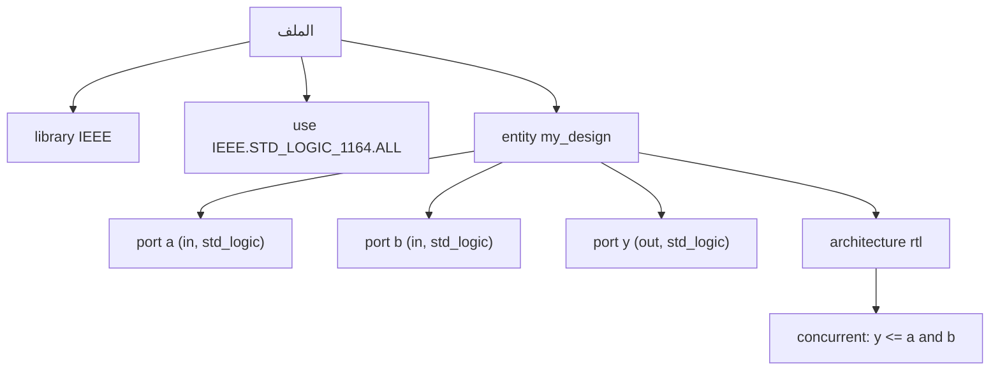

# تشريح ملف VHDL

كل ملف VHDL يحوي الأقسام الأربعة نفسها، دائمًا بالترتيب نفسه. بمجرد أن تتعرف على الشكل، تتوقف قراءة الكود غير المألوف عن كونها مُرعبة — تعرف أين تبحث عن كل قطعة.

## الأقسام الأربعة

```vhdl
library IEEE;                          -- 1. المكتبات
use IEEE.STD_LOGIC_1164.ALL;           -- 2. الحزم المستخدمة

entity my_design is                    -- 3. الكيان ("الرأس")
  port (
    a : in  std_logic;
    b : in  std_logic;
    y : out std_logic
  );
end entity my_design;

architecture rtl of my_design is       -- 4. البنية المعمارية ("الجسم")
begin
  y <= a and b;
end architecture rtl;
```

لنمرّ على كل منها.

### 1. `library`

`library IEEE;` يستورد مكتبة IEEE القياسية. هو المكافئ في التصميم الرقمي لـ `#include <stdio.h>` — يبدأ كل ملف ستكتبه تقريبًا به.

### 2. `use`

`use IEEE.STD_LOGIC_1164.ALL;` يسحب كل اسم من حزمة `STD_LOGIC_1164` إلى النطاق. هذا ما يمنحك `std_logic` و`std_logic_vector` و`rising_edge()` وأصدقاءها.

ستشاهد غالبًا `use` ثانية:

```vhdl
use IEEE.NUMERIC_STD.ALL;
```

تلك تمنحك `unsigned` و`signed` و`to_integer` و`resize` والحساب لأنواع المتجهات. أضفها كلما قمت بحساب على متجهات.

### 3. `entity`

الكيان هو **واجهة الصندوق الأسود**. يقول:

- ما اسم التصميم (`my_design`)
- ما منافذه
- لكل منفذ: **اتجاهه** (`in`, `out`, `inout`, `buffer`) و**نوعه**

كل ما داخل `port (…)` هو ما يراه العالم الخارجي. لا شيء عن كيفية عمل التصميم يُصرَّح هنا.

### 4. `architecture`

البنية المعمارية هي **التطبيق**. يمكن لكيان أن يملك عدة بنى معمارية (للواجهة نفسها) — قد تكون لديك بنى `rtl` و`behavioral` و`tb` لنفس كيان `cpu` وتختار واحدة لكل إعداد. عمليًا، معظم الملفات لها واحدة بالضبط.

الجسم بين `begin` و`end architecture` هو حيث تُوصَف الإشارات والبوابات فعليًا.

## كيف يُفسّر Kmila هذا

مُفسِّر VHDL في Kmila يقرأ ملفك من الأعلى إلى الأسفل ويبني شجرة:



عندما تنقر **Build**، تصبح المنافذ مدخلات في تبويب **Ports**، ويصبح الكيان مدخلًا في **Entities**، وتصبح الإسنادات داخل البنية المعمارية التوصيلات التي يُشغّلها المحاكي.

## اصطلاحات التسمية

VHDL غير حساسة لحالة الأحرف. `SIGNAL` و`Signal` و`signal` هي الكلمة المفتاحية نفسها. لكن حافظ على أسلوب واحد في ملف محدد — معظم الفرق تستخدم **الحروف الصغيرة** للكلمات المفتاحية وأسماء الإشارات، و**snake_case** للمعرِّفات، و**UPPER_CASE** للثوابت.

## ما الذي يجب تذكره

- `library` + `use` — استيراداتك.
- `entity` — الواجهة (المنافذ والاتجاهات).
- `architecture` — التطبيق (ما الذي يحدث فعلًا).
- يمكن لكيان أن يملك عدة بنى معمارية؛ معظم المشاريع تشحن واحدة تُسمى `rtl`.
