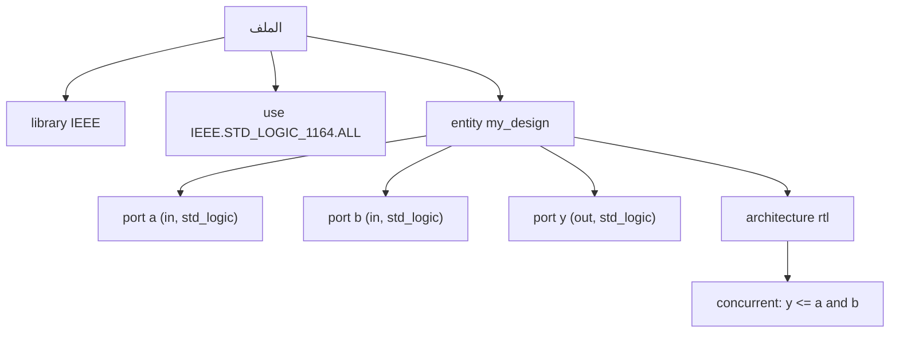

# تشريح ملف VHDL

كل ملف VHDL له نفس الأقسام الأربعة، دائمًا بالترتيب ذاته. حالما تتعرَّف على الشكل، تتوقَّف قراءة شفرة غير مألوفة عن أن تكون مُخيفة — ستعرف ببساطة أين تبحث عن كل قطعة. هذا تحديدًا هو «هيكل البرنامج في لغة HDL» الذي يطلب منك المساق إتقانه قبل أن تكتب أي شيء مفيد.

## الأقسام الأربعة

```vhdl
library IEEE;                          -- 1. المكتبات
use IEEE.STD_LOGIC_1164.ALL;           -- 2. الحزم المُستخدَمة

entity my_design is                    -- 3. الـ entity («الترويسة»)
  port (
    a : in  std_logic;
    b : in  std_logic;
    y : out std_logic
  );
end entity my_design;

architecture rtl of my_design is       -- 4. الـ architecture («الجسم»)
begin
  y <= a and b;
end architecture rtl;
```

لنُلقِ نظرة على كل واحد.

### 1. `library`

`library IEEE;` تجعل المكتبة المنطقيَّة المُسمَّاة `IEEE` مرئيَّة لملفك. هي المعادل في التصميم الرقمي لـ `#include <stdio.h>` — كل ملف ستكتبه تقريبًا يبدأ بها.

تفصيل صغير يستحقُّ المعرفة مبكِّرًا: المكتبة `STD` (التي تُعرِّف الأنواع المُدمَجة `boolean` و`integer` و`character` و`bit` وما إلى ذلك) ومكتبتك الخاصَّة `WORK` تكونان مرئيَّتين *دائمًا*. لا تكتب أبدًا `library STD;`. أنت تذكر `IEEE` فقط لأن الأنواع المنطقيَّة التي تريدها فعلًا تعيش هناك.

### 2. `use`

`use IEEE.STD_LOGIC_1164.ALL;` تسحب كل اسم من حزمة `STD_LOGIC_1164` إلى النطاق. وهي التي تُعطيك `std_logic` و`std_logic_vector` و`rising_edge()` والعوامل المنطقيَّة على تلك الأنواع.

ستراها كثيرًا مصحوبة بـ `use` ثانية:

```vhdl
use IEEE.NUMERIC_STD.ALL;
```

تلك تُعطيك `unsigned` و`signed` و`to_integer` و`resize` والحساب على أنواع المتجهات. أضفها كلَّما أجريت حسابًا على متجهات. وتجنَّب الحزمتين القديمتين `std_logic_arith` / `std_logic_unsigned` اللتين قد تجدهما في بعض الدروس على الإنترنت — فهما لم تكونا أصلًا جزءًا من معيار IEEE، وخلطهما مع `numeric_std` يؤدي إلى تحميلات غامضة متضاربة.

### 3. `entity`

الـ entity هي **واجهة الصندوق الأسود**. تقول:

- اسم التصميم (`my_design`)
- ما المنافذ التي يمتلكها
- لكل منفذ: **اتجاهه** (`in`، `out`، `inout`، `buffer`) و**نوعه**

| الاتجاه | هل يمكنك قراءته من الداخل؟ | هل يمكنك تشغيله؟ |
|------|-------------------------|-------------------|
| `in`     | نعم | لا |
| `out`    | نعم (VHDL-2008 فما فوق) | نعم |
| `inout`  | نعم | نعم (ثنائي الاتجاه / tristate) |
| `buffer` | نعم | نعم (مُشغِّل داخلي واحد) |

كل ما في `port (…)` هو ما يراه العالم الخارجي. لا شيء عن *طريقة* عمل التصميم يُعلَن هنا. قد تحمل الـ entity أيضًا **generics** — وهي معطيات تُحدَّد وقت الترجمة مثل عرض ناقل — وسنستخدمها لاحقًا لنجعل التصاميم قابلة لإعادة الاستخدام.

### 4. `architecture`

الـ architecture هي **التنفيذ**. يمكن أن يكون لـ entity عدَّة architectures لنفس الواجهة — قد تكون لديك `rtl` و`behavioral` و`tb` لنفس الـ entity المُسمَّاة `cpu`، وتختار واحدة لكل تهيئة. لكن في الواقع، معظم الملفات لها واحدة بالضبط.

الجزء بين سطر `architecture` و`begin` هو **المنطقة التعريفيَّة** — حيث تعيش الإشارات والثوابت والأنواع الداخليَّة. والجزء بين `begin` و`end architecture` هو **منطقة العبارات** — حيث تُوصَف الإشارات والبوابات فعلًا.

## كيف يحلِّل Kmila هذا

محلِّل VHDL في Kmila يقرأ ملفك من الأعلى للأسفل ويبني شجرة:



حين تضغط **Build**، تصير المنافذ مدخلات في تبويب **Ports** بالـ dock، وتصير الـ entity مدخلًا في **Entities**، وتصير الإسنادات داخل الـ architecture الأسلاك التي يُشغِّلها المحاكي.

## أعراف التسمية

VHDL غير حسَّاسة لحالة الحرف. `SIGNAL` و`Signal` و`signal` كلمة مفتاحيَّة واحدة، و`My_Design` و`my_design` يُسمِّيان الشيء ذاته. (الاستثناء الوحيد هو المحارف داخل الثوابت النصيَّة والحرفيَّة — فـ `'0'` و`'1'` قيمتان حرفيَّتان، لا كلمتان مفتاحيَّتان.) حافظ على أسلوب واحد في الملف الواحد — تستخدم معظم الفرق **lowercase** للكلمات المفتاحيَّة وأسماء الإشارات، و**snake_case** للمعرِّفات، و**UPPER_CASE** للثوابت.

## أخطاء شائعة في الملف الأول

- **نسيان عبارة `use`.** `library IEEE;` وحدها *لا* تجلب `std_logic`. بدون سطر `use IEEE.STD_LOGIC_1164.ALL;` يبلِّغ المترجم عن خطأ «نوع غير معروف `std_logic`».
- **عدم تطابق أسماء الإغلاق.** `end entity foo;` يجب أن يطابق `entity foo`. الاسم بعد `end` اختياري، لكنه حين يوجد يجب أن يكون صحيحًا.
- **فاصلة منقوطة أو فاصلة زائدة داخل المنفذ الأخير.** المنفذ الأخير في قائمة `port (…)` لا يحمل `;` قبل القوس الخاتم.

## ما يجب تذكُّره

- `library` + `use` — استيراداتك. `library IEEE;` وحدها لا تكفي؛ تحتاج عبارة `use` أيضًا.
- `entity` — الواجهة: المنافذ واتجاهاتها والـ generics.
- `architecture` — التنفيذ، مقسوم إلى منطقة تعريفيَّة (قبل `begin`) ومنطقة عبارات (بعده).
- يمكن لـ entity عدَّة architectures؛ معظم المشاريع تشحن واحدة باسم `rtl`.
