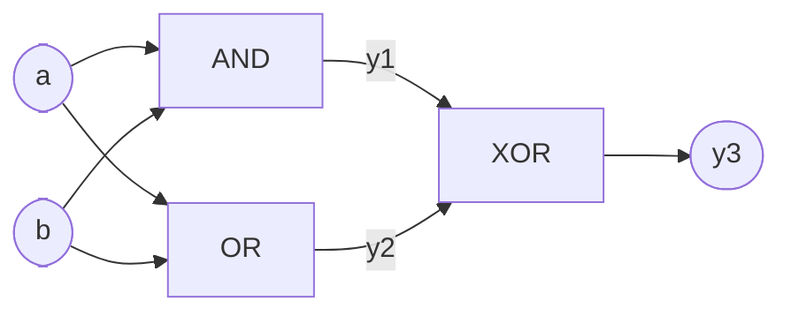

# 硬件是并行的

来自 C、Python 或 JavaScript 的同学全都内化了同一个思维模型:“代码从上到下,一次一行运行"。VHDL 会因为这个假设惩罚你,直到你建立起正确的思维模型。

## 思维大转变

看这段架构:

```vhdl
architecture rtl of demo is
begin
  y1 <= a and b;
  y2 <= a or  b;
  y3 <= y1 xor y2;
end architecture rtl;
```

在软件语言里你会把它读成三步顺序执行。在 VHDL 里,这三行描述的是**同时存在的线**。它们不按顺序执行 —— 它们就是存在着。

综合器构建出:



三个门同时通电。当 `a` 或 `b` 变化时,输出 `y3` 在经过最长路径上的传播延迟后稳定到新值。没有 “先" 和 “后"。

## 为什么顺序不重要

你可以以任意顺序写这三行:

```vhdl
y3 <= y1 xor y2;   -- 引用先于“声明"?
y1 <= a and b;
y2 <= a or  b;
```

仍是合法的 VHDL。这三条赋值描述了三条线,而线不在乎你按什么顺序画原理图。工具读完三条,然后把它们接上。

## “顺序"是如何悄悄回来的

`process` 内部的事情**确实**是顺序的 —— 在这个 process 里,一次一条语句、从上到下。但一个 process 整体上仍然只是另一条并发单元,和其它并发单元并列。

```vhdl
architecture rtl of demo is
begin

  -- 并发 1
  y1 <= a and b;

  -- 并发 2(一个 process,内部是顺序的)
  process(clk)
  begin
    if rising_edge(clk) then
      counter <= counter + 1;
    end if;
  end process;

  -- 并发 3
  y2 <= a or b;

end architecture rtl;
```

三个并发单元同时活着。每个单元在其输入变化时运行。在 process 内部,主体是按顺序读的,但那是 process 的局部属性,不是 architecture 的。

## 一个具体后果

这个设计里有一个不显眼的竞争:

```vhdl
architecture wrong of demo is
  signal a, b : std_logic;
begin
  a <= not b;
  b <= not a;
end architecture wrong;
```

当软件读,它像是 “把 `a` 设成 not-b,再把 `b` 设成 not-a" —— 没问题。当硬件读,这是两个反相器接成一个环。这是**振荡器** —— 一个永远稳不下来的反馈环。仿真器会抱怨,综合器(有时)会优化掉它,而板子会以不可预测的方式产生毛刺。

## 在你脑子里重接线

- 别再想 “谁先跑?"
- 开始想 “有哪些线存在?"
- 在 process 内部,旧的 “一次一行" 模型又回来了 —— 但只在那里。

一旦想通这点,VHDL 就不再和你对着干。你会看一段 architecture 时立刻看到它代表的原理图,而不是过去你想象的那种 “程序执行"。
