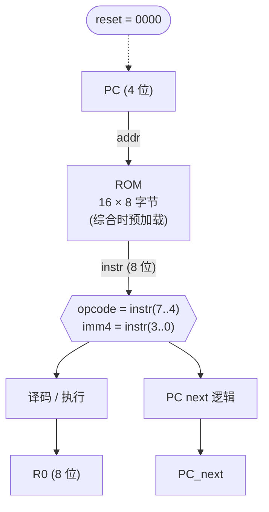

# 项目:单周期 8 位 CPU

这是收官之作。你要把前面各个模块里的所有东西——一个 ROM、一个寄存器、一个 ALU、一段像 FSM 的控制——组装成一台真能跑程序的小机器。

## 这台机器



这是 ESCOM《计算机体系结构》课里的 3.5 节——正是前面几块里的 ALU、寄存器、ROM 和控制逻辑汇到一起、组成一台能工作的 RISC 机器的那一刻。

## 单周期的契约

一切都挂在一条规则上:**在一个单周期设计里,每个时钟周期完成一条指令。**在一拍之内,硬件必须组合地去取 PC 指向的那条指令、把它译码、让它过一遍 ALU,并算出下一个 PC——而只有在上升沿上,那些*状态*元件(PC、R0、halt 标志)才锁住它们的新值。

这就是为什么 ROM 读取必须是组合的:地址(PC)和数据(instr)必须在同一个周期里、*都在*时钟沿之前就有效。因此时钟周期得盖住穿过整台机器、从取指到写回的那条最长路径。推理起来简单,但它给你的时钟速度封了顶——而这恰恰正是后面搞流水线的动机。

## 脚手架给了你什么

一颗完整、能工作的 CPU。仔细读起步代码:

```vhdl
process(clk, reset)
begin
  if reset = '1' then
    pc   <= (others => '0');
    r0   <= (others => '0');
    halt <= '0';
  elsif rising_edge(clk) then
    if halt = '0' then
      case instr(7 downto 4) is
        when "0000" => r0 <= resize(unsigned(instr(3 downto 0)), 8); pc <= pc + 1;
        when "0001" => r0 <= r0 + resize(unsigned(instr(3 downto 0)), 8); pc <= pc + 1;
        when "0010" => pc <= unsigned(instr(3 downto 0));
        when "1111" => halt <= '1';
        when others => pc <= pc + 1;
      end case;
    end if;
  end if;
end process;
```

它已经实现了:

- LOAD (`0000`)
- ADD  (`0001`)
- JUMP (`0010`)
- HALT (`1111`)

预加载的 ROM 跑的是 `R0 = 3; R0 += 4; R0 += 2; HALT`。

## 你要做的

先让它原样跑起来。用捆绑的 clock + reset 激励仿真 200 µs。在 Waveforms 标签页里,你应该看到 `r0_out` 走过 `3 → 7 → 9`,然后 `halted` 拉高并一直保持。

基线跑通之后,**扩展**这个 ISA:

### 任务 1:SUB

opcode `0011`。`R0 <= R0 - imm4`。一行改动。

### 任务 2:条件跳转

opcode `0100`:`JZ addr`——如果 `R0 = 0` 就跳到 `addr`,否则就 `pc <= pc + 1`。

这里有一段写好的循环,把 `R0` 倒数到零然后停机。每趟减 1;当 `R0` 到 0 时,`JZ` 落空,穿到 `HALT`:

```
0: 03   LOAD R0, #3     -- R0 = 3
1: 31   SUB  R0, #1     -- R0 = R0 - 1   (任务 1 来的 opcode 0011)
2: 44   JZ   #4         -- 若 R0 = 0 跳到地址 4,否则穿下去
3: 21   JUMP #1         -- 回去再减一次
4: F0   HALT
```

跟一遍:R0 走 3 → 2 → 1 → 0,只有在 R0 到了 0 的那一趟,`JZ` 才会走分支去 `HALT`。在 Waveforms 标签页上盯着 `r0_out`,先确认倒计数对了,再去信任分支逻辑。

`JZ` 的译码不过是一个带条件的下一个 PC:

```vhdl
when "0100" =>
  if r0 = 0 then
    pc <= unsigned(instr(3 downto 0));   -- 走分支
  else
    pc <= pc + 1;                        -- 穿下去
  end if;
```

### 任务 3:第二个寄存器

加一个 `r1` 作为第二个 8 位寄存器。把 `LOAD R1, #i` 定义为 opcode `0101`,把 `ADD R0, R1`(无立即数)定义为 opcode `0110`。你需要把译码的 case 加宽,并加第二个输出端口便于观察。

### 任务 4:外部数据存储器

把 Memories 那条线里的 RAM 模块接进这颗 CPU。加 `LOAD R0, [addr]` 和 `STORE R0, [addr]` 这两个 opcode。这里有个真正的陷阱,值得去理解而不是照抄:一个单周期的 `LOAD` 需要 RAM 的数据在它发出地址的*同一个周期*里就有效。那只有在**组合(异步)读**下才行得通——地址进去,数据出来,中间没有一个时钟沿(FPGA 上的小型分布式/LUT RAM 能做到)。而**同步(寄存)读**,也就是 block RAM 给你的那种,会在*下一个*时钟沿才返回数据——所以你的 `LOAD` 会锁住过期的数据,并悄无声息地读到错的值。如果你非得用 block RAM,诚实的修法是让 `LOAD` 多花一个周期(一条微型的多周期指令),而不是假装读已经就绪了。store 则容易些:写本来就是一个边沿触发的事件,所以一个寄存的写能很好地契合单周期模型。

## 为什么做这个?

因为当你第一次看着自己的 CPU 一步步走完你写的程序(用你亲手写进一个 ROM 的字节),脑子里会有什么东西咔哒一声。它上面的每一层抽象——汇编器、编译器、操作系统——都站在这个机制上。而它们每一个,一路向上直到上周在浏览器里跑你写的 JavaScript,都是同一个把戏在更大的规模上重复。

## 再进一步

- 在同一个 ISA 上实现经典的五级流水线。加上冒险检测和一个转发单元。你现在就有了一个 RISC-V 教科书所教内容的微缩版。
- 给 ROM 换源:不再用常量,而是在仿真时从一个外部文件加载,然后搭一条把文本汇编成那些字节的工具链。
- 把前面那个项目里的 UART TX 丢进来,让 CPU 把 `'HI'` 打印到波形上。恭喜——你有了一颗 SoC。

## 要点

- 一颗单周期 CPU 在一个时钟周期里组合地走完从取指到写回的整段旅程;只有 PC、R0 和 halt 在上升沿上锁存。
- 加一条指令就是在 opcode 的 `case` 里加一个新分支——扩展译码,加上任何新的状态(寄存器)和用于观察的输出端口。
- 条件分支(`JZ`)不过是下一个 PC 的逻辑在读一个标志:要么跳到目标,要么穿到 `pc + 1`。
- 存储器时序是单周期的那个经典坑:同周期的 load 要用组合读;一个同步的 block-RAM 读会晚一个周期返回数据,必须把它算进去。
