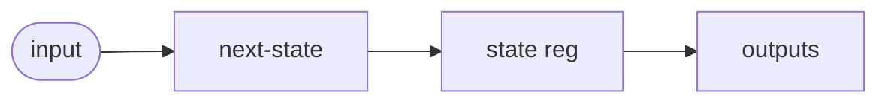

# Mealy 与 Moore 状态机

有限状态机(FSM)是一段会记住自己当下在做什么的控制逻辑。每个 FSM 都有:

- 一个**状态寄存器**(一组触发器)。
- **次态逻辑**(组合电路,决定下一个时钟沿后状态会变成什么)。
- **输出逻辑**(组合电路,决定此刻输出是什么)。

输出逻辑在哪儿取输入,把 FSM 分成两族。

## Moore:输出只与状态有关



给定状态,输出就定了。处在 `S_GREEN`,那 `green = '1'`,永远如此,不管输入长什么样。

**优点**
- 输出只在时钟沿变化 → 没有毛刺。
- 容易推理、容易调试、容易验证。

**缺点**
- 输入到输出之间至少差一个时钟沿延迟(状态先要转移)。
- 有时为了表达同样的行为,需要比 Mealy 多用几个状态。

## Mealy:输出与状态 + 输入都有关


输出是当前状态**和**当前输入的函数。它们可以在时钟沿之间变化。

**优点**
- 更快 —— 输出可以在同一个时钟周期内响应输入,而不是下一个。
- 通常用更少的状态。

**缺点**
- 输出可能产生毛刺(跟随组合输入)。
- 当输出和时钟沿不对齐时,更难调试。

## 你该用哪个?

**默认:Moore**。无毛刺、与时钟沿对齐的输出,让设计可预测。CPU 内部的控制逻辑、存储控制器、所有跟安全有关的东西,Moore 更稳妥。

**当你需要在同一个时钟周期内响应、或额外的 Moore 状态会让设计膨胀时,选 Mealy**。UART 和协议引擎经常因为响应时间问题落到 Mealy。

## Kmila 如何支持两者

两种风格都落进同一个**双进程模式**,你将在交通灯例子里看到:

```vhdl
-- 进程 1:状态寄存器(永远 Moore 安全)
process(clk, reset)
begin
  if reset = '1' then
    state <= S_IDLE;
  elsif rising_edge(clk) then
    state <= next_state;
  end if;
end process;

-- 进程 2:组合次态 + 输出
process(state, input)
begin
  ...
end process;
```

Moore 机:输出只看 `state`。Mealy 机:输出看 `state` 和 `input`。

## 要记住的

- Moore:输出是状态单独的函数。无毛刺。
- Mealy:输出是状态 + 输入的函数。更快。
- 默认从 Moore 起手;有具体原因再走 Mealy。
