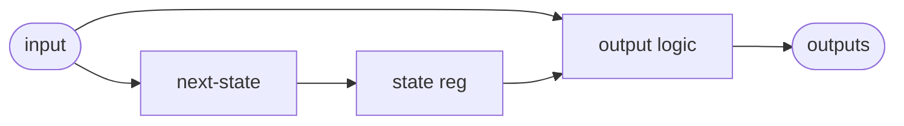

# Mealy 与 Moore 状态机

有限状态机(FSM)是一段会记住自己当下在做什么的控制逻辑。形式上讲它是一个确定性自动机:一个有限的状态集合、一个根据当前状态和输入挑出次态的转移函数,再加一个输出函数。你构建的每一个同步 FSM 都由三部分组成:

- 一个**状态寄存器**(一组触发器)——唯一有记忆的东西。
- **次态逻辑**(组合电路,决定下一个时钟沿后状态会变成什么)。
- **输出逻辑**(组合电路,决定此刻的输出是什么)。

输出逻辑到哪儿去取它的输入,把 FSM 分成了两族。

## Moore:输出只与状态有关


给定状态,输出就定了。处在 `S_GREEN`,那 `green = '1'`,永远如此,不管输入长什么样。

**优点**
- 输出只在时钟沿变化 → 没有毛刺。
- 容易推理、容易调试、容易验证。

**缺点**
- 输入到输出之间至少差一个时钟周期的延迟(状态得先转移)。
- 有时为了表达和 Mealy 机一样的行为,需要更多的状态。

## Mealy:输出与状态 + 输入都有关



输出是当前状态**和**当前输入的函数。它们可以在时钟沿之间变化。

**优点**
- 更快——输出可以在同一个时钟周期内响应输入,而不是下一个。
- 通常用更少的状态。

**缺点**
- 输出可能产生毛刺(它们跟随组合输入)。
- 当输出和时钟沿不对齐时,更难调试。

有个快速体会二者差异的办法:同样是"检测输入上的一个 `1`"这件事,在 Mealy 机里是一个状态(在*看到* `1` 的那次转移上就把输出拉起来),而在 Moore 机里需要多一个"我刚看到了一个 1"的状态(这样输出才能和*处在*那个状态绑定)。行为一样,状态数不同,时序上差一个周期。

## 一个、两个还是三个进程

VHDL 给了你好几种方式来写同一台机器。它们综合出来的硬件是一样的;区别在于可读性,以及有多容易写错。

- **单进程:**状态寄存器*和*输出都放在一个时钟进程里。所有东西最后都被寄存,所以输出天然无毛刺(Moore 风格,被寄存)。紧凑,但次态逻辑和输出逻辑搅在了一起。
- **双进程(推荐的默认做法):**一个时钟进程保管状态寄存器;一个组合进程计算 `next_state` 和输出。这就是 Kmila 示例采用的模式——它和上面那张三部分的图干净地对应起来。
- **三进程:**状态寄存器、次态逻辑、输出逻辑各自一个进程。最啰嗦,但分离最清晰,也最难被不小心改坏。

## 人人都会被咬的那个坑:推断出的锁存器

在一个*组合*进程里,你驱动的每一个信号都必须在穿过该进程的**每一条**路径上拿到一个值。如果 `case` 或 `if` 的某个分支忘了给 `next_state`(或某个输出)赋值,综合器就只好去*记住*旧值——而组合逻辑里唯一能记东西的,就是**锁存器**。锁存器几乎从来不是你想要的:它们是电平敏感的、难以做时序约束,而且是"仿真对、上硅片就挂"的经典根源。

修法就一行:在进程顶部、`case` 之前,给每一个信号一个**默认值**。

```vhdl
process(state, input)
begin
  next_state <= state;   -- 默认:原地不动
  green      <= '0';     -- 每个输出也给个默认值
  case state is
    when S_IDLE  => if input = '1' then next_state <= S_RUN; end if;
    when S_RUN   => green <= '1';
                    next_state <= S_IDLE;
  end case;
end process;
```

这样即便某个分支"忘了"赋值,默认值也会兜底——没有锁存器。(注意 VHDL 要求 `case` 的分支穷举,所以你经常会加一个 `when others =>`;那是为了让编译器满意,但真正把你从锁存器里救出来的,是那个*默认赋值*。)

## 状态编码

你用枚举类型写出命名的状态,然后让工具去挑具体的比特:

```vhdl
type state_t is (S_IDLE, S_RUN, S_DONE);
signal state, next_state : state_t;
```

综合器会挑一种编码——**二进制**(触发器最少)、**独热**(每个状态一个触发器,快且对 FPGA 友好),或**格雷码**(每步只变一位,适合低噪声的转换)。在 FPGA 上独热常常是默认,因为触发器很充裕,而且它让次态逻辑保持浅。你很少需要手工编码;除非有特别的理由,否则交给工具决定。

## 你该用哪个?

**默认:Moore。**无毛刺、与时钟沿对齐的输出,让设计可预测。CPU 内部的控制逻辑、存储控制器、任何跟安全相关的东西,Moore 都是更稳妥的选择。

**在以下情况伸手去拿 Mealy:**你需要在同一个时钟周期内响应,或者额外的 Moore 状态会让设计膨胀。UART 和协议引擎常常因为响应时间的理由落到 Mealy。如果你喜欢 Mealy 的状态数,又想要 Moore 那种干净的时序,就**把 Mealy 的输出寄存一下**(再过一级触发器)——你就把无毛刺的输出拿回来了,代价是你本想避开的那一个周期延迟。

## 与课程的联系

这是第二单元*数字系统设计*的核心:带输出和不带输出的确定性自动机、Mealy 和 Moore 模型,以及它们在 HDL 里的描述。在纸上你还会用 JK / SR / T / D 触发器来搭这些机器,并用状态约简(质蕴涵项 / 表格)方法把它们缩小——这里的枚举类型写法,正是同一张状态图在 HDL 里的对应物。

## 要点

- Moore:输出单独是状态的函数。无毛刺,一个周期的延迟。
- Mealy:输出是状态 + 输入的函数。更快,可能有毛刺——如果这要紧,就把输出寄存起来。
- 用双进程模式,并在组合进程顶部给**每一个信号都赋默认值**,以避免推断出的锁存器。
- 让工具去挑状态编码(FPGA 上独热很常见);从 Moore 起手,有具体理由再转向 Mealy。
