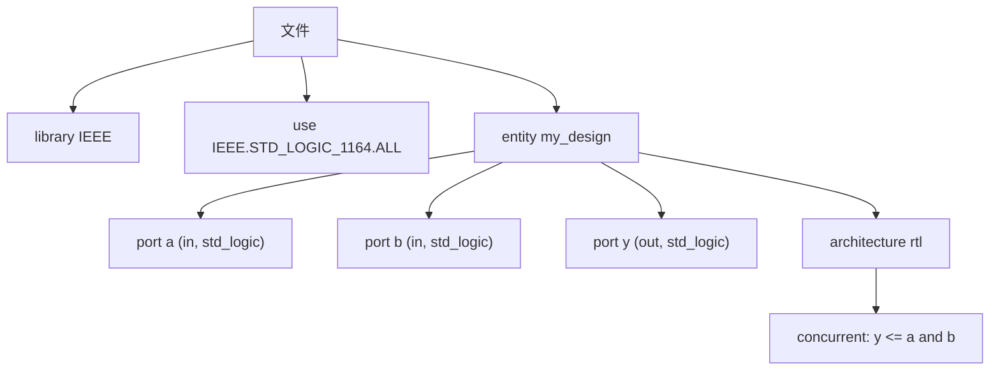

# VHDL 文件的解剖

每个 VHDL 文件都有同样的四节,始终是同一个顺序。一旦你认出这个形状,读不熟悉的代码就不再令人害怕 —— 你直接知道去哪儿找哪一段。这正是课程要求你在写出任何有用的东西之前先掌握的那个“HDL 程序结构”。

## 四节

```vhdl
library IEEE;                          -- 1. 库
use IEEE.STD_LOGIC_1164.ALL;           -- 2. 用到的 package

entity my_design is                    -- 3. entity(“头部”)
  port (
    a : in  std_logic;
    b : in  std_logic;
    y : out std_logic
  );
end entity my_design;

architecture rtl of my_design is       -- 4. architecture(“主体”)
begin
  y <= a and b;
end architecture rtl;
```

逐个看。

### 1. `library`

`library IEEE;` 让名为 `IEEE` 的逻辑库对你的文件可见。这相当于数字设计里的 `#include <stdio.h>` —— 你今后写的几乎每个文件都以它开头。

有个值得早点知道的细节:`STD` 库(它定义了内建类型 `boolean`、`integer`、`character`、`bit` 等)和你自己的 `WORK` 库*永远*可见。你从不写 `library STD;`。你之所以要点名 `IEEE`,只是因为你真正想用的逻辑类型住在那里。

### 2. `use`

`use IEEE.STD_LOGIC_1164.ALL;` 把 `STD_LOGIC_1164` package 里的所有名字拉进作用域。这就是给你 `std_logic`、`std_logic_vector`、`rising_edge()`,以及作用在这些类型上的逻辑运算符的东西。

你常会看到第二条 `use`:

```vhdl
use IEEE.NUMERIC_STD.ALL;
```

它给你 `unsigned`、`signed`、`to_integer`、`resize`,以及向量类型上的算术。只要你在向量上做算术,就加上它。要避开你在网上教程里可能见到的老 package `std_logic_arith` / `std_logic_unsigned` —— 它们从来就不是 IEEE 标准的一部分,和 `numeric_std` 混用会导致重载二义性。

### 3. `entity`

entity 是**黑盒接口**。它说明:

- 设计叫什么名字(`my_design`)
- 它有什么端口
- 每个端口:**方向**(`in`、`out`、`inout`、`buffer`)和**类型**

| 方向 | 内部能读吗? | 能驱动吗? |
|------|-------------------------|-------------------|
| `in`     | 能 | 不能 |
| `out`    | 能(VHDL-2008+) | 能 |
| `inout`  | 能 | 能(双向 / tristate) |
| `buffer` | 能 | 能(单个内部驱动源) |

`port (…)` 里的全部就是外面世界看到的东西。设计如何工作的事情在这里完全不声明。entity 还可以带 **generic** —— 编译期参数,比如总线位宽 —— 我们之后会用它来让设计可复用。

### 4. `architecture`

architecture 是**实现**。一个 entity 可以有多个 architecture(对应同一个接口)—— 你可能给同一个 `cpu` entity 准备 `rtl`、`behavioral`、`tb` 三种 architecture,在不同 configuration 里挑一种。实际工作中,大多数文件正好只有一个。

`architecture` 这一行到 `begin` 之间的部分是**声明区** —— 内部信号、常量和类型住在这里。`begin` 与 `end architecture` 之间的部分是**语句区** —— 真正描述信号和门的地方。

## Kmila 怎么解析这个

Kmila 的 VHDL 解析器从上到下读你的文件,构建一棵树:



当你点 **Build**,端口变成 dock 里 **Ports** 标签页的条目,entity 变成 **Entities** 里的条目,architecture 里的赋值变成仿真器跑的连线。

## 命名约定

VHDL 大小写不敏感。`SIGNAL`、`Signal`、`signal` 是同一个关键字,`My_Design` 和 `my_design` 指同一个东西。(唯一的例外是字符串字面量和字符字面量里的字符 —— `'0'` 和 `'1'` 是字面量值,不是关键字。)同一个文件里保持一种风格 —— 多数团队对关键字和信号名用**小写**、标识符用 **snake_case**、常量用 **UPPER_CASE**。

## 新手写第一个文件常犯的错

- **忘了 `use` 子句。** 光有 `library IEEE;` *并不会*引入 `std_logic`。少了 `use IEEE.STD_LOGIC_1164.ALL;` 这行,编译器就会报“未知类型 `std_logic`”的错。
- **收尾名字对不上。** `end entity foo;` 必须和 `entity foo` 匹配。`end` 后面的名字可写可不写,但一旦写了就必须正确。
- **最后一个端口后面多了分号或逗号。** `port (…)` 列表里最后一个端口,在右括号前没有结尾的 `;`。

## 要点

- `library` + `use` —— 你的 import。光有 `library IEEE;` 还不够,你还需要 `use` 子句。
- `entity` —— 接口:端口、它们的方向,以及 generic。
- `architecture` —— 实现,分成声明区(`begin` 之前)和语句区(`begin` 之后)。
- 一个 entity 可以有多个 architecture;多数项目交付一个叫 `rtl` 的。
