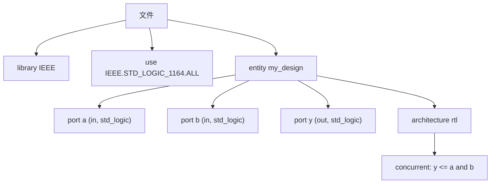

# VHDL 文件的解剖

每个 VHDL 文件都有同样的四节,始终是同一个顺序。一旦你认出这个形状,读不熟悉的代码就不再令人害怕 —— 你直接知道去哪儿找哪一段。

## 四节

```vhdl
library IEEE;                          -- 1. 库
use IEEE.STD_LOGIC_1164.ALL;           -- 2. 用到的 package

entity my_design is                    -- 3. entity(“头部”)
  port (
    a : in  std_logic;
    b : in  std_logic;
    y : out std_logic
  );
end entity my_design;

architecture rtl of my_design is       -- 4. architecture(“主体”)
begin
  y <= a and b;
end architecture rtl;
```

逐个看。

### 1. `library`

`library IEEE;` 导入 IEEE 标准库。这相当于数字设计里的 `#include <stdio.h>` —— 你今后写的几乎每个文件都以它开头。

### 2. `use`

`use IEEE.STD_LOGIC_1164.ALL;` 把 `STD_LOGIC_1164` package 里的所有名字拉进作用域。这就是给你 `std_logic`、`std_logic_vector`、`rising_edge()` 等的东西。

你常会看到第二条 `use`:

```vhdl
use IEEE.NUMERIC_STD.ALL;
```

它给你 `unsigned`、`signed`、`to_integer`、`resize`,以及向量类型上的算术。只要你在向量上做算术,就加上它。

### 3. `entity`

entity 是**黑盒接口**。它说明:

- 设计叫什么名字(`my_design`)
- 它有什么端口
- 每个端口:**方向**(`in`、`out`、`inout`、`buffer`)和**类型**

`port (…)` 里的全部就是外面世界看到的东西。设计如何工作的事情在这里完全不声明。

### 4. `architecture`

architecture 是**实现**。一个 entity 可以有多个 architecture(对应同一个接口)—— 你可能给同一个 `cpu` entity 准备 `rtl`、`behavioral`、`tb` 三种 architecture,在不同 configuration 里挑一种。实际工作中,大多数文件正好只有一个。

`begin` 与 `end architecture` 之间的主体,是真正描述信号和门的地方。

## Kmila 怎么解析这个

Kmila 的 VHDL 解析器从上到下读你的文件,构建一棵树:



当你点 **Build**,端口变成 dock 里 **Ports** 标签页的条目,entity 变成 **Entities** 里的条目,architecture 里的赋值变成仿真器跑的连线。

## 命名约定

VHDL 大小写不敏感。`SIGNAL`、`Signal`、`signal` 是同一个关键字。但同一个文件里保持一种风格 —— 多数团队对关键字和信号名用**小写**、标识符用 **snake_case**、常量用 **UPPER_CASE**。

## 要记住的

- `library` + `use` —— 你的 import。
- `entity` —— 接口(端口和方向)。
- `architecture` —— 实现(真正发生什么)。
- 一个 entity 可以有多个 architecture;多数项目交付一个叫 `rtl` 的。
