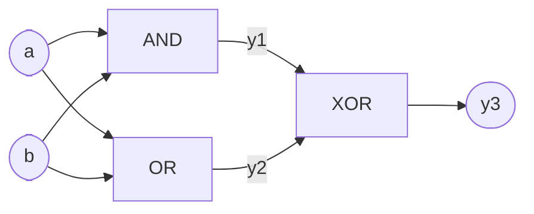

# Hardware ist parallel

Studierende, die aus C, Python oder JavaScript kommen, haben alle dasselbe mentale Modell verinnerlicht: „Code läuft von oben nach unten, eine Anweisung nach der anderen.“ VHDL wird dich für diese Annahme bestrafen, bis du das richtige Modell aufgebaut hast.

## Der große Umschalter

Schau dir diese Architektur an:

```vhdl
architecture rtl of demo is
begin
  y1 <= a and b;
  y2 <= a or  b;
  y3 <= y1 xor y2;
end architecture rtl;
```

In einer Software-Sprache liest du das als drei sequentielle Schritte. In VHDL beschreiben alle drei Zeilen **Drähte, die gleichzeitig existieren**. Sie laufen nicht in Reihenfolge ab — sie existieren.

Der Synthesizer baut:



Alle drei Gatter sind gleichzeitig unter Strom. Wenn sich `a` oder `b` ändert, pegelt sich `y3` nach einer kleinen Laufzeitverzögerung über den längsten Pfad neu ein. Es gibt kein „erstes“ und „zweites“.

## Warum die Reihenfolge egal ist

Du könntest die drei Zeilen in beliebiger Reihenfolge schreiben:

```vhdl
y3 <= y1 xor y2;   -- Referenz vor der „Deklaration“?
y1 <= a and b;
y2 <= a or  b;
```

Das ist immer noch gültiges VHDL. Die drei Zuweisungen beschreiben drei Drähte, und Drähten ist es egal, in welcher Reihenfolge du den Schaltplan gezeichnet hast. Das Tool liest alle drei und verkabelt.

## Wo „sequenziell“ wieder reinrutscht

Innerhalb eines `process` ist die Ausführung **sehr wohl** sequenziell — eine Anweisung nach der anderen, von oben nach unten. Aber ein Prozess als Ganzes ist trotzdem nur eine weitere nebenläufige Einheit neben den anderen.

```vhdl
architecture rtl of demo is
begin

  -- Nebenläufig 1
  y1 <= a and b;

  -- Nebenläufig 2 (ein Prozess, der intern sequenziell ist)
  process(clk)
  begin
    if rising_edge(clk) then
      counter <= counter + 1;
    end if;
  end process;

  -- Nebenläufig 3
  y2 <= a or b;

end architecture rtl;
```

Alle drei nebenläufigen Einheiten leben gleichzeitig. Jede läuft, wann immer ihre Eingänge sich ändern. Innerhalb des Prozesses wird der Body in Reihenfolge gelesen, aber das ist eine lokale Eigenschaft des Prozesses, nicht der Architektur.

## Eine konkrete Folge

Dieses Design hat einen subtilen Race:

```vhdl
architecture wrong of demo is
  signal a, b : std_logic;
begin
  a <= not b;
  b <= not a;
end architecture wrong;
```

Als Software gelesen sieht das aus wie „setze `a` auf not-b, dann setze `b` auf not-a“ — kein Problem. Als Hardware gelesen sind das zwei Inverter, in einer Schleife verdrahtet. Das ist ein **Oszillator** — eine Rückkopplungsschleife, die nie zur Ruhe kommt. Die Simulation meckert, die Synthese optimiert es (manchmal) weg, das Board glitcht unvorhersehbar.

## Die Umverdrahtung in deinem Kopf

- Hör auf zu denken „was läuft zuerst?“
- Fang an zu denken „welche Drähte existieren?“
- Innerhalb eines Prozesses ist das alte „eines nach dem anderen“-Modell wieder zurück — aber nur dort drin.

Sobald das klickt, hört VHDL auf, gegen dich zu kämpfen. Du liest eine Architektur und siehst sofort den Schaltplan, den sie repräsentiert, statt der „Programm-Ausführung“, die du dir früher vorgestellt hast.
