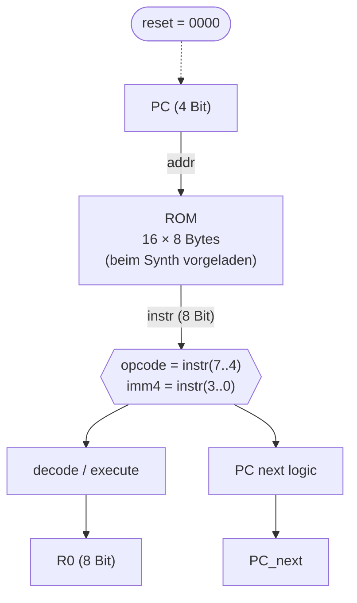

# Projekt: Single-Cycle-8-Bit-CPU

Das ist die Krönung. Du baust alles aus den früheren Modulen – ein ROM, ein Register, eine ALU, eine FSM-artige Steuerung – zu einer winzigen Maschine zusammen, die tatsächlich Programme ausführt.

## Die Maschine



Das ist Thema 3.5 im ESCOM-Kurs *Arquitectura de Computadoras* – der Punkt, an dem die ALU, das Register, das ROM und die Steuerlogik aus den früheren Blöcken zu einer funktionierenden RISC-Maschine zusammenkommen.

## Der Single-Cycle-Vertrag

Alles hängt an einer Regel: **In einem Single-Cycle-Entwurf beendet jede Taktperiode einen Befehl.** Innerhalb eines einzigen Ticks muss die Hardware kombinatorisch den Befehl holen, auf den der PC zeigt, ihn decodieren, ihn durch die ALU laufen lassen und den nächsten PC ausrechnen – und nur an der steigenden Flanke latchen die *Zustandselemente* (PC, R0, das Halt-Flag) ihre neuen Werte.

Deshalb muss der ROM-Read kombinatorisch sein: Die Adresse (PC) und die Daten (instr) müssen beide *vor* der Taktflanke gültig sein, im selben Zyklus. Die Taktperiode muss daher den längsten Pfad durch die ganze Maschine abdecken, von Fetch bis Writeback. Einfach nachzuvollziehen, aber es deckelt deine Taktgeschwindigkeit – was genau die Motivation fürs spätere Pipelining ist.

## Was dir das Gerüst gibt

Eine komplette, funktionierende CPU. Lies den Starter genau:

```vhdl
process(clk, reset)
begin
  if reset = '1' then
    pc   <= (others => '0');
    r0   <= (others => '0');
    halt <= '0';
  elsif rising_edge(clk) then
    if halt = '0' then
      case instr(7 downto 4) is
        when "0000" => r0 <= resize(unsigned(instr(3 downto 0)), 8); pc <= pc + 1;
        when "0001" => r0 <= r0 + resize(unsigned(instr(3 downto 0)), 8); pc <= pc + 1;
        when "0010" => pc <= unsigned(instr(3 downto 0));
        when "1111" => halt <= '1';
        when others => pc <= pc + 1;
      end case;
    end if;
  end if;
end process;
```

Es implementiert bereits:

- LOAD (`0000`)
- ADD  (`0001`)
- JUMP (`0010`)
- HALT (`1111`)

Das vorgeladene ROM lässt `R0 = 3; R0 += 4; R0 += 2; HALT` laufen.

## Dein Job

Lass es zuerst unverändert laufen. Simuliere 200 µs mit den mitgelieferten Clock-+-Reset-Stimuli. Im Wellenform-Tab solltest du `r0_out` durch `3 → 7 → 9` durchschalten sehen, dann `halted` high werden und high bleiben.

Sobald die Basis läuft, **erweitere** die ISA:

### Aufgabe 1: SUB

Opcode `0011`. `R0 <= R0 - imm4`. Eine Zeile Änderung.

### Aufgabe 2: Bedingter Sprung

Opcode `0100`: `JZ addr` – springe zu `addr`, wenn `R0 = 0`, sonst nur `pc <= pc + 1`.

Hier ist eine durchgerechnete Schleife, die `R0` auf null runterzählt und dann anhält. Subtrahiere bei jedem Durchlauf 1; wenn `R0` 0 erreicht, fällt `JZ` zum `HALT` durch:

```
0: 03   LOAD R0, #3     -- R0 = 3
1: 31   SUB  R0, #1     -- R0 = R0 - 1   (Opcode 0011 aus Aufgabe 1)
2: 44   JZ   #4         -- wenn R0 = 0, springe zu Adresse 4, sonst durchfallen
3: 21   JUMP #1         -- zurück und erneut subtrahieren
4: F0   HALT
```

Verfolge es: R0 schreitet 3 → 2 → 1 → 0, und nur bei dem Durchlauf, bei dem R0 0 erreicht, nimmt `JZ` den Sprung zum `HALT`. Beobachte `r0_out` im Wellenform-Tab, um das Runterzählen zu bestätigen, bevor du der Sprunglogik vertraust.

Das Decode für `JZ` ist nur ein bedingter nächster PC:

```vhdl
when "0100" =>
  if r0 = 0 then
    pc <= unsigned(instr(3 downto 0));   -- genommen
  else
    pc <= pc + 1;                        -- durchfallen
  end if;
```

### Aufgabe 3: Ein zweites Register

Füge `r1` als zweites 8-Bit-Register hinzu. Definiere `LOAD R1, #i` als Opcode `0101` und `ADD R0, R1` (ohne Immediate) als Opcode `0110`. Du musst den Decode-Case verbreitern und einen zweiten Output-Port für die Sichtbarkeit hinzufügen.

### Aufgabe 4: Externer Datenspeicher

Hänge das RAM-Modul aus dem Memories-Track an diese CPU. Füge `LOAD R0, [addr]`- und `STORE R0, [addr]`-Opcodes hinzu. Hier ist die echte Falle, und es lohnt sich, sie zu verstehen statt sie abzuschreiben: Ein Single-Cycle-`LOAD` braucht die Daten des RAMs gültig *im selben Zyklus*, in dem er die Adresse ausgibt. Das funktioniert nur mit einem **kombinatorischen (asynchronen) Read** – die Adresse geht rein, die Daten kommen ohne Taktflanke dazwischen raus (kleiner verteilter/LUT-RAM auf einem FPGA kann das). Ein **synchroner (registrierter) Read**, wie ihn Block-RAM liefert, gibt die Daten an der *nächsten* Taktflanke zurück – dein `LOAD` würde also veraltete Daten latchen und stillschweigend den falschen Wert lesen. Wenn du Block-RAM nutzen musst, ist die ehrliche Lösung, `LOAD` einen Extra-Zyklus nehmen zu lassen (ein Mini-Multi-Cycle-Befehl), nicht so zu tun, als wäre der Read bereit. Stores sind einfacher: Ein Schreibvorgang ist ohnehin ein flankengetriggertes Ereignis, also passt ein registrierter Write gut ins Single-Cycle-Modell.

## Warum das tun?

Weil das erste Mal, wenn du deine CPU ein Programm durchschreiten siehst (in Bytes, die du selbst in ein ROM geschrieben hast), etwas klickt. Jede Abstraktion darüber – Assembler, Compiler, Betriebssystem – steht auf genau diesem Mechanismus. Und jede einzelne davon, bis hoch zum Webbrowser, der das JavaScript ausführt, das du letzte Woche geschrieben hast, ist derselbe Trick, nur größer skaliert.

## Weitergehen

- Implementiere die klassische Fünf-Stufen-Pipeline auf derselben ISA. Füge Hazard-Erkennung und eine Forwarding-Einheit hinzu. Du hast jetzt eine Mikro-Version dessen, was RISC-V-Lehrbücher lehren.
- Retarget das ROM: Statt Konstanten, lade es zur Simulationszeit aus einer externen Datei und bau dann eine Toolchain, die Text in diese Bytes assembliert.
- Bau den UART-TX aus dem früheren Projekt ein und lass die CPU `'HI'` in die Wellenform drucken. Glückwunsch – du hast einen SoC.

## Was du behalten solltest

- Eine Single-Cycle-CPU macht die ganze Reise von Fetch bis Writeback kombinatorisch in einer Taktperiode; nur PC, R0 und Halt latchen an der steigenden Flanke.
- Einen Befehl hinzuzufügen ist ein neuer Zweig im Opcode-`case` – erweitere das Decode, füge jeden neuen Zustand (Register) und Output-Ports für die Sichtbarkeit hinzu.
- Bedingte Sprünge (`JZ`) sind nur die Next-PC-Logik, die ein Flag liest: nimm das Ziel oder fall zu `pc + 1` durch.
- Speicher-Timing ist die klassische Single-Cycle-Falle: kombinatorischer Read für Loads im selben Zyklus; ein synchroner Block-RAM-Read gibt die Daten einen Zyklus zu spät zurück und muss berücksichtigt werden.
