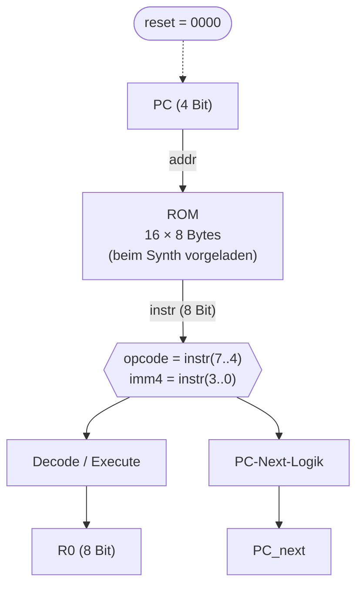

# Projekt: Single-Cycle-8-Bit-CPU

Das ist die Krönung. Du baust alles aus den früheren Modulen — ein ROM, ein Register, eine ALU, eine FSM-artige Steuerung — zu einer winzigen Maschine zusammen, die tatsächlich Programme ausführt.

## Die Maschine



## Was dir das Gerüst gibt

Eine komplette, funktionierende CPU. Lies den Starter genau:

```vhdl
process(clk, reset)
begin
  if reset = '1' then
    pc   <= (others => '0');
    r0   <= (others => '0');
    halt <= '0';
  elsif rising_edge(clk) then
    if halt = '0' then
      case instr(7 downto 4) is
        when "0000" => r0 <= resize(unsigned(instr(3 downto 0)), 8); pc <= pc + 1;
        when "0001" => r0 <= r0 + resize(unsigned(instr(3 downto 0)), 8); pc <= pc + 1;
        when "0010" => pc <= unsigned(instr(3 downto 0));
        when "1111" => halt <= '1';
        when others => pc <= pc + 1;
      end case;
    end if;
  end if;
end process;
```

Es implementiert bereits:

- LOAD (`0000`)
- ADD  (`0001`)
- JUMP (`0010`)
- HALT (`1111`)

Das vorgeladene ROM lässt `R0 = 3; R0 += 4; R0 += 2; HALT` laufen.

## Dein Job

Lass es zuerst unverändert laufen. Simuliere 200 µs mit den mitgelieferten Clock-+-Reset-Stimuli. Im Wellenform-Tab solltest du `r0_out` durch `3 → 7 → 9` durchschalten sehen, dann `halted` high werden und high bleiben.

Sobald die Basis läuft, **erweitere** die ISA:

### Aufgabe 1: SUB

Opcode `0011`. `R0 <= R0 - imm4`. Eine Zeile.

### Aufgabe 2: Bedingter Sprung

Opcode `0100`: `JZ addr` — springe zu `addr`, wenn `R0 = 0`, sonst nur `pc <= pc + 1`.

Schreibe ein kleines Programm, das von irgendeinem Wert runterzählt und bei 0 zurückspringt. Nutze `JZ` als Schleifenausgang.

### Aufgabe 3: Ein zweites Register

Füge `r1` als zweites 8-Bit-Register hinzu. Definiere `LOAD R1, #i` als Opcode `0101` und `ADD R0, R1` (ohne Immediate) als Opcode `0110`. Du musst den Decode-Case erweitern und einen zweiten Output-Port für die Sichtbarkeit hinzufügen.

### Aufgabe 4: Externer Datenspeicher

Hänge das RAM-Modul aus dem Memories-Track an diese CPU. Füge `LOAD R0, [addr]` und `STORE R0, [addr]` als Opcodes hinzu. Vorsicht: ein Single-Cycle-Design verlangt, dass der Lese-Port des Speichers seinen Output im selben Zyklus liefert, in dem du die Adresse anlegst — nutze einen kombinatorischen Read fürs ROM und einen getakteten Read fürs Daten-RAM und plane die Pipeline sorgfältig.

## Warum das tun?

Weil das erste Mal, wenn du deine CPU ein Programm durchschreiten siehst (in Bytes, die du selbst in ein ROM geschrieben hast), etwas klickt. Jede Abstraktion darüber — Assembler, Compiler, Betriebssystem — steht auf genau diesem Mechanismus. Und jede einzelne davon, bis hoch zum Webbrowser, der das JavaScript ausführt, das du letzte Woche geschrieben hast, ist derselbe Trick, nur größer skaliert.

## Weitergehen

- Implementiere die klassische Fünf-Stufen-Pipeline auf derselben ISA. Füge Hazard-Erkennung und eine Forwarding-Einheit hinzu. Du hast jetzt eine Mikro-Version dessen, was RISC-V-Lehrbücher lehren.
- Retarget das ROM: statt Konstanten, lade es zur Simulationszeit aus einer externen Datei und baue dann eine Toolchain, die Text in diese Bytes assembliert.
- Bau den UART-TX aus dem früheren Projekt ein und lass die CPU `'HI'` in die Wellenform drucken. Glückwunsch — du hast einen SoC.
