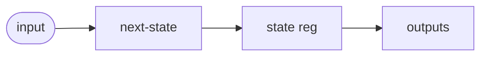
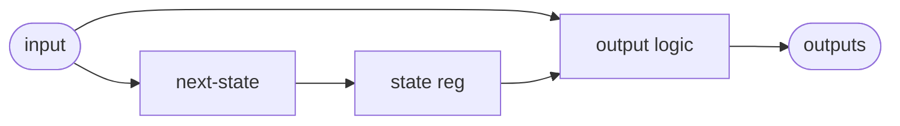

# Mealy- vs. Moore-Automaten

Ein endlicher Automat (FSM) ist Steuerlogik, die sich merkt, was sie gerade tut. Jeder FSM hat:

- Ein **Zustandsregister** (eine Gruppe Flip-Flops).
- **Folgezustandslogik** (kombinatorisch, entscheidet, was der Zustand bei der nächsten Taktflanke sein wird).
- **Ausgangslogik** (kombinatorisch, entscheidet, was die Ausgänge jetzt sind).

Wo die Ausgangslogik ihre Eingänge sucht, teilt FSMs in zwei Familien.

## Moore: Ausgänge hängen nur vom Zustand ab



Bei gegebenem Zustand ist der Ausgang fix. Bist du in `S_GREEN`, dann `green = '1'`. Immer. Egal, wie der Eingang aussieht.

**Vorteile**
- Ausgänge ändern sich nur an Taktflanken → keine Glitches.
- Leicht nachzuvollziehen, leicht zu debuggen, leicht zu verifizieren.

**Nachteile**
- Mindestens ein Taktzyklus Latenz zwischen Eingang und Ausgang (der Zustand muss zuerst wechseln).
- Manchmal brauchst du mehr Zustände, um dasselbe Verhalten wie ein Mealy-Automat zu codieren.

## Mealy: Ausgänge hängen vom Zustand + Eingang ab



Ausgänge sind eine Funktion des aktuellen Zustands **und** des aktuellen Eingangs. Sie können sich zwischen Taktflanken ändern.

**Vorteile**
- Schneller — Ausgänge können im selben Zyklus auf einen Eingang reagieren, nicht erst im nächsten.
- Oft weniger Zustände nötig.

**Nachteile**
- Ausgänge können glitchen (folgen dem kombinatorischen Eingang).
- Schwerer zu debuggen, wenn Ausgänge nicht mit Taktflanken zusammenfallen.

## Welchen nehmen?

**Standard: Moore.** Die Glitch-Freiheit und die kantenausgerichteten Ausgänge machen Designs vorhersagbar. Für Steuerlogik in einer CPU, einem Speichercontroller oder bei allem Sicherheitsrelevanten ist Moore die sicherere Wahl.

**Greife zu Mealy, wenn** du im selben Taktzyklus reagieren musst oder wenn die zusätzlichen Moore-Zustände den Entwurf aufblähen würden. UART und Protokoll-Engines landen oft bei Mealy wegen des Reaktionszeit-Arguments.

## Wie Kmila beide unterstützt

Beide Stile lassen sich in dasselbe **Zwei-Prozess-Muster** packen, das du im Ampelbeispiel sehen wirst:

```vhdl
-- Prozess 1: Zustandsregister (immer Moore-sicher)
process(clk, reset)
begin
  if reset = '1' then
    state <= S_IDLE;
  elsif rising_edge(clk) then
    state <= next_state;
  end if;
end process;

-- Prozess 2: kombinatorischer Folgezustand + Ausgänge
process(state, input)
begin
  ...
end process;
```

Bei einem Moore-Automaten schauen die Ausgänge nur auf `state`. Bei einem Mealy-Automaten schauen sie auf `state` und `input`.

## Was du behalten solltest

- Moore: Ausgang ist Funktion des Zustands allein. Glitch-frei.
- Mealy: Ausgang ist Funktion von Zustand + Eingang. Schneller.
- Starte mit Moore; wechsle zu Mealy, wenn du einen konkreten Grund hast.
