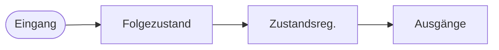
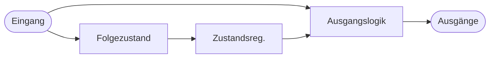

# Mealy- vs. Moore-Automaten

Ein endlicher Automat (FSM) ist Steuerlogik, die sich merkt, was sie gerade tut. Jede FSM hat:

- Ein **Zustandsregister** (eine Gruppe von Flipflops).
- **Folgezustandslogik** (kombinatorisch, entscheidet, was der Zustand bei der nächsten Taktflanke sein wird).
- **Ausgangslogik** (kombinatorisch, entscheidet, was die Ausgänge gerade jetzt sind).

Wo die Ausgangslogik ihre Eingaben bezieht, teilt FSMs in zwei Familien.

## Moore: Ausgänge hängen nur vom Zustand ab



Bei gegebenem Zustand ist der Ausgang fest. Wenn du in `S_GREEN` bist, ist `green = '1'`. Immer. Egal, wie die Eingabe aussieht.

**Vorteile**
- Ausgänge ändern sich nur an Taktflanken → keine Glitches.
- Leicht zu durchdenken, leicht zu debuggen, leicht zu verifizieren.

**Nachteile**
- Mindestens ein Taktzyklus Latenz zwischen Eingang und Ausgang (der Zustand muss erst wechseln).
- Manchmal brauchst du mehr Zustände, um dasselbe Verhalten wie eine Mealy-Maschine zu kodieren.

## Mealy: Ausgänge hängen von Zustand + Eingang ab



Ausgänge sind eine Funktion des aktuellen Zustands **und** des aktuellen Eingangs. Sie können sich zwischen Taktflanken ändern.

**Vorteile**
- Schneller — Ausgänge können im selben Zyklus auf einen Eingang reagieren, nicht erst im nächsten.
- Benötigt oft weniger Zustände.

**Nachteile**
- Ausgänge können glitchen (folgen dem kombinatorischen Eingang).
- Schwerer zu debuggen, wenn Ausgänge nicht an Taktflanken ausgerichtet sind.

## Welche solltest du verwenden?

**Standard: Moore.** Die Glitch-Freiheit und die flankenausgerichteten Ausgänge machen Designs vorhersehbar. Für Steuerlogik in einer CPU, einem Speichercontroller oder irgendetwas Sicherheitsrelevantem ist Moore die sicherere Wahl.

**Greife zu Mealy,** wenn du innerhalb desselben Taktzyklus reagieren musst oder wenn die zusätzlichen Moore-Zustände das Design aufblähen würden. UART- und Protokoll-Engines landen aus Reaktionszeit-Gründen oft bei Mealy.

## Wie Kmila sie unterstützt

Beide Stile passen in dasselbe **Zwei-Prozess-Muster**, das du im Ampel-Beispiel sehen wirst:

```vhdl
-- Prozess 1: Zustandsregister (immer Moore-sicher)
process(clk, reset)
begin
  if reset = '1' then
    state <= S_IDLE;
  elsif rising_edge(clk) then
    state <= next_state;
  end if;
end process;

-- Prozess 2: kombinatorisch Folgezustand + Ausgänge
process(state, input)
begin
  ...
end process;
```

Bei einer Moore-Maschine schauen die Ausgänge nur auf `state`. Bei einer Mealy-Maschine schauen sie auf `state` und `input`.

## Was zu merken ist

- Moore: Ausgang ist eine Funktion nur des Zustands. Glitch-frei.
- Mealy: Ausgang ist eine Funktion von Zustand + Eingang. Schneller.
- Starte mit Moore; wechsle zu Mealy, wenn du einen konkreten Grund hast.
