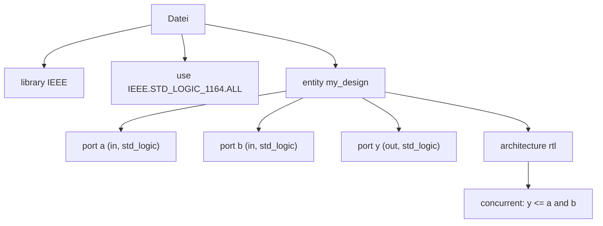

# Aufbau einer VHDL-Datei

Jede VHDL-Datei hat dieselben vier Abschnitte, immer in derselben Reihenfolge. Sobald du die Form erkennst, hört unbekannter Code auf, einschüchternd zu sein — du weißt einfach, wo du jede Information findest.

## Die vier Abschnitte

```vhdl
library IEEE;                          -- 1. Bibliotheken
use IEEE.STD_LOGIC_1164.ALL;           -- 2. genutzte Packages

entity my_design is                    -- 3. Entity (der „Header“)
  port (
    a : in  std_logic;
    b : in  std_logic;
    y : out std_logic
  );
end entity my_design;

architecture rtl of my_design is       -- 4. Architecture (der „Body“)
begin
  y <= a and b;
end architecture rtl;
```

Schauen wir uns jeden an.

### 1. `library`

`library IEEE;` importiert die Standard-IEEE-Bibliothek. Das ist das Digitaldesign-Äquivalent zu `#include <stdio.h>` — fast jede Datei, die du je schreibst, beginnt damit.

### 2. `use`

`use IEEE.STD_LOGIC_1164.ALL;` zieht jeden Namen aus dem `STD_LOGIC_1164`-Package in den Scope. Das gibt dir `std_logic`, `std_logic_vector`, `rising_edge()` und Konsorten.

Oft siehst du ein zweites `use`:

```vhdl
use IEEE.NUMERIC_STD.ALL;
```

Das gibt dir `unsigned`, `signed`, `to_integer`, `resize` und Arithmetik für Vektortypen. Füge es hinzu, wann immer du auf Vektoren rechnest.

### 3. `entity`

Die Entity ist die **Black-Box-Schnittstelle**. Sie sagt:

- wie das Design heißt (`my_design`)
- welche Ports es hat
- für jeden Port: seine **Richtung** (`in`, `out`, `inout`, `buffer`) und seinen **Typ**

Alles innerhalb von `port (…)` ist das, was die Außenwelt sieht. Nichts darüber, wie das Design funktioniert, wird hier deklariert.

### 4. `architecture`

Die Architecture ist die **Implementierung**. Eine Entity kann mehrere Architectures haben (für dieselbe Schnittstelle) — du könntest `rtl`, `behavioral` und `tb` Architectures derselben `cpu`-Entity haben und je Konfiguration eine wählen. In der Praxis hat die meiste Datei genau eine.

Der Body zwischen `begin` und `end architecture` ist, wo Signale und Gatter tatsächlich beschrieben werden.

## Wie Kmila das parst

Kmilas VHDL-Parser liest deine Datei von oben nach unten und baut einen Baum:



Wenn du auf **Build** klickst, werden aus den Ports die Einträge im **Ports**-Dock-Tab, aus der Entity der Eintrag in **Entities**, und aus den Zuweisungen in der Architecture wird die Verdrahtung, die der Simulator ausführt.

## Namenskonventionen

VHDL ist case-insensitive. `SIGNAL`, `Signal` und `signal` sind dasselbe Schlüsselwort. Aber halte einen einzigen Stil in einer Datei — die meisten Teams nutzen **kleinbuchstaben** für Schlüsselwörter und Signalnamen, **snake_case** für Bezeichner und **UPPER_CASE** für Konstanten.

## Was du behalten solltest

- `library` + `use` — deine Imports.
- `entity` — die Schnittstelle (Ports und Richtungen).
- `architecture` — die Implementierung (was tatsächlich passiert).
- Eine Entity kann mehrere Architectures haben; die meisten Projekte liefern eine namens `rtl`.
