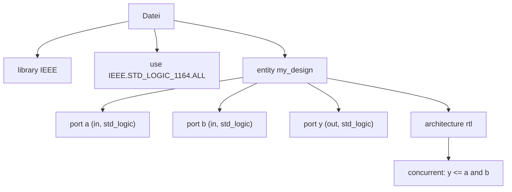

# Aufbau einer VHDL-Datei

Jede VHDL-Datei hat dieselben vier Abschnitte, immer in derselben Reihenfolge. Sobald du die Form erkennst, hört unbekannter Code auf, einschüchternd zu sein — du weißt einfach, wo du jede Information findest. Genau das ist die „estructura de un programa en HDL“, die der Kurs von dir verlangt, bevor du etwas Nützliches schreibst.

## Die vier Abschnitte

```vhdl
library IEEE;                          -- 1. Bibliotheken
use IEEE.STD_LOGIC_1164.ALL;           -- 2. genutzte Packages

entity my_design is                    -- 3. Entity (der „Header“)
  port (
    a : in  std_logic;
    b : in  std_logic;
    y : out std_logic
  );
end entity my_design;

architecture rtl of my_design is       -- 4. Architecture (der „Body“)
begin
  y <= a and b;
end architecture rtl;
```

Schauen wir uns jeden an.

### 1. `library`

`library IEEE;` macht die logische Bibliothek namens `IEEE` für deine Datei sichtbar. Das ist das Digitaldesign-Äquivalent zu `#include <stdio.h>` — fast jede Datei, die du je schreibst, beginnt damit.

Eine Feinheit, die man früh kennen sollte: Die Bibliothek `STD` (die die eingebauten Typen `boolean`, `integer`, `character`, `bit` und so weiter definiert) und deine eigene `WORK`-Bibliothek sind *immer* sichtbar. Du schreibst nie `library STD;`. Du nennst nur `IEEE`, weil die Logik-Typen, die du wirklich willst, dort liegen.

### 2. `use`

`use IEEE.STD_LOGIC_1164.ALL;` zieht jeden Namen aus dem `STD_LOGIC_1164`-Package in den Scope. Das gibt dir `std_logic`, `std_logic_vector`, `rising_edge()` und die Logikoperatoren auf diesen Typen.

Oft siehst du ein zweites `use`:

```vhdl
use IEEE.NUMERIC_STD.ALL;
```

Das gibt dir `unsigned`, `signed`, `to_integer`, `resize` und Arithmetik für Vektortypen. Füge es hinzu, wann immer du auf Vektoren rechnest. Meide die alten Packages `std_logic_arith` / `std_logic_unsigned`, die dir in Online-Tutorials begegnen können — sie waren nie Teil des IEEE-Standards, und sie mit `numeric_std` zu mischen führt zu mehrdeutigen Overloads.

### 3. `entity`

Die Entity ist die **Black-Box-Schnittstelle**. Sie sagt:

- wie das Design heißt (`my_design`)
- welche Ports es hat
- für jeden Port: seinen **Mode** (`in`, `out`, `inout`, `buffer`) und seinen **Typ**

| Mode | Kannst du ihn drinnen lesen? | Kannst du ihn treiben? |
|------|-------------------------|-------------------|
| `in`     | ja | nein |
| `out`    | ja (ab VHDL-2008) | ja |
| `inout`  | ja | ja (bidirektional / Tristate) |
| `buffer` | ja | ja (ein interner Treiber) |

Alles innerhalb von `port (…)` ist das, was die Außenwelt sieht. Nichts darüber, *wie* das Design funktioniert, wird hier deklariert. Eine Entity kann außerdem **Generics** tragen — Parameter zur Compile-Zeit wie eine Busbreite —, die wir später nutzen, um Designs wiederverwendbar zu machen.

### 4. `architecture`

Die Architecture ist die **Implementierung**. Eine Entity kann mehrere Architectures für dieselbe Schnittstelle haben — du könntest `rtl`, `behavioral` und `tb` Architectures derselben `cpu`-Entity haben und je Konfiguration eine wählen. In der Praxis hat die meiste Datei genau eine.

Der Teil zwischen der `architecture`-Zeile und `begin` ist der **Deklarationsbereich** — hier leben interne Signale, Konstanten und Typen. Der Teil zwischen `begin` und `end architecture` ist der **Anweisungsbereich** — wo Signale und Gatter tatsächlich beschrieben werden.

## Wie Kmila das parst

Kmilas VHDL-Parser liest deine Datei von oben nach unten und baut einen Baum:



Wenn du auf **Build** klickst, werden aus den Ports die Einträge im **Ports**-Dock-Tab, aus der Entity der Eintrag in **Entities**, und aus den Zuweisungen in der Architecture wird die Verdrahtung, die der Simulator ausführt.

## Namenskonventionen

VHDL ist case-insensitive. `SIGNAL`, `Signal` und `signal` sind dasselbe Schlüsselwort, und `My_Design` und `my_design` benennen dasselbe. (Die eine Ausnahme sind Zeichen innerhalb von String- und Zeichen-Literalen — `'0'` und `'1'` sind Literalwerte, keine Schlüsselwörter.) Halte einen einzigen Stil in einer Datei — die meisten Teams nutzen **kleinbuchstaben** für Schlüsselwörter und Signalnamen, **snake_case** für Bezeichner und **UPPER_CASE** für Konstanten.

## Typische Fehler bei der ersten Datei

- **Die `use`-Klausel vergessen.** `library IEEE;` allein bringt dir *kein* `std_logic`. Ohne die Zeile `use IEEE.STD_LOGIC_1164.ALL;` meldet der Compiler einen Fehler „unbekannter Typ `std_logic`“.
- **Unpassende Abschlussnamen.** `end entity foo;` muss zu `entity foo` passen. Der Name nach `end` ist optional, muss aber, wenn vorhanden, korrekt sein.
- **Ein überzähliges Semikolon oder Komma beim letzten Port.** Der letzte Port in einer `port (…)`-Liste hat kein abschließendes `;` vor der schließenden Klammer.

## Was du behalten solltest

- `library` + `use` — deine Imports. `library IEEE;` allein reicht nicht; du brauchst auch die `use`-Klausel.
- `entity` — die Schnittstelle: Ports, ihre Modes und Generics.
- `architecture` — die Implementierung, aufgeteilt in einen Deklarationsbereich (vor `begin`) und einen Anweisungsbereich (danach).
- Eine Entity kann mehrere Architectures haben; die meisten Projekte liefern eine namens `rtl`.
