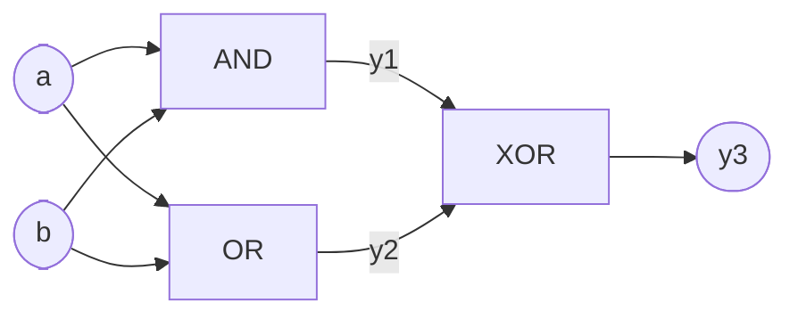

# Hardware is parallel

Students coming from C, Python, or JavaScript have all internalised the same mental model: "code runs top to bottom, one statement at a time." VHDL will punish you for that assumption until you build the correct mental model. This is the single biggest conceptual jump in the whole HDL unit, so it's worth slowing down for.

## The big shift

Look at this architecture:

```vhdl
architecture rtl of demo is
begin
  y1 <= a and b;
  y2 <= a or  b;
  y3 <= y1 xor y2;
end architecture rtl;
```

In a software language, you'd read this as three sequential steps. In VHDL, all three lines describe **wires that exist simultaneously**. They don't execute in order — they exist.

The synthesizer builds:



All three gates are powered up at the same time. When `a` or `b` changes, `y3` settles to its new value after a small propagation delay through whichever path is longest. There is no "first" and "second".

## Why the order doesn't matter

You could write the three lines in any order:

```vhdl
y3 <= y1 xor y2;   -- "reference before declaration"?
y1 <= a and b;
y2 <= a or  b;
```

This is still valid VHDL and produces the identical circuit. The three assignments describe three wires, and wires don't care what order you drew the schematic in. The tool reads all three and connects them up.

## The event-driven engine behind it

So how does a *sequential* computer simulate all this "at once"? Each concurrent assignment behaves like a tiny process with an implicit sensitivity list: it is **re-evaluated whenever any signal on its right-hand side changes**. The simulator keeps a queue of pending events; when `a` changes it wakes every assignment that reads `a`, those recompute and may schedule new events, and so on until the circuit is quiet. That "settling" is why concurrency is deterministic rather than chaotic — a point the next lesson (delta cycles) makes precise.

## Where "sequential" sneaks back in

Inside a `process`, things **are** sequential — within that process, statements run one at a time, top to bottom. But a process *as a whole* is still just one more concurrent unit sitting next to all the others.

```vhdl
architecture rtl of demo is
begin

  -- Concurrent 1
  y1 <= a and b;

  -- Concurrent 2 (a process, which internally is sequential)
  process(clk)
  begin
    if rising_edge(clk) then
      counter <= counter + 1;
    end if;
  end process;

  -- Concurrent 3
  y2 <= a or b;

end architecture rtl;
```

All three concurrent units are alive at the same time. Each runs whenever its inputs change. Inside the process, the body is read in order, but that's a local property of the process, not of the architecture. In fact, a concurrent signal assignment is *exactly* shorthand for a one-line process — the two are interchangeable.

## A concrete consequence: combinational loops

This design has a subtle bug:

```vhdl
architecture wrong of demo is
  signal a, b : std_logic;
begin
  a <= not b;
  b <= not a;
end architecture wrong;
```

Read as software, this looks like "set `a` to not-b, then set `b` to not-a" — no problem. Read as hardware, it's two inverters wired into a loop with no register to break it. That's a **combinational loop**: a ring of feedback that can never settle. Depending on the delays it either oscillates or latches to an unpredictable state. Simulation will spin through delta cycles (and may report an iteration-limit error), synthesis tools will warn about a combinational loop, and the board will glitch.

> The fix is always the same: break the feedback with a register. If you *want* memory, put the loop through a clocked process (that's how a flip-flop is built). If you don't, you have a design error.

## Count the hardware

A useful habit while you rewire your brain: read an architecture and tally the gates. The first example is 3 gates (AND, OR, XOR). This one —

```vhdl
y <= (a and b) or (c and d) or (e and f);
```

— is three AND gates feeding one 3-input OR, all live at once. You're no longer counting *steps*; you're counting *parts*.

## The rewiring in your head

- Stop thinking "what runs first?"
- Start thinking "what wires exist, and what feeds what?"
- Inside a process, the old "one-at-a-time" model is back — but only inside that process.
- Never close a combinational path on itself without a register.

Once this clicks, VHDL stops fighting you. You'll read an architecture and immediately see the schematic it represents, not the "program execution" you used to imagine.

## What to remember

- Concurrent statements describe wires that all exist at once; their order in the file is irrelevant.
- The simulator fakes this with an event queue — assignments re-run whenever an input changes.
- A `process` is one concurrent unit; only *inside* it is code sequential.
- A combinational feedback loop with no register is a bug — break it with a clocked process.
