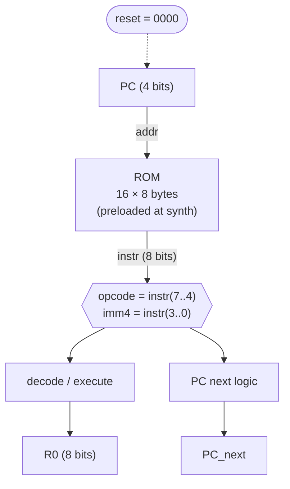

# Project: single-cycle 8-bit CPU

This is the capstone. You'll assemble everything from the earlier modules — a ROM, a register, an ALU, an FSM-ish control — into a tiny machine that actually runs programs.

## The machine



This is topic 3.5 in the ESCOM *Arquitectura de Computadoras* course — the point where the ALU, register, ROM, and control logic from the earlier blocks come together into one working RISC machine.

## The single-cycle contract

Everything hangs on one rule: **in a single-cycle design, one instruction finishes every clock period.** Within a single tick the hardware must, combinationally, fetch the instruction the PC points at, decode it, run it through the ALU, and work out the next PC — and only on the rising edge do the *state* elements (PC, R0, the halt flag) latch their new values.

That's why the ROM read has to be combinational: the address (PC) and the data (instr) must both be valid *before* the clock edge, in the same cycle. The clock period therefore has to cover the longest path through the whole machine, fetch to writeback. Simple to reason about, but it caps your clock speed — which is exactly the motivation for pipelining later.

## What the scaffold gives you

A complete, working CPU. Read the starter carefully:

```vhdl
process(clk, reset)
begin
  if reset = '1' then
    pc   <= (others => '0');
    r0   <= (others => '0');
    halt <= '0';
  elsif rising_edge(clk) then
    if halt = '0' then
      case instr(7 downto 4) is
        when "0000" => r0 <= resize(unsigned(instr(3 downto 0)), 8); pc <= pc + 1;
        when "0001" => r0 <= r0 + resize(unsigned(instr(3 downto 0)), 8); pc <= pc + 1;
        when "0010" => pc <= unsigned(instr(3 downto 0));
        when "1111" => halt <= '1';
        when others => pc <= pc + 1;
      end case;
    end if;
  end if;
end process;
```

It already implements:

- LOAD (`0000`)
- ADD  (`0001`)
- JUMP (`0010`)
- HALT (`1111`)

The preloaded ROM runs `R0 = 3; R0 += 4; R0 += 2; HALT`.

## Your job

Run it as-is first. Simulate for 200 µs with the bundled clock + reset stimulus. On the Waveforms tab you should see `r0_out` step through `3 → 7 → 9`, then `halted` go high and stay high.

Once the baseline works, **extend** the ISA:

### Task 1: SUB

Opcode `0011`. `R0 <= R0 - imm4`. One-line change.

### Task 2: Conditional jump

Opcode `0100`: `JZ addr` — jump to `addr` if `R0 = 0`, otherwise just `pc <= pc + 1`.

Here's a worked loop that counts `R0` down to zero and then halts. Subtract 1 each pass; when `R0` hits 0, `JZ` falls through to the `HALT`:

```
0: 03   LOAD R0, #3     -- R0 = 3
1: 31   SUB  R0, #1     -- R0 = R0 - 1   (opcode 0011 from Task 1)
2: 44   JZ   #4         -- if R0 = 0 jump to addr 4, else fall through
3: 21   JUMP #1         -- go back and subtract again
4: F0   HALT
```

Trace it: R0 steps 3 → 2 → 1 → 0, and only on the pass where R0 reached 0 does `JZ` take the branch to the `HALT`. Watch `r0_out` on the Waveforms tab to confirm the countdown before trusting the branch logic.

The decode for `JZ` is just a conditional next-PC:

```vhdl
when "0100" =>
  if r0 = 0 then
    pc <= unsigned(instr(3 downto 0));   -- taken
  else
    pc <= pc + 1;                        -- fall through
  end if;
```

### Task 3: A second register

Add `r1` as a second 8-bit register. Define `LOAD R1, #i` as opcode `0101` and `ADD R0, R1` (no immediate) as opcode `0110`. You'll need to widen the decode case and add a second output port for visibility.

### Task 4: External data memory

Hook the RAM module from the Memories track into this CPU. Add `LOAD R0, [addr]` and `STORE R0, [addr]` opcodes. Here's the real trap, and it's worth understanding rather than copying past: a single-cycle `LOAD` needs the RAM's data valid *in the same cycle* it issues the address. That only works with a **combinational (asynchronous) read** — the address goes in, the data comes out with no clock edge in between (small distributed/LUT RAM on an FPGA can do this). A **synchronous (registered) read**, which is what block RAM gives you, returns the data on the *next* clock edge — so your `LOAD` would latch stale data and silently read the wrong value. If you must use block RAM, the honest fix is to let `LOAD` take an extra cycle (a mini multi-cycle instruction), not to pretend the read is ready. Stores are easier: a write is already an edge-triggered event, so a registered write fits the single-cycle model fine.

## Why do this?

Because the first time you watch your CPU step through a program you wrote (in bytes you wrote into a ROM), something clicks. Every abstraction on top — assembler, compiler, operating system — stands on exactly this mechanism. And every one of them, all the way up to the web browser running the JavaScript you wrote last week, is the same trick repeated at larger scale.

## Going further

- Implement the classic five-stage pipeline on this same ISA. Add hazard detection and a forwarding unit. You now have a microscale version of what RISC-V textbooks teach.
- Retarget the ROM: instead of constants, load it from an external file at simulation time, then build a toolchain that assembles text into those bytes.
- Drop in the UART TX from the earlier project and make the CPU print `'HI'` to the waveform. Congratulations — you have a SoC.

## What to remember

- A single-cycle CPU does the whole fetch-to-writeback journey combinationally in one clock period; only PC, R0, and halt latch on the rising edge.
- Adding an instruction is a new branch in the opcode `case` — extend the decode, add any new state (registers) and output ports for visibility.
- Conditional branches (`JZ`) are just the next-PC logic reading a flag: take the target or fall through to `pc + 1`.
- Memory timing is the classic single-cycle gotcha: combinational read for same-cycle loads; a synchronous block-RAM read returns data a cycle late and must be accounted for.
