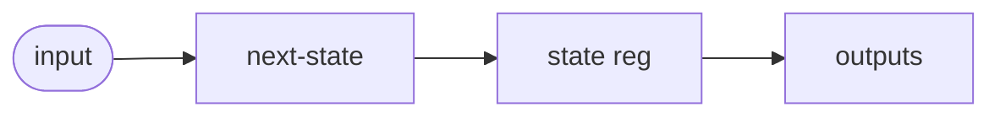
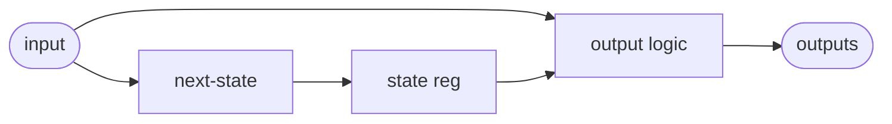

# Mealy vs Moore machines

A finite-state machine (FSM) is control logic that remembers what it's currently doing. Every FSM has:

- A **state register** (a group of flip-flops).
- **Next-state logic** (combinational, decides what the state will be on the next clock edge).
- **Output logic** (combinational, decides what the outputs are right now).

Where the output logic looks for its inputs splits FSMs into two families.

## Moore: outputs depend on state only



Given a state, the output is fixed. If you're in `S_GREEN`, `green = '1'`. Always. Regardless of what the input looks like.

**Pros**
- Outputs only change at clock edges → no glitches.
- Easy to reason about, easy to debug, easy to verify.

**Cons**
- At least one clock cycle of latency between input and output (the state has to transition first).
- Sometimes you need more states to encode the same behavior as a Mealy machine.

## Mealy: outputs depend on state + input



Outputs are a function of the current state **and** the current input. They can change between clock edges.

**Pros**
- Faster — outputs can react to an input in the same cycle, not the next.
- Often needs fewer states.

**Cons**
- Outputs can glitch (follow the combinational input).
- Harder to debug when outputs don't line up with clock edges.

## Which one should you use?

**Default: Moore.** The glitch-freeness and edge-aligned outputs make designs predictable. For control logic inside a CPU, a memory controller, or anything safety-relevant, Moore is the safer choice.

**Reach for Mealy when** you need to react within the same clock cycle, or when the extra Moore states would balloon the design. UART and protocol engines often end up Mealy for the reaction-time argument.

## How Kmila supports them

Both styles drop into the same **two-process pattern** you'll see in the traffic-light sample:

```vhdl
-- Process 1: state register (always Moore-safe)
process(clk, reset)
begin
  if reset = '1' then
    state <= S_IDLE;
  elsif rising_edge(clk) then
    state <= next_state;
  end if;
end process;

-- Process 2: combinational next-state + outputs
process(state, input)
begin
  ...
end process;
```

For a Moore machine, the outputs only look at `state`. For a Mealy machine, they look at `state` and `input`.

## What to remember

- Moore: output is a function of state alone. Glitch-free.
- Mealy: output is a function of state + input. Faster.
- Start with Moore; move to Mealy when you have a specific reason.
