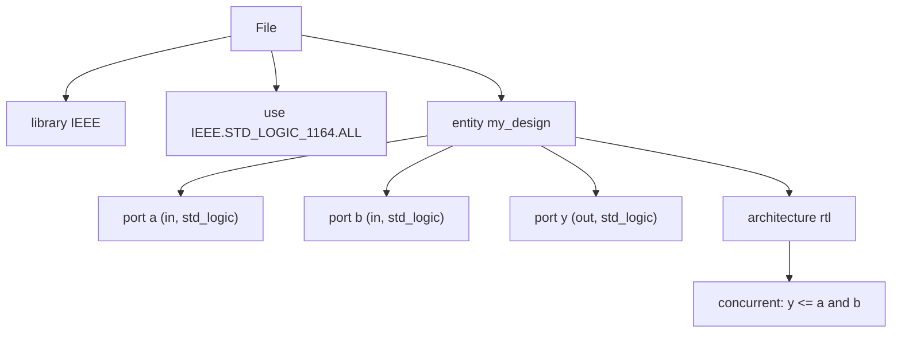

# Anatomy of a VHDL file

Every VHDL file has the same four sections, always in the same order. Once you recognise the shape, reading unfamiliar code stops being intimidating — you just know where to look for each piece. This is exactly the "estructura de un programa en HDL" that the course asks you to master before you write anything useful.

## The four sections

```vhdl
library IEEE;                          -- 1. libraries
use IEEE.STD_LOGIC_1164.ALL;           -- 2. packages in use

entity my_design is                    -- 3. entity (the "header")
  port (
    a : in  std_logic;
    b : in  std_logic;
    y : out std_logic
  );
end entity my_design;

architecture rtl of my_design is       -- 4. architecture (the "body")
begin
  y <= a and b;
end architecture rtl;
```

Let's go through each one.

### 1. `library`

`library IEEE;` makes the logical library named `IEEE` visible to your file. It's the digital-design equivalent of `#include <stdio.h>` — almost every file you'll ever write starts with it.

One subtlety worth knowing early: the library `STD` (which defines the built-in types `boolean`, `integer`, `character`, `bit`, and so on) and your own `WORK` library are *always* visible. You never write `library STD;`. You only name `IEEE` because the logic types you actually want live there.

### 2. `use`

`use IEEE.STD_LOGIC_1164.ALL;` pulls every name from the `STD_LOGIC_1164` package into scope. That's what gives you `std_logic`, `std_logic_vector`, `rising_edge()`, and the logic operators on those types.

You'll often see a second `use`:

```vhdl
use IEEE.NUMERIC_STD.ALL;
```

That one gives you `unsigned`, `signed`, `to_integer`, `resize`, and arithmetic for vector types. Add it whenever you do arithmetic on vectors. Avoid the old `std_logic_arith` / `std_logic_unsigned` packages you may find in tutorials online — they were never part of the IEEE standard, and mixing them with `numeric_std` leads to ambiguous overloads.

### 3. `entity`

The entity is the **black-box interface**. It says:

- what the design is called (`my_design`)
- what ports it has
- for each port: its **mode** (`in`, `out`, `inout`, `buffer`) and its **type**

| Mode | Can you read it inside? | Can you drive it? |
|------|-------------------------|-------------------|
| `in`     | yes | no |
| `out`    | yes (VHDL-2008+) | yes |
| `inout`  | yes | yes (bidirectional / tristate) |
| `buffer` | yes | yes (single internal driver) |

Everything inside `port (…)` is what the outside world sees. Nothing about *how* the design works is declared here. An entity may also carry **generics** — compile-time parameters such as a bus width — which we'll use later to make designs reusable.

### 4. `architecture`

The architecture is the **implementation**. An entity can have multiple architectures for the same interface — you might have `rtl`, `behavioral`, and `tb` architectures of the same `cpu` entity and pick one per configuration. In practice, most files have exactly one.

The part between the `architecture` line and `begin` is the **declarative region** — where internal signals, constants, and types live. The part between `begin` and `end architecture` is the **statement region** — where signals and gates actually get described.

## How Kmila parses this

Kmila's VHDL parser reads your file top-to-bottom and builds a tree:



When you click **Build**, the ports become the entries in the **Ports** dock tab, the entity becomes the entry in **Entities**, and the assignments inside the architecture become the wiring the simulator runs.

## Naming conventions

VHDL is case-insensitive. `SIGNAL`, `Signal`, and `signal` are the same keyword, and `My_Design` and `my_design` name the same thing. (The one exception is characters inside string and character literals — `'0'` and `'1'` are literal values, not keywords.) Keep a single style in a given file — most teams use **lowercase** for keywords and signal names, **snake_case** for identifiers, and **UPPER_CASE** for constants.

## Common first-file mistakes

- **Forgetting the `use` clause.** `library IEEE;` on its own does *not* bring in `std_logic`. Without the `use IEEE.STD_LOGIC_1164.ALL;` line, the compiler reports an "unknown type `std_logic`" error.
- **Mismatched closing names.** `end entity foo;` must match `entity foo`. The name after `end` is optional but, when present, must be correct.
- **A trailing semicolon or comma inside the last port.** The last port in a `port (…)` list has no trailing `;` before the closing paren.

## What to remember

- `library` + `use` — your imports. `library IEEE;` alone is not enough; you need the `use` clause too.
- `entity` — the interface: ports, their modes, and generics.
- `architecture` — the implementation, split into a declarative region (before `begin`) and a statement region (after it).
- An entity can have multiple architectures; most projects ship one called `rtl`.
