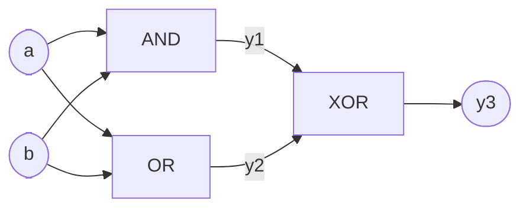

# El hardware es paralelo

Quienes vienen de C, Python o JavaScript traen el mismo modelo mental: "el código corre de arriba abajo, una sentencia a la vez". VHDL te va a castigar por esa suposición hasta que construyas el modelo correcto.

## El gran cambio

Mira esta arquitectura:

```vhdl
architecture rtl of demo is
begin
  y1 <= a and b;
  y2 <= a or  b;
  y3 <= y1 xor y2;
end architecture rtl;
```

En software leerías esto como tres pasos secuenciales. En VHDL, las tres líneas describen **cables que existen al mismo tiempo**. No se ejecutan en orden — existen.

El sintetizador construye:



Las tres compuertas están encendidas al mismo tiempo. Cuando `a` o `b` cambia, la salida `y3` se estabiliza en su nuevo valor tras un pequeño retraso de propagación por el camino más largo. No hay "primero" ni "segundo".

## Por qué el orden no importa

Podrías escribir las tres líneas en cualquier orden:

```vhdl
y3 <= y1 xor y2;   -- ¿referencia antes de "declaración"?
y1 <= a and b;
y2 <= a or  b;
```

Sigue siendo VHDL válido. Las tres asignaciones describen tres cables, y a los cables no les importa el orden en que dibujaste el esquemático. La herramienta lee las tres y los cablea.

## Dónde vuelve lo "secuencial"

Dentro de un `process`, las cosas **sí** son secuenciales — dentro de ese proceso, una sentencia a la vez, de arriba abajo. Pero un proceso como un todo sigue siendo una unidad concurrente más al lado de las demás.

```vhdl
architecture rtl of demo is
begin

  -- Concurrente 1
  y1 <= a and b;

  -- Concurrente 2 (un proceso, que internamente es secuencial)
  process(clk)
  begin
    if rising_edge(clk) then
      counter <= counter + 1;
    end if;
  end process;

  -- Concurrente 3
  y2 <= a or b;

end architecture rtl;
```

Las tres unidades concurrentes están vivas al mismo tiempo. Cada una corre cuando cambian sus entradas. Dentro del proceso, el cuerpo se lee en orden, pero es una propiedad local del proceso, no de la arquitectura.

## Una consecuencia concreta

Este diseño tiene una carrera sutil:

```vhdl
architecture wrong of demo is
  signal a, b : std_logic;
begin
  a <= not b;
  b <= not a;
end architecture wrong;
```

Leído como software, parece "pon `a` en no-b, luego pon `b` en no-a" — no pasa nada. Leído como hardware, son dos inversores cableados en un lazo. Eso es un **oscilador** — un anillo de retroalimentación que no puede estabilizarse. La simulación se queja, la síntesis (a veces) lo optimiza, y la placa glitchea impredeciblemente.

## El recableado mental

- Deja de pensar "¿qué corre primero?"
- Empieza a pensar "¿qué cables existen?"
- Dentro de un proceso vuelve el "uno a la vez" — pero solo dentro de ese proceso.

Una vez que esto hace clic, VHDL deja de pelearse contigo. Lees una arquitectura y ves de inmediato el esquemático que representa, no la "ejecución del programa" que imaginabas antes.
