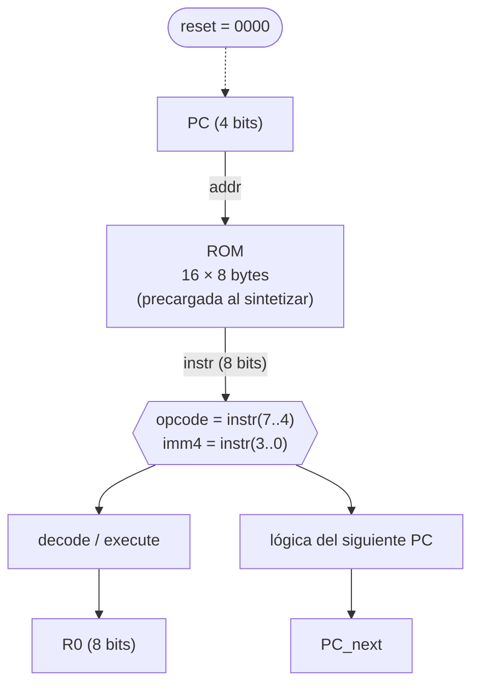

# Proyecto: CPU de 8 bits monociclo

Este es el proyecto culminante. Vas a ensamblar todo lo de los módulos anteriores — una ROM, un registro, una ALU, un control tipo FSM — en una máquina pequeña que de verdad ejecuta programas.

## La máquina



Este es el tema 3.5 del curso de *Arquitectura de Computadoras* de ESCOM — el punto donde la ALU, el registro, la ROM y la lógica de control de los bloques anteriores se juntan en una máquina RISC funcional.

## El contrato del monociclo

Todo cuelga de una sola regla: **en un diseño monociclo, una instrucción termina en cada período de reloj.** Dentro de un solo tick el hardware debe, combinacionalmente, hacer fetch de la instrucción a la que apunta el PC, decodificarla, pasarla por la ALU y calcular el siguiente PC — y solo en el flanco de subida los elementos de *estado* (PC, R0, la bandera de halt) capturan sus valores nuevos.

Por eso la lectura de la ROM tiene que ser combinacional: la dirección (PC) y el dato (instr) deben ser válidos *antes* del flanco de reloj, en el mismo ciclo. El período de reloj por lo tanto tiene que cubrir el camino más largo por toda la máquina, de fetch a writeback. Simple de razonar, pero limita tu frecuencia de reloj — que es justamente la motivación para la segmentación más adelante.

## Qué te da el andamiaje

Un CPU completo y funcional. Lee el código inicial con atención:

```vhdl
process(clk, reset)
begin
  if reset = '1' then
    pc   <= (others => '0');
    r0   <= (others => '0');
    halt <= '0';
  elsif rising_edge(clk) then
    if halt = '0' then
      case instr(7 downto 4) is
        when "0000" => r0 <= resize(unsigned(instr(3 downto 0)), 8); pc <= pc + 1;
        when "0001" => r0 <= r0 + resize(unsigned(instr(3 downto 0)), 8); pc <= pc + 1;
        when "0010" => pc <= unsigned(instr(3 downto 0));
        when "1111" => halt <= '1';
        when others => pc <= pc + 1;
      end case;
    end if;
  end if;
end process;
```

Ya implementa:

- LOAD (`0000`)
- ADD  (`0001`)
- JUMP (`0010`)
- HALT (`1111`)

La ROM precargada ejecuta `R0 = 3; R0 += 4; R0 += 2; HALT`.

## Tu trabajo

Ejecútalo tal cual primero. Simula 200 µs con el estímulo de reloj + reset incluido. En la pestaña de formas de onda deberías ver `r0_out` pasar por `3 → 7 → 9`, y luego `halted` ponerse en alto y quedarse ahí.

Cuando la base funcione, **extiende** la ISA:

### Tarea 1: SUB

Opcode `0011`. `R0 <= R0 - imm4`. Cambio de una línea.

### Tarea 2: Jump condicional

Opcode `0100`: `JZ addr` — salta a `addr` si `R0 = 0`, si no solo `pc <= pc + 1`.

Aquí tienes un bucle resuelto que cuenta `R0` hacia atrás hasta cero y después se detiene. Resta 1 en cada pasada; cuando `R0` llega a 0, `JZ` cae de frente al `HALT`:

```
0: 03   LOAD R0, #3     -- R0 = 3
1: 31   SUB  R0, #1     -- R0 = R0 - 1   (opcode 0011 de la Tarea 1)
2: 44   JZ   #4         -- si R0 = 0 salta a la addr 4, si no sigue de frente
3: 21   JUMP #1         -- regresa y vuelve a restar
4: F0   HALT
```

Síguelo: R0 baja 3 → 2 → 1 → 0, y solo en la pasada donde R0 llegó a 0 es que `JZ` toma el salto al `HALT`. Observa `r0_out` en la pestaña de formas de onda para confirmar la cuenta regresiva antes de confiar en la lógica del salto.

La decodificación de `JZ` no es más que un siguiente-PC condicional:

```vhdl
when "0100" =>
  if r0 = 0 then
    pc <= unsigned(instr(3 downto 0));   -- tomado
  else
    pc <= pc + 1;                        -- sigue de frente
  end if;
```

### Tarea 3: Un segundo registro

Agrega `r1` como un segundo registro de 8 bits. Define `LOAD R1, #i` como opcode `0101` y `ADD R0, R1` (sin inmediato) como opcode `0110`. Tendrás que ampliar el `case` de decodificación y agregar un segundo puerto de salida para visibilidad.

### Tarea 4: Memoria de datos externa

Conecta el módulo de RAM del track de Memorias a este CPU. Agrega los opcodes `LOAD R0, [addr]` y `STORE R0, [addr]`. Aquí está la trampa real, y vale la pena entenderla en lugar de copiar y pegar: un `LOAD` monociclo necesita que el dato de la RAM sea válido *en el mismo ciclo* en que emite la dirección. Eso solo funciona con una **lectura combinacional (asíncrona)** — entra la dirección y el dato sale sin un flanco de reloj de por medio (la RAM pequeña distribuida/LUT de una FPGA puede hacer esto). Una **lectura síncrona (registrada)**, que es lo que da el block RAM, regresa el dato en el *siguiente* flanco de reloj — así que tu `LOAD` capturaría datos viejos y leería silenciosamente el valor equivocado. Si tienes que usar block RAM, el arreglo honesto es dejar que `LOAD` tome un ciclo extra (una mini instrucción multiciclo), no fingir que la lectura ya está lista. Los stores son más fáciles: una escritura ya es un evento disparado por flanco, así que una escritura registrada encaja bien en el modelo monociclo.

## ¿Por qué hacer esto?

Porque la primera vez que veas a tu CPU avanzar por un programa que tú escribiste (en bytes que tú pusiste en una ROM), algo hace clic. Toda abstracción por encima — ensamblador, compilador, sistema operativo — se apoya exactamente en este mecanismo. Y cada una de ellas, hasta el navegador web que ejecuta el JavaScript que escribiste la semana pasada, es el mismo truco repetido a mayor escala.

## Para ir más lejos

- Implementa el pipeline clásico de cinco etapas sobre esta misma ISA. Agrega detección de riesgos (hazards) y una unidad de adelantamiento (forwarding). Ya tienes una versión a microescala de lo que enseñan los libros de RISC-V.
- Reapunta la ROM: en lugar de constantes, cárgala desde un archivo externo en tiempo de simulación, y luego construye una cadena de herramientas que ensamble texto hacia esos bytes.
- Conéctale el TX de UART del proyecto anterior y haz que el CPU imprima `'HI'` en la forma de onda. Felicidades — tienes un SoC.

## Qué recordar

- Un CPU monociclo hace todo el recorrido de fetch a writeback combinacionalmente en un período de reloj; solo PC, R0 y halt capturan en el flanco de subida.
- Agregar una instrucción es una nueva rama en el `case` del opcode — amplía la decodificación, agrega cualquier estado nuevo (registros) y puertos de salida para visibilidad.
- Los saltos condicionales (`JZ`) no son más que la lógica del siguiente-PC leyendo una bandera: toma el destino o sigue de frente a `pc + 1`.
- La temporización de memoria es el clásico tropiezo del monociclo: lectura combinacional para loads del mismo ciclo; una lectura síncrona de block RAM regresa el dato un ciclo tarde y hay que tomarlo en cuenta.
