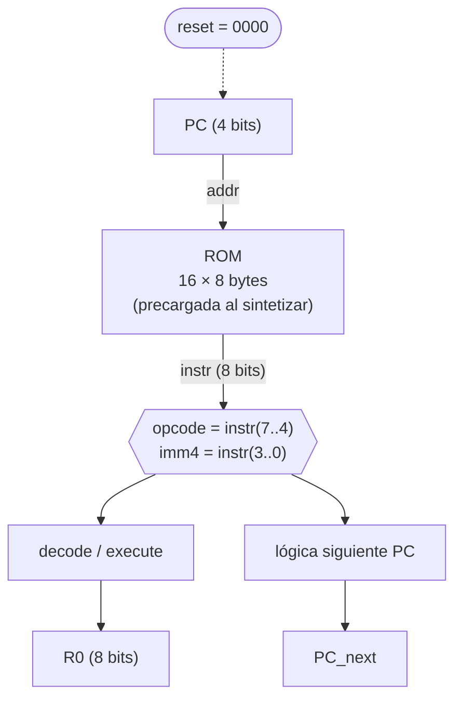

# Proyecto: CPU de 8 bits monociclo

Este es el capstone. Vas a ensamblar todo lo aprendido — una ROM, un registro, una ALU, una FSM-como-control — en una máquina pequeña que de verdad ejecuta programas.

## La máquina



## Qué te da el andamiaje

Un CPU completo y funcional. Lee con atención:

```vhdl
process(clk, reset)
begin
  if reset = '1' then
    pc   <= (others => '0');
    r0   <= (others => '0');
    halt <= '0';
  elsif rising_edge(clk) then
    if halt = '0' then
      case instr(7 downto 4) is
        when "0000" => r0 <= resize(unsigned(instr(3 downto 0)), 8); pc <= pc + 1;
        when "0001" => r0 <= r0 + resize(unsigned(instr(3 downto 0)), 8); pc <= pc + 1;
        when "0010" => pc <= unsigned(instr(3 downto 0));
        when "1111" => halt <= '1';
        when others => pc <= pc + 1;
      end case;
    end if;
  end if;
end process;
```

Ya implementa:

- LOAD (`0000`)
- ADD  (`0001`)
- JUMP (`0010`)
- HALT (`1111`)

La ROM preinicializada ejecuta `R0 = 3; R0 += 4; R0 += 2; HALT`.

## Tu trabajo

Ejecútalo tal cual primero. Simula 200 µs con el reloj y reset incluidos. En la pestaña de formas de onda verás `r0_out` pasando por `3 → 7 → 9`, y luego `halted` quedando en alto.

Cuando la base funcione, **extiende** la ISA:

### Tarea 1: SUB

Opcode `0011`. `R0 <= R0 - imm4`. Cambio de una línea.

### Tarea 2: Jump condicional

Opcode `0100`: `JZ addr` — salta a `addr` si `R0 = 0`, si no solo `pc <= pc + 1`.

Escribe un programa que cuente atrás desde un valor y salte cuando llegue a 0. Usa `JZ` como salida del bucle.

### Tarea 3: Un segundo registro

Agrega `r1` como segundo registro de 8 bits. Define `LOAD R1, #i` como opcode `0101` y `ADD R0, R1` (sin inmediato) como opcode `0110`. Tendrás que extender el `case` y agregar un puerto de salida para visibilidad.

### Tarea 4: Memoria de datos externa

Conecta el módulo de RAM del track de Memorias a este CPU. Añade `LOAD R0, [addr]` y `STORE R0, [addr]`. Cuidado: un diseño monociclo requiere que el puerto de lectura tenga su salida válida en el mismo ciclo que emites la dirección — usa lectura combinacional para la ROM y lectura registrada para la RAM de datos, y planea el pipeline con cuidado.

## Por qué hacer esto

Porque la primera vez que veas tu CPU avanzar por un programa que tú escribiste (en bytes que tú pusiste en una ROM), algo hace clic. Toda abstracción por encima — ensamblador, compilador, sistema operativo — se apoya en este mecanismo. Y cada una, hasta el navegador ejecutando el JavaScript que escribiste la semana pasada, es el mismo truco repetido a escala.

## Más lejos

- Implementa el pipeline clásico de cinco etapas sobre esta ISA. Agrega detección de hazards y una unidad de forwarding. Ya tienes una versión microescala de lo que enseñan los libros de RISC-V.
- Cambia la ROM: en lugar de constantes, cárgala desde un archivo en simulación, y luego construye un ensamblador que convierta texto a bytes.
- Conéctale el TX de UART del proyecto anterior y haz que el CPU imprima `'HI'` en la forma de onda. Felicidades — tienes un SoC.
