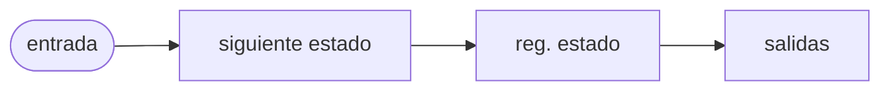
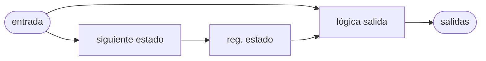

# Máquinas Mealy vs Moore

Una máquina de estados finitos (FSM) es lógica de control que recuerda qué está haciendo en este momento. Formalmente es un autómata determinista: un conjunto finito de estados, una función de transición que elige el siguiente estado a partir del estado actual y las entradas, y una función de salida. Toda FSM síncrona que construyas tiene tres partes:

- Un **registro de estado** (un grupo de flip-flops) — lo único que tiene memoria.
- **Lógica de siguiente estado** (combinacional, decide qué estado será en el próximo flanco de reloj).
- **Lógica de salida** (combinacional, decide cuáles son las salidas en este momento).

De dónde toma sus entradas la lógica de salida divide a las FSM en dos familias.

## Moore: las salidas dependen solo del estado



Dado un estado, la salida está fija. Si estás en `S_GREEN`, `green = '1'`. Siempre. Sin importar cómo se vea la entrada.

**Pros**
- Las salidas solo cambian en los flancos de reloj → sin glitches.
- Fáciles de razonar, fáciles de depurar, fáciles de verificar.

**Contras**
- Al menos un ciclo de reloj de latencia entre la entrada y la salida (el estado tiene que transicionar primero).
- A veces necesitas más estados para codificar el mismo comportamiento que una máquina Mealy.

## Mealy: las salidas dependen del estado + la entrada



Las salidas son función del estado **y** de la entrada actuales. Pueden cambiar entre flancos de reloj.

**Pros**
- Más rápida — las salidas pueden reaccionar a una entrada en el mismo ciclo, no en el siguiente.
- Suele necesitar menos estados.

**Contras**
- Las salidas pueden glitchar (siguen a la entrada combinacional).
- Más difícil de depurar cuando las salidas no se alinean con los flancos de reloj.

Una forma rápida de sentir la diferencia: el mismo trabajo de "detectar un `1` en la entrada" es un solo estado en Mealy (activas la salida en la transición que *ve* el `1`), pero necesita un estado extra de "acabo de ver un 1" en Moore (para poder ligar la salida a *estar* en ese estado). Mismo comportamiento, distinto número de estados, con un ciclo de diferencia en el tiempo.

## Uno, dos o tres procesos

VHDL te da varias maneras de escribir la misma máquina. Todas sintetizan al mismo hardware; se diferencian en la legibilidad y en qué tan fácil es equivocarse con ellas.

- **Un proceso:** el registro de estado *y* las salidas viven en un solo proceso con reloj. Todo queda registrado, así que las salidas son naturalmente libres de glitches (estilo Moore, registradas). Compacto, pero la lógica de siguiente estado y la de salida quedan enredadas.
- **Dos procesos (el valor por defecto recomendado):** un proceso con reloj mantiene el registro de estado; un proceso combinacional calcula `next_state` y las salidas. Es el patrón que usan los ejemplos de Kmila — se mapea limpiamente sobre el esquema de tres partes de arriba.
- **Tres procesos:** el registro de estado, la lógica de siguiente estado y la lógica de salida tienen cada uno su propio proceso. El más verboso, pero con la separación más clara y el más difícil de romper por accidente.

## La trampa en la que todos caen: latches inferidos

En un proceso *combinacional*, cada señal que manejas debe recibir un valor en **cada** camino que atraviesa el proceso. Si una rama de un `case` o un `if` olvida asignar `next_state` (o una salida), la síntesis tiene que *recordar* el valor anterior — y lo único que recuerda en lógica combinacional es un **latch**. Los latches casi nunca son lo que quieres: son sensibles al nivel, difíciles de temporizar y una fuente clásica de "funciona en simulación, falla en silicio".

El arreglo es de una sola línea: asigna un **valor por defecto** a cada señal al inicio del proceso, antes del `case`.

```vhdl
process(state, input)
begin
  next_state <= state;   -- por defecto: quedarse donde está
  green      <= '0';     -- pon también un valor por defecto a cada salida
  case state is
    when S_IDLE  => if input = '1' then next_state <= S_RUN; end if;
    when S_RUN   => green <= '1';
                    next_state <= S_IDLE;
  end case;
end process;
```

Ahora, aunque una rama "olvide" una asignación, el valor por defecto la cubre — sin latch. (Toma en cuenta que VHDL exige que las opciones del `case` sean exhaustivas, así que a menudo agregarás `when others =>`; eso satisface al compilador, pero es la *asignación por defecto* lo que de verdad te salva de los latches.)

## Codificación de estados

Escribes los estados con nombre usando un tipo enumerado y dejas que la herramienta elija los bits:

```vhdl
type state_t is (S_IDLE, S_RUN, S_DONE);
signal state, next_state : state_t;
```

El sintetizador elige una codificación — **binaria** (menos flip-flops), **one-hot** (un flip-flop por estado, rápida y amigable con la FPGA) o **Gray** (cambia un solo bit por paso, buena para transiciones de bajo ruido). En las FPGA la one-hot suele ser la opción por defecto, porque sobran flip-flops y mantiene poco profunda la lógica de siguiente estado. Rara vez necesitas codificar a mano; deja que la herramienta decida, a menos que tengas una razón para no hacerlo.

## ¿Cuál deberías usar?

**Por defecto: Moore.** La ausencia de glitches y las salidas alineadas con los flancos hacen que los diseños sean predecibles. Para lógica de control dentro de un CPU, un controlador de memoria o cualquier cosa relacionada con seguridad, Moore es la opción más segura.

**Usa Mealy cuando** necesites reaccionar dentro del mismo ciclo de reloj, o cuando los estados extra de una Moore inflen el diseño. Los UART y los motores de protocolo suelen terminar siendo Mealy por el argumento del tiempo de reacción. Si te gusta el número de estados de Mealy pero quieres el tiempo limpio de Moore, **registra las salidas Mealy** (pásalas por un flip-flop más) — recuperas salidas libres de glitches, a cambio del ciclo de latencia que querías evitar.

## Relación con la asignatura

Esto es el corazón de la Unidad II, *Diseño de sistemas digitales*: el autómata determinista con y sin salida, los modelos Mealy y Moore, y su descripción en HDL. En papel también las construirás a partir de flip-flops JK / SR / T / D y las reducirás con métodos de reducción de estados (implicantes primos / tabular) — el estilo de tipo enumerado que ves aquí es la contraparte en HDL de ese mismo diagrama de estados.

## Qué recordar

- Moore: la salida es función solo del estado. Libre de glitches, con un ciclo de latencia.
- Mealy: la salida es función del estado + la entrada. Más rápida, puede glitchar — registra las salidas si eso importa.
- Usa el patrón de dos procesos, y **asígnale un valor por defecto a cada señal** al inicio del proceso combinacional para evitar latches inferidos.
- Deja que la herramienta elija la codificación de estados (one-hot es común en las FPGA); empieza con Moore y pásate a Mealy por una razón específica.
