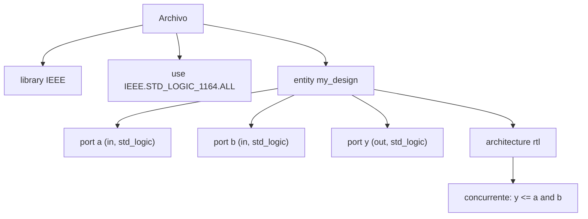

# Anatomía de un archivo VHDL

Todo archivo VHDL tiene las mismas cuatro secciones, siempre en el mismo orden. Una vez que reconoces la forma, leer código ajeno deja de intimidar — simplemente sabes dónde buscar cada pieza. Esta es justo la "estructura de un programa en HDL" que el curso te pide dominar antes de escribir algo útil.

## Las cuatro secciones

```vhdl
library IEEE;                          -- 1. bibliotecas
use IEEE.STD_LOGIC_1164.ALL;           -- 2. paquetes que se usarán

entity my_design is                    -- 3. entidad (el "encabezado")
  port (
    a : in  std_logic;
    b : in  std_logic;
    y : out std_logic
  );
end entity my_design;

architecture rtl of my_design is       -- 4. arquitectura (el "cuerpo")
begin
  y <= a and b;
end architecture rtl;
```

Repasemos cada una.

### 1. `library`

`library IEEE;` hace visible la biblioteca lógica llamada `IEEE` dentro de tu archivo. Es el equivalente, en diseño digital, de `#include <stdio.h>` — casi todo archivo que escribas empieza con esto.

Un detalle que conviene saber desde temprano: la biblioteca `STD` (que define los tipos integrados `boolean`, `integer`, `character`, `bit`, etcétera) y tu propia biblioteca `WORK` están *siempre* visibles. Nunca escribes `library STD;`. Solo nombras `IEEE` porque los tipos de lógica que realmente quieres viven ahí.

### 2. `use`

`use IEEE.STD_LOGIC_1164.ALL;` trae cada nombre del paquete `STD_LOGIC_1164` al ámbito actual. Es lo que te da `std_logic`, `std_logic_vector`, `rising_edge()` y los operadores lógicos sobre esos tipos.

Muchas veces verás un segundo `use`:

```vhdl
use IEEE.NUMERIC_STD.ALL;
```

Ese te da `unsigned`, `signed`, `to_integer`, `resize` y aritmética para tipos de vector. Agrégalo cuando hagas aritmética con vectores. Evita los viejos paquetes `std_logic_arith` / `std_logic_unsigned` que quizá encuentres en tutoriales en línea — nunca fueron parte del estándar IEEE, y mezclarlos con `numeric_std` lleva a sobrecargas ambiguas.

### 3. `entity`

La entidad es la **interfaz de caja negra**. Dice:

- cómo se llama el diseño (`my_design`)
- qué puertos tiene
- para cada puerto: su **modo** (`in`, `out`, `inout`, `buffer`) y su **tipo**

| Modo | ¿Lo puedes leer adentro? | ¿Lo puedes manejar (driver)? |
|------|--------------------------|------------------------------|
| `in`     | sí | no |
| `out`    | sí (VHDL-2008+) | sí |
| `inout`  | sí | sí (bidireccional / tristate) |
| `buffer` | sí | sí (un solo driver interno) |

Todo lo que está dentro de `port (…)` es lo que ve el mundo exterior. Nada sobre *cómo* funciona el diseño se declara aquí. Una entidad también puede llevar **genéricos** — parámetros de tiempo de compilación, como el ancho de un bus — que usaremos más adelante para hacer diseños reutilizables.

### 4. `architecture`

La arquitectura es la **implementación**. Una entidad puede tener varias arquitecturas para la misma interfaz — podrías tener las arquitecturas `rtl`, `behavioral` y `tb` de la misma entidad `cpu` y elegir una por configuración. En la práctica, la mayoría de los archivos trae exactamente una.

La parte entre la línea `architecture` y `begin` es la **región declarativa** — donde viven las señales internas, las constantes y los tipos. La parte entre `begin` y `end architecture` es la **región de sentencias** — donde realmente se describen las señales y las compuertas.

## Cómo parsea esto Kmila

El parser de VHDL de Kmila lee tu archivo de arriba abajo y construye un árbol:



Al pulsar **Compilar**, los puertos se vuelven las entradas de la pestaña **Puertos** del dock, la entidad aparece en **Entidades**, y las asignaciones dentro de la arquitectura se convierten en el cableado que ejecuta el simulador.

## Convenciones de nombres

VHDL no distingue mayúsculas de minúsculas. `SIGNAL`, `Signal` y `signal` son la misma palabra clave, y `My_Design` y `my_design` nombran la misma cosa. (La única excepción son los caracteres dentro de literales de cadena y de carácter — `'0'` y `'1'` son valores literales, no palabras clave.) Mantén un solo estilo en cada archivo — la mayoría de los equipos usa **minúsculas** para keywords y nombres de señal, **snake_case** para identificadores y **MAYÚSCULAS** para constantes.

## Errores típicos del primer archivo

- **Olvidar la cláusula `use`.** `library IEEE;` por sí sola *no* trae `std_logic`. Sin la línea `use IEEE.STD_LOGIC_1164.ALL;`, el compilador reporta un error de "tipo `std_logic` desconocido".
- **Nombres de cierre que no coinciden.** `end entity foo;` debe coincidir con `entity foo`. El nombre después de `end` es opcional pero, cuando está, debe ser correcto.
- **Un punto y coma o coma de más en el último puerto.** El último puerto de una lista `port (…)` no lleva `;` antes del paréntesis de cierre.

## Qué recordar

- `library` + `use` — tus imports. `library IEEE;` sola no basta; también necesitas la cláusula `use`.
- `entity` — la interfaz: puertos, sus modos y genéricos.
- `architecture` — la implementación, dividida en una región declarativa (antes de `begin`) y una región de sentencias (después de él).
- Una entidad puede tener varias arquitecturas; la mayoría de los proyectos publica una llamada `rtl`.
