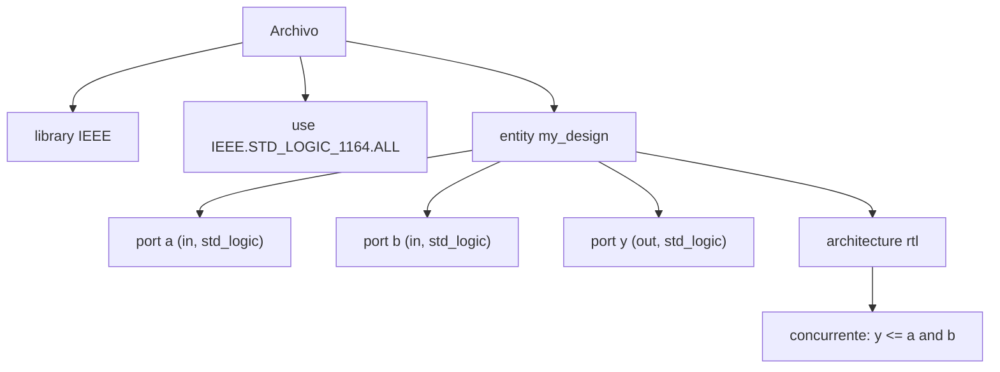

# Anatomía de un archivo VHDL

Todo archivo VHDL tiene las mismas cuatro secciones, siempre en el mismo orden. Una vez que reconoces la forma, leer código ajeno deja de intimidar — sabes dónde buscar cada pieza.

## Las cuatro secciones

```vhdl
library IEEE;                          -- 1. bibliotecas
use IEEE.STD_LOGIC_1164.ALL;           -- 2. paquetes que se usarán

entity my_design is                    -- 3. entidad (el "encabezado")
  port (
    a : in  std_logic;
    b : in  std_logic;
    y : out std_logic
  );
end entity my_design;

architecture rtl of my_design is       -- 4. arquitectura (el "cuerpo")
begin
  y <= a and b;
end architecture rtl;
```

Repasamos cada una.

### 1. `library`

`library IEEE;` importa la biblioteca estándar de IEEE. Es el equivalente digital de `#include <stdio.h>` — casi todo archivo que escribas empieza con esto.

### 2. `use`

`use IEEE.STD_LOGIC_1164.ALL;` trae cada nombre del paquete `STD_LOGIC_1164` al ámbito actual. Es lo que te da `std_logic`, `std_logic_vector`, `rising_edge()` y compañía.

Muchas veces verás un segundo `use`:

```vhdl
use IEEE.NUMERIC_STD.ALL;
```

Ese te da `unsigned`, `signed`, `to_integer`, `resize` y aritmética para tipos de vector. Agrégalo cuando hagas aritmética con vectores.

### 3. `entity`

La entidad es la **interfaz de caja negra**. Dice:

- cómo se llama el diseño (`my_design`)
- qué puertos tiene
- para cada puerto: su **dirección** (`in`, `out`, `inout`, `buffer`) y su **tipo**

Todo lo que está dentro de `port (…)` es lo que ve el mundo exterior. Nada de cómo funciona el diseño va aquí.

### 4. `architecture`

La arquitectura es la **implementación**. Una entidad puede tener varias arquitecturas (para la misma interfaz) — podrías tener `rtl`, `behavioral` y `tb` de la misma entidad `cpu` y elegir una por configuración. En la práctica, la mayoría de los archivos trae exactamente una.

El cuerpo entre `begin` y `end architecture` es donde realmente se describen las señales y las compuertas.

## Cómo parsea esto Kmila

El parser de Kmila lee tu archivo de arriba abajo y construye un árbol:



Al pulsar **Compilar**, los puertos se vuelven entradas en la pestaña **Puertos** del dock, la entidad aparece en **Entidades**, y las asignaciones dentro de la arquitectura se convierten en el cableado que ejecuta el simulador.

## Convenciones de nombres

VHDL no distingue mayúsculas. `SIGNAL`, `Signal` y `signal` son la misma palabra clave. Pero elige un estilo y mantenlo en el archivo — la mayoría usa **minúsculas** para keywords y señales, **snake_case** para identificadores y **MAYÚSCULAS** para constantes.

## Qué recordar

- `library` + `use` — tus imports.
- `entity` — la interfaz (puertos y direcciones).
- `architecture` — la implementación (lo que realmente pasa).
- Una entidad puede tener varias arquitecturas; la mayoría de los proyectos publica una llamada `rtl`.
