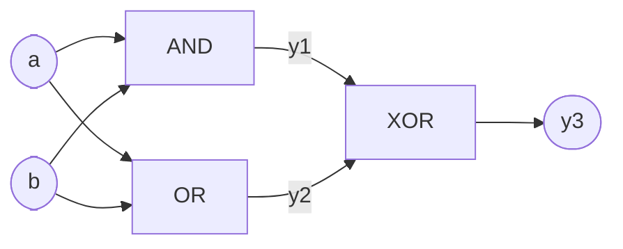

# Le matériel est parallèle

Les étudiants qui viennent de C, Python ou JavaScript ont tous intériorisé le même modèle mental : « le code s'exécute de haut en bas, une instruction à la fois ». VHDL te punira pour cette supposition jusqu'à ce que tu construises le bon modèle mental.

## Le grand changement

Regarde cette architecture :

```vhdl
architecture rtl of demo is
begin
  y1 <= a and b;
  y2 <= a or  b;
  y3 <= y1 xor y2;
end architecture rtl;
```

Dans un langage logiciel, tu lirais ça comme trois étapes séquentielles. En VHDL, les trois lignes décrivent **des fils qui existent simultanément**. Elles ne s'exécutent pas dans l'ordre — elles existent.

Le synthétiseur construit :



Les trois portes sont alimentées en même temps. Quand `a` ou `b` change, la sortie `y3` se stabilise à sa nouvelle valeur après un petit délai de propagation le long du chemin le plus long. Il n'y a pas de « premier » ni de « second ».

## Pourquoi l'ordre n'a pas d'importance

Tu pourrais écrire les trois lignes dans n'importe quel ordre :

```vhdl
y3 <= y1 xor y2;   -- référence avant "déclaration" ?
y1 <= a and b;
y2 <= a or  b;
```

C'est toujours du VHDL valide. Les trois assignations décrivent trois fils, et les fils se moquent de l'ordre dans lequel tu as dessiné le schéma. L'outil lit les trois et les câble.

## Où le « séquentiel » revient en douce

À l'intérieur d'un `process`, les choses **sont** séquentielles — dans ce process, une instruction à la fois, de haut en bas. Mais le process dans son ensemble n'est qu'une unité concurrente de plus, à côté des autres.

```vhdl
architecture rtl of demo is
begin

  -- Concurrent 1
  y1 <= a and b;

  -- Concurrent 2 (un process, qui est séquentiel en interne)
  process(clk)
  begin
    if rising_edge(clk) then
      counter <= counter + 1;
    end if;
  end process;

  -- Concurrent 3
  y2 <= a or b;

end architecture rtl;
```

Les trois unités concurrentes sont vivantes en même temps. Chacune s'exécute quand ses entrées changent. À l'intérieur du process, le corps est lu dans l'ordre, mais c'est une propriété locale du process, pas de l'architecture.

## Une conséquence concrète

Ce design a une course subtile :

```vhdl
architecture wrong of demo is
  signal a, b : std_logic;
begin
  a <= not b;
  b <= not a;
end architecture wrong;
```

Lu comme du logiciel, ça ressemble à « mets `a` à not-b, puis mets `b` à not-a » — pas de problème. Lu comme du matériel, c'est deux inverseurs câblés en boucle. C'est un **oscillateur** — un anneau de rétroaction qui ne peut jamais se stabiliser. La simulation va se plaindre, la synthèse va (parfois) l'optimiser, et la carte va glitcher de façon imprévisible.

## Le recâblage dans ta tête

- Arrête de penser « qu'est-ce qui s'exécute en premier ? »
- Commence à penser « quels fils existent ? »
- À l'intérieur d'un process, le vieux modèle « un à la fois » revient — mais seulement à l'intérieur de ce process.

Une fois que ce clic se produit, VHDL cesse de te combattre. Tu liras une architecture et tu verras immédiatement le schéma qu'elle représente, pas l'« exécution de programme » que tu imaginais.
