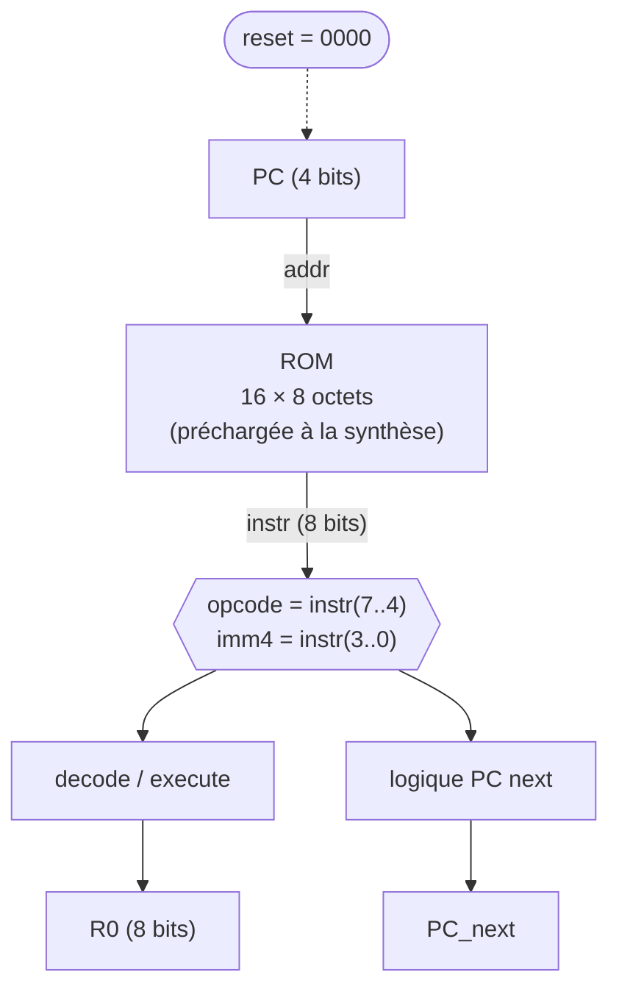

# Projet : CPU 8 bits single-cycle

C'est le point d'orgue. Tu vas assembler tout ce que tu as vu dans les modules précédents — une ROM, un registre, une ALU, un contrôle de type FSM — en une petite machine qui exécute réellement des programmes.

## La machine



## Ce que te donne le squelette

Un CPU complet et fonctionnel. Lis attentivement le starter :

```vhdl
process(clk, reset)
begin
  if reset = '1' then
    pc   <= (others => '0');
    r0   <= (others => '0');
    halt <= '0';
  elsif rising_edge(clk) then
    if halt = '0' then
      case instr(7 downto 4) is
        when "0000" => r0 <= resize(unsigned(instr(3 downto 0)), 8); pc <= pc + 1;
        when "0001" => r0 <= r0 + resize(unsigned(instr(3 downto 0)), 8); pc <= pc + 1;
        when "0010" => pc <= unsigned(instr(3 downto 0));
        when "1111" => halt <= '1';
        when others => pc <= pc + 1;
      end case;
    end if;
  end if;
end process;
```

Il implémente déjà :

- LOAD (`0000`)
- ADD  (`0001`)
- JUMP (`0010`)
- HALT (`1111`)

La ROM préchargée exécute `R0 = 3; R0 += 4; R0 += 2; HALT`.

## Ton travail

Lance-le tel quel d'abord. Simule 200 µs avec le stimulus horloge + reset fourni. Dans l'onglet Waveforms, tu devrais voir `r0_out` passer par `3 → 7 → 9`, puis `halted` passer à haut et y rester.

Une fois que la base fonctionne, **étends** l'ISA :

### Tâche 1 : SUB

Opcode `0011`. `R0 <= R0 - imm4`. Modification d'une ligne.

### Tâche 2 : Saut conditionnel

Opcode `0100` : `JZ addr` — saute à `addr` si `R0 = 0`, sinon juste `pc <= pc + 1`.

Écris un petit programme qui compte à rebours depuis une valeur et revient à 0 quand c'est fini. Utilise `JZ` comme sortie de boucle.

### Tâche 3 : Un second registre

Ajoute `r1` comme second registre 8 bits. Définis `LOAD R1, #i` comme opcode `0101` et `ADD R0, R1` (sans immédiat) comme opcode `0110`. Tu devras élargir le case de décodage et ajouter un second port de sortie pour la visibilité.

### Tâche 4 : Mémoire de données externe

Branche le module RAM de la piste Mémoires sur ce CPU. Ajoute les opcodes `LOAD R0, [addr]` et `STORE R0, [addr]`. Attention : un design single-cycle exige que le port de lecture de la mémoire ait sa sortie valide dans le même cycle où tu émets l'adresse — utilise une lecture combinatoire pour la ROM et une lecture registrée pour la RAM de données, et planifie soigneusement le pipeline.

## Pourquoi faire ça ?

Parce que la première fois que tu regardes ton CPU dérouler un programme que tu as écrit (en octets que tu as placés dans une ROM), quelque chose fait tilt. Toutes les abstractions au-dessus — assembleur, compilateur, système d'exploitation — reposent exactement sur ce mécanisme. Et toutes, jusqu'au navigateur web qui exécute le JavaScript que tu as écrit la semaine dernière, ne sont que la même astuce répétée à plus grande échelle.

## Pour aller plus loin

- Implémente le classique pipeline à cinq étages sur cette même ISA. Ajoute la détection d'aléas et une unité de forwarding. Tu as maintenant une version microscale de ce que les manuels RISC-V enseignent.
- Reconfigure la ROM : au lieu de constantes, charge-la depuis un fichier externe au moment de la simulation, puis construis une toolchain qui assemble du texte vers ces octets.
- Ajoute l'UART TX du projet précédent et fais imprimer `'HI'` par le CPU sur la forme d'onde. Félicitations — tu as un SoC.
