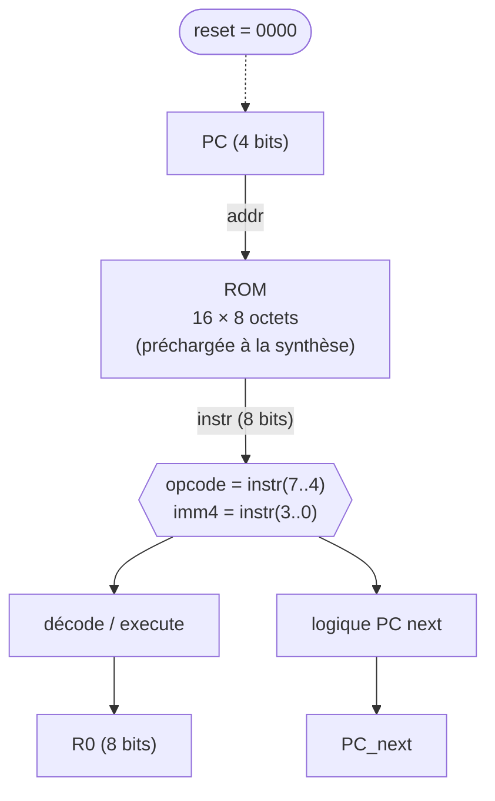

# Projet : CPU 8 bits monocycle

C'est le couronnement. Vous allez assembler tout ce qui vient des modules précédents — une ROM, un registre, une ALU, un contrôle façon FSM — en une petite machine qui exécute vraiment des programmes.

## La machine



C'est le thème 3.5 du cours ESCOM *Arquitectura de Computadoras* — le point où l'ALU, le registre, la ROM et la logique de contrôle des blocs précédents se réunissent en une machine RISC qui fonctionne.

## Le contrat monocycle

Tout repose sur une règle : **dans un design monocycle, une instruction se termine à chaque période d'horloge.** À l'intérieur d'un seul tick, le matériel doit, en combinatoire, récupérer l'instruction que pointe le PC, la décoder, la faire passer dans l'ALU et calculer le prochain PC — et ce n'est qu'au front montant que les éléments d'*état* (PC, R0, le drapeau de halt) latchent leurs nouvelles valeurs.

C'est pourquoi la lecture de la ROM doit être combinatoire : l'adresse (PC) et la donnée (instr) doivent toutes deux être valides *avant* le front d'horloge, dans le même cycle. La période d'horloge doit donc couvrir le chemin le plus long à travers toute la machine, du fetch au writeback. Simple à raisonner, mais ça plafonne votre fréquence d'horloge — ce qui est exactement la motivation du pipelining plus tard.

## Ce que le squelette vous donne

Un CPU complet et fonctionnel. Lisez le starter attentivement :

```vhdl
process(clk, reset)
begin
  if reset = '1' then
    pc   <= (others => '0');
    r0   <= (others => '0');
    halt <= '0';
  elsif rising_edge(clk) then
    if halt = '0' then
      case instr(7 downto 4) is
        when "0000" => r0 <= resize(unsigned(instr(3 downto 0)), 8); pc <= pc + 1;
        when "0001" => r0 <= r0 + resize(unsigned(instr(3 downto 0)), 8); pc <= pc + 1;
        when "0010" => pc <= unsigned(instr(3 downto 0));
        when "1111" => halt <= '1';
        when others => pc <= pc + 1;
      end case;
    end if;
  end if;
end process;
```

Il implémente déjà :

- LOAD (`0000`)
- ADD  (`0001`)
- JUMP (`0010`)
- HALT (`1111`)

La ROM préchargée exécute `R0 = 3 ; R0 += 4 ; R0 += 2 ; HALT`.

## Votre boulot

Lancez-le tel quel d'abord. Simulez pendant 200 µs avec les stimuli d'horloge + reset fournis. Dans l'onglet Formes d'onde, vous devriez voir `r0_out` passer par `3 → 7 → 9`, puis `halted` monter et y rester.

Une fois la baseline qui marche, **étendez** l'ISA :

### Tâche 1 : SUB

Opcode `0011`. `R0 <= R0 - imm4`. Modification d'une ligne.

### Tâche 2 : Saut conditionnel

Opcode `0100` : `JZ addr` — saute à `addr` si `R0 = 0`, sinon juste `pc <= pc + 1`.

Voici une boucle travaillée qui décompte `R0` jusqu'à zéro puis s'arrête. On soustrait 1 à chaque passage ; quand `R0` atteint 0, `JZ` laisse passer vers le `HALT` :

```
0: 03   LOAD R0, #3     -- R0 = 3
1: 31   SUB  R0, #1     -- R0 = R0 - 1   (opcode 0011 de la Tâche 1)
2: 44   JZ   #4         -- si R0 = 0 saute à l'adr 4, sinon continue
3: 21   JUMP #1         -- repart en arrière et soustrait encore
4: F0   HALT
```

Tracez-la : R0 passe par 3 → 2 → 1 → 0, et c'est seulement au passage où R0 a atteint 0 que `JZ` prend le branchement vers le `HALT`. Regardez `r0_out` dans l'onglet Formes d'onde pour confirmer le décompte avant de faire confiance à la logique de branchement.

Le décodage de `JZ` n'est qu'un prochain-PC conditionnel :

```vhdl
when "0100" =>
  if r0 = 0 then
    pc <= unsigned(instr(3 downto 0));   -- pris
  else
    pc <= pc + 1;                        -- on continue
  end if;
```

### Tâche 3 : Un second registre

Ajoutez `r1` comme second registre 8 bits. Définissez `LOAD R1, #i` comme opcode `0101` et `ADD R0, R1` (sans immédiat) comme opcode `0110`. Il vous faudra élargir le case de décodage et ajouter un second port de sortie pour la visibilité.

### Tâche 4 : Mémoire de données externe

Branchez le module RAM du track Mémoires sur ce CPU. Ajoutez les opcodes `LOAD R0, [addr]` et `STORE R0, [addr]`. Voici le vrai piège, et il vaut mieux le comprendre que le copier sans réfléchir : un `LOAD` monocycle a besoin que la donnée de la RAM soit valide *dans le même cycle* où il émet l'adresse. Ça ne marche qu'avec une **lecture combinatoire (asynchrone)** — l'adresse entre, la donnée sort sans front d'horloge entre les deux (une petite RAM distribuée/LUT sur FPGA peut faire ça). Une **lecture synchrone (registrée)**, c'est-à-dire ce que donne la block RAM, retourne la donnée au front d'horloge *suivant* — donc votre `LOAD` latcherait une donnée périmée et lirait silencieusement la mauvaise valeur. Si vous devez utiliser de la block RAM, le remède honnête est de laisser le `LOAD` prendre un cycle de plus (une mini-instruction multicycle), pas de faire semblant que la lecture est prête. Les stores sont plus faciles : une écriture est déjà un événement déclenché sur front, donc une écriture registrée s'accorde bien avec le modèle monocycle.

## Pourquoi faire ça ?

Parce que la première fois que vous voyez votre CPU dérouler un programme que vous avez écrit (dans des octets que vous avez écrits dans une ROM), quelque chose clique. Toute abstraction au-dessus — assembleur, compilateur, système d'exploitation — repose exactement sur ce mécanisme. Et chacune, jusqu'au navigateur qui exécute le JavaScript que vous avez écrit la semaine dernière, c'est la même astuce répétée à plus grande échelle.

## Pour aller plus loin

- Implémentez le pipeline classique à cinq étages sur cette même ISA. Ajoutez la détection d'aléas et une unité de forwarding. Vous avez alors une version micro de ce que les manuels RISC-V enseignent.
- Reciblez la ROM : au lieu de constantes, chargez-la depuis un fichier externe à la simulation, puis construisez une toolchain qui assemble du texte vers ces octets.
- Branchez l'UART TX du projet précédent et faites imprimer `'HI'` par le CPU dans le chronogramme. Félicitations — vous avez un SoC.

## À retenir

- Un CPU monocycle fait tout le voyage fetch-vers-writeback en combinatoire dans une seule période d'horloge ; seuls PC, R0 et halt latchent sur le front montant.
- Ajouter une instruction, c'est une nouvelle branche dans le `case` de l'opcode — étendez le décodage, ajoutez tout nouvel état (registres) et des ports de sortie pour la visibilité.
- Les branchements conditionnels (`JZ`) ne sont que la logique de prochain-PC qui lit un drapeau : prendre la cible ou continuer vers `pc + 1`.
- Le timing mémoire est le piège classique du monocycle : lecture combinatoire pour des loads dans le même cycle ; une lecture synchrone de block RAM retourne la donnée un cycle en retard et doit être prise en compte.
