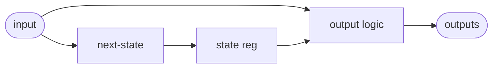

# Machines Mealy vs Moore

Une machine à états finis (FSM) est une logique de contrôle qui se souvient de ce qu'elle fait. Toute FSM a :

- Un **registre d'état** (un groupe de bascules).
- **Logique de prochain état** (combinatoire, décide ce que sera l'état au prochain front d'horloge).
- **Logique de sortie** (combinatoire, décide ce que sont les sorties à l'instant présent).

L'endroit où la logique de sortie cherche ses entrées partage les FSM en deux familles.

## Moore : les sorties ne dépendent que de l'état


Étant donné un état, la sortie est fixée. Si tu es dans `S_GREEN`, `green = '1'`. Toujours. Quoi que dise l'entrée.

**Pour**
- Les sorties ne changent qu'aux fronts d'horloge → pas de glitches.
- Facile à raisonner, à débugger, à vérifier.

**Contre**
- Au moins un cycle d'horloge de latence entre entrée et sortie (l'état doit transitionner d'abord).
- Il faut parfois plus d'états pour encoder le même comportement qu'une machine Mealy.

## Mealy : les sorties dépendent de l'état + entrée



Les sorties sont une fonction de l'état courant **et** de l'entrée courante. Elles peuvent changer entre deux fronts d'horloge.

**Pour**
- Plus rapide — les sorties peuvent réagir à une entrée dans le même cycle, pas au suivant.
- Souvent moins d'états nécessaires.

**Contre**
- Les sorties peuvent glitcher (elles suivent l'entrée combinatoire).
- Plus dur à débugger quand les sorties ne sont pas alignées sur les fronts d'horloge.

## Laquelle prendre ?

**Par défaut : Moore.** L'absence de glitches et les sorties alignées sur les fronts rendent le design prévisible. Pour de la logique de contrôle dans un CPU, un contrôleur mémoire ou tout ce qui relève de la sûreté, Moore est le choix le plus sûr.

**Prends Mealy quand** tu dois réagir dans le même cycle d'horloge, ou quand les états supplémentaires Moore feraient enfler le design. UART et moteurs de protocole finissent souvent en Mealy pour cette raison de temps de réaction.

## Comment Kmila les supporte

Les deux styles entrent dans le même **motif à deux process** que tu verras dans l'exemple du feu tricolore :

```vhdl
-- Process 1 : registre d'état (toujours sûr Moore)
process(clk, reset)
begin
  if reset = '1' then
    state <= S_IDLE;
  elsif rising_edge(clk) then
    state <= next_state;
  end if;
end process;

-- Process 2 : prochain état combinatoire + sorties
process(state, input)
begin
  ...
end process;
```

Pour une machine Moore, les sorties ne regardent que `state`. Pour une machine Mealy, elles regardent `state` et `input`.

## À retenir

- Moore : sortie = fonction de l'état seul. Sans glitch.
- Mealy : sortie = fonction de l'état + entrée. Plus rapide.
- Commence par Moore ; passe à Mealy quand tu as une raison précise.
