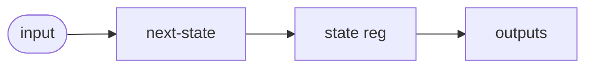

# Machines Mealy vs Moore

Une machine à états finis (FSM) est une logique de contrôle qui se souvient de ce qu'elle est en train de faire. Formellement, c'est un automate déterministe : un ensemble fini d'états, une fonction de transition qui choisit l'état suivant à partir de l'état courant et des entrées, et une fonction de sortie. Toute FSM synchrone que vous construisez a trois parties :

- Un **registre d'état** (un groupe de flip-flops) — la seule chose qui a de la mémoire.
- **Logique de prochain état** (combinatoire, décide ce que sera l'état au prochain front d'horloge).
- **Logique de sortie** (combinatoire, décide ce que sont les sorties à l'instant présent).

L'endroit où la logique de sortie cherche ses entrées partage les FSM en deux familles.

## Moore : les sorties ne dépendent que de l'état



Étant donné un état, la sortie est fixée. Si vous êtes dans `S_GREEN`, `green = '1'`. Toujours. Quoi que dise l'entrée.

**Pour**
- Les sorties ne changent qu'aux fronts d'horloge → pas de glitches.
- Facile à raisonner, à débugger, à vérifier.

**Contre**
- Au moins un cycle d'horloge de latence entre entrée et sortie (l'état doit transitionner d'abord).
- Il faut parfois plus d'états pour encoder le même comportement qu'une machine Mealy.

## Mealy : les sorties dépendent de l'état + entrée


Les sorties sont une fonction de l'état courant **et** de l'entrée courante. Elles peuvent changer entre deux fronts d'horloge.

**Pour**
- Plus rapide — les sorties peuvent réagir à une entrée dans le même cycle, pas au suivant.
- Souvent moins d'états nécessaires.

**Contre**
- Les sorties peuvent glitcher (elles suivent l'entrée combinatoire).
- Plus dur à débugger quand les sorties ne sont pas alignées sur les fronts d'horloge.

Un moyen rapide de sentir la différence : le même boulot « détecter un `1` sur l'entrée » tient en un seul état en Mealy (on active la sortie sur la transition qui *voit* le `1`) mais exige un état supplémentaire « je viens de voir un 1 » en Moore (pour que la sortie puisse être liée au fait d'*être dans* cet état). Même comportement, nombre d'états différent, décalés d'un cycle en timing.

## Un, deux ou trois process

VHDL vous offre plusieurs façons d'écrire la même machine. Elles se synthétisent vers le même matériel ; elles diffèrent par la lisibilité et par la facilité à se tromper.

- **Un process :** registre d'état *et* sorties vivent dans un seul process cadencé. Tout finit registré, donc les sorties sont naturellement sans glitch (style Moore, registré). Compact, mais la logique de prochain état et celle de sortie sont enchevêtrées.
- **Deux process (défaut recommandé) :** un process cadencé tient le registre d'état ; un process combinatoire calcule `next_state` et les sorties. C'est le motif qu'utilisent les exemples Kmila — il correspond proprement à l'image en trois parties ci-dessus.
- **Trois process :** registre d'état, logique de prochain état et logique de sortie ont chacun leur propre process. Le plus verbeux, mais la séparation la plus claire et le plus dur à casser par accident.

## Le piège qui attrape tout le monde : les latchs inférés

Dans un process *combinatoire*, chaque signal que vous pilotez doit recevoir une valeur sur **chaque** chemin à travers le process. Si une branche d'un `case` ou d'un `if` oublie d'affecter `next_state` (ou une sortie), la synthèse doit *se souvenir* de l'ancienne valeur — et la seule chose qui se souvient en logique combinatoire, c'est un **latch**. Les latchs ne sont presque jamais ce que vous voulez : ils sont sensibles au niveau, difficiles à timer, et une source classique de « marche en simu, échoue sur le silicium ».

Le remède tient en une ligne : affectez une **valeur par défaut** à chaque signal en haut du process, avant le `case`.

```vhdl
process(state, input)
begin
  next_state <= state;   -- défaut : on reste sur place
  green      <= '0';     -- affecter un défaut à chaque sortie aussi
  case state is
    when S_IDLE  => if input = '1' then next_state <= S_RUN; end if;
    when S_RUN   => green <= '1';
                    next_state <= S_IDLE;
  end case;
end process;
```

Maintenant, même si une branche « oublie » une affectation, le défaut la couvre — pas de latch. (Notez que VHDL exige que les choix d'un `case` soient exhaustifs, vous ajouterez donc souvent un `when others =>` ; ça satisfait le compilateur, mais c'est l'*affectation par défaut* qui vous sauve réellement des latchs.)

## Encodage des états

Vous écrivez des états nommés avec un type énuméré et laissez l'outil choisir les bits :

```vhdl
type state_t is (S_IDLE, S_RUN, S_DONE);
signal state, next_state : state_t;
```

Le synthétiseur choisit un encodage — **binaire** (le moins de flip-flops), **one-hot** (un flip-flop par état, rapide et ami des FPGA), ou **Gray** (un seul bit change par étape, bon pour les transitions peu bruyantes). Sur FPGA, le one-hot est souvent le défaut parce que les flip-flops sont abondants et que ça garde la logique de prochain état peu profonde. Vous avez rarement besoin d'encoder à la main ; laissez l'outil décider sauf raison contraire.

## Laquelle prendre ?

**Par défaut : Moore.** L'absence de glitches et les sorties alignées sur les fronts rendent le design prévisible. Pour de la logique de contrôle dans un CPU, un contrôleur mémoire ou tout ce qui relève de la sûreté, Moore est le choix le plus sûr.

**Prenez Mealy quand** vous devez réagir dans le même cycle d'horloge, ou quand les états Moore supplémentaires feraient enfler le design. UART et moteurs de protocole finissent souvent en Mealy pour cet argument de temps de réaction. Si vous aimez le nombre d'états de Mealy mais voulez le timing propre de Moore, **registrez les sorties Mealy** (faites-les passer par un flip-flop de plus) — vous récupérez des sorties sans glitch, au prix du cycle de latence que vous cherchiez justement à éviter.

## Liens avec le cours

C'est le cœur de l'unité II, *Diseño de sistemas digitales* : l'automate déterministe avec et sans sortie, les modèles Mealy et Moore, et leur description en HDL. Sur papier vous les construirez aussi à partir de flip-flops JK / SR / T / D et vous les réduirez avec des méthodes de réduction d'états (impliquants premiers / tabulaires) — le style à type énuméré d'ici est la contrepartie HDL de ce même diagramme d'états.

## À retenir

- Moore : la sortie est une fonction de l'état seul. Sans glitch, un cycle de latence.
- Mealy : la sortie est une fonction de l'état + entrée. Plus rapide, peut glitcher — registrez les sorties si ça compte.
- Utilisez le motif à deux process, et **affectez un défaut à chaque signal** en haut du process combinatoire pour éviter les latchs inférés.
- Laissez l'outil choisir l'encodage des états (le one-hot est courant sur FPGA) ; commencez par Moore et passez à Mealy pour une raison précise.
