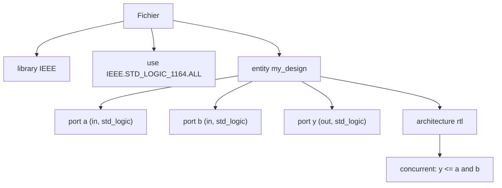

# Anatomie d'un fichier VHDL

Tout fichier VHDL a les mêmes quatre sections, toujours dans le même ordre. Une fois que vous en reconnaissez la forme, lire du code inconnu cesse d'être intimidant — vous savez tout simplement où chercher chaque morceau. C'est exactement la « structure d'un programme en HDL » que le cours vous demande de maîtriser avant d'écrire quoi que ce soit d'utile.

## Les quatre sections

```vhdl
library IEEE;                          -- 1. bibliothèques
use IEEE.STD_LOGIC_1164.ALL;           -- 2. packages utilisés

entity my_design is                    -- 3. entity (l'« en-tête »)
  port (
    a : in  std_logic;
    b : in  std_logic;
    y : out std_logic
  );
end entity my_design;

architecture rtl of my_design is       -- 4. architecture (le « corps »)
begin
  y <= a and b;
end architecture rtl;
```

Examinons-les une par une.

### 1. `library`

`library IEEE;` rend visible à votre fichier la bibliothèque logique nommée `IEEE`. C'est l'équivalent, en design numérique, de `#include <stdio.h>` — presque tout fichier que vous écrirez un jour commence par là.

Une subtilité qu'il vaut mieux connaître tôt : la bibliothèque `STD` (qui définit les types intégrés `boolean`, `integer`, `character`, `bit`, etc.) et votre propre bibliothèque `WORK` sont *toujours* visibles. On n'écrit jamais `library STD;`. Vous ne nommez `IEEE` que parce que les types logiques dont vous avez réellement besoin s'y trouvent.

### 2. `use`

`use IEEE.STD_LOGIC_1164.ALL;` amène dans la portée tous les noms du package `STD_LOGIC_1164`. C'est ce qui vous donne `std_logic`, `std_logic_vector`, `rising_edge()`, ainsi que les opérateurs logiques sur ces types.

Vous verrez souvent un second `use` :

```vhdl
use IEEE.NUMERIC_STD.ALL;
```

Celui-là vous donne `unsigned`, `signed`, `to_integer`, `resize`, et l'arithmétique pour les types vecteurs. Ajoutez-le dès que vous faites de l'arithmétique sur des vecteurs. Évitez les vieux packages `std_logic_arith` / `std_logic_unsigned` que vous pourriez croiser dans des tutoriels en ligne — ils n'ont jamais fait partie du standard IEEE, et les mélanger avec `numeric_std` conduit à des surcharges ambiguës.

### 3. `entity`

L'entity est l'**interface boîte noire**. Elle dit :

- comment le design s'appelle (`my_design`)
- quels ports il possède
- pour chaque port : son **mode** (`in`, `out`, `inout`, `buffer`) et son **type**

| Mode | Peut-on le lire à l'intérieur ? | Peut-on le piloter ? |
|------|-------------------------|-------------------|
| `in`     | oui | non |
| `out`    | oui (VHDL-2008+) | oui |
| `inout`  | oui | oui (bidirectionnel / tristate) |
| `buffer` | oui | oui (un seul driver interne) |

Tout ce qui se trouve dans `port (…)` est ce que le monde extérieur voit. Rien sur la *façon* dont le design fonctionne n'est déclaré ici. Une entity peut aussi porter des **generics** — des paramètres connus à la compilation, comme la largeur d'un bus — que nous utiliserons plus tard pour rendre les designs réutilisables.

### 4. `architecture`

L'architecture est l'**implémentation**. Une entity peut avoir plusieurs architectures pour la même interface — vous pourriez avoir des architectures `rtl`, `behavioral` et `tb` de la même entity `cpu` et en choisir une par configuration. En pratique, la plupart des fichiers en ont exactement une.

La partie comprise entre la ligne `architecture` et `begin` est la **zone déclarative** — c'est là que vivent les signaux internes, les constantes et les types. La partie entre `begin` et `end architecture` est la **zone des instructions** — c'est là que les signaux et les portes sont réellement décrits.

## Comment Kmila parse tout ça

Le parser VHDL de Kmila lit votre fichier de haut en bas et construit un arbre :



Quand vous cliquez sur **Compiler**, les ports deviennent les entrées de l'onglet **Ports** du dock, l'entity devient l'entrée dans **Entités**, et les affectations à l'intérieur de l'architecture deviennent le câblage que le simulateur exécute.

## Conventions de nommage

VHDL est insensible à la casse. `SIGNAL`, `Signal` et `signal` sont le même mot-clé, et `My_Design` et `my_design` désignent la même chose. (La seule exception concerne les caractères à l'intérieur des littéraux de chaîne et de caractère — `'0'` et `'1'` sont des valeurs littérales, pas des mots-clés.) Gardez un style unique dans un fichier donné — la plupart des équipes utilisent les **minuscules** pour les mots-clés et les noms de signaux, le **snake_case** pour les identifiants, et les **MAJUSCULES** pour les constantes.

## Erreurs classiques du premier fichier

- **Oublier la clause `use`.** `library IEEE;` seul n'amène *pas* `std_logic`. Sans la ligne `use IEEE.STD_LOGIC_1164.ALL;`, le compilateur signale une erreur « type `std_logic` inconnu ».
- **Noms de fermeture incohérents.** `end entity foo;` doit correspondre à `entity foo`. Le nom après `end` est facultatif mais, lorsqu'il est présent, il doit être exact.
- **Un point-virgule ou une virgule en trop dans le dernier port.** Le dernier port d'une liste `port (…)` ne porte pas de `;` avant la parenthèse fermante.

## À retenir

- `library` + `use` — vos imports. `library IEEE;` seul ne suffit pas ; il vous faut aussi la clause `use`.
- `entity` — l'interface : les ports, leurs modes, et les generics.
- `architecture` — l'implémentation, séparée en une zone déclarative (avant `begin`) et une zone des instructions (après).
- Une entity peut avoir plusieurs architectures ; la plupart des projets en livrent une appelée `rtl`.
