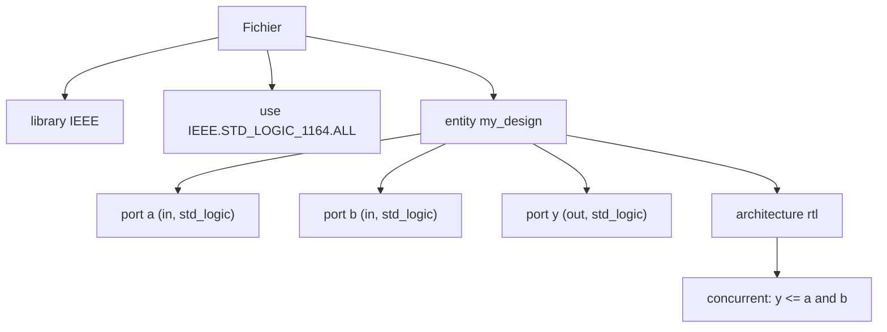

# Anatomie d'un fichier VHDL

Tout fichier VHDL a les mêmes quatre sections, toujours dans le même ordre. Une fois que vous reconnaissez la forme, lire du code inconnu cesse d'être intimidant — vous savez où chercher chaque morceau.

## Les quatre sections

```vhdl
library IEEE;                          -- 1. bibliothèques
use IEEE.STD_LOGIC_1164.ALL;           -- 2. packages utilisés

entity my_design is                    -- 3. entity (l'« en-tête »)
  port (
    a : in  std_logic;
    b : in  std_logic;
    y : out std_logic
  );
end entity my_design;

architecture rtl of my_design is       -- 4. architecture (le « corps »)
begin
  y <= a and b;
end architecture rtl;
```

Examinons chacune.

### 1. `library`

`library IEEE;` importe la bibliothèque IEEE standard. C'est l'équivalent en design numérique de `#include <stdio.h>` — presque tout fichier que vous écrirez commence par ça.

### 2. `use`

`use IEEE.STD_LOGIC_1164.ALL;` met tous les noms du package `STD_LOGIC_1164` dans la portée. C'est ce qui vous donne `std_logic`, `std_logic_vector`, `rising_edge()`, et compagnie.

Vous verrez souvent un second `use` :

```vhdl
use IEEE.NUMERIC_STD.ALL;
```

Celui-là vous donne `unsigned`, `signed`, `to_integer`, `resize`, et l'arithmétique pour les types vecteurs. Ajoutez-le dès que vous faites de l'arithmétique sur des vecteurs.

### 3. `entity`

L'entity est l'**interface boîte noire**. Elle dit :

- comment le design s'appelle (`my_design`)
- quels ports il a
- pour chaque port : sa **direction** (`in`, `out`, `inout`, `buffer`) et son **type**

Tout ce qui est dans `port (…)` est ce que le monde extérieur voit. Rien sur la façon dont le design fonctionne n'est déclaré ici.

### 4. `architecture`

L'architecture est l'**implémentation**. Une entity peut avoir plusieurs architectures (pour la même interface) — vous pourriez avoir des architectures `rtl`, `behavioral` et `tb` de la même entity `cpu` et en choisir une par configuration. En pratique, la plupart des fichiers en ont exactement une.

Le corps entre `begin` et `end architecture` est où les signaux et les portes sont réellement décrits.

## Comment Kmila parse ça

Le parser VHDL de Kmila lit votre fichier de haut en bas et construit un arbre :



Quand vous cliquez sur **Compiler**, les ports deviennent les entrées de l'onglet **Ports** du dock, l'entity devient l'entrée dans **Entités**, et les affectations dans l'architecture deviennent le câblage que le simulateur exécute.

## Conventions de nommage

VHDL est insensible à la casse. `SIGNAL`, `Signal` et `signal` sont le même mot-clé. Mais gardez un style unique dans un fichier — la plupart des équipes utilisent **minuscule** pour les mots-clés et les noms de signaux, **snake_case** pour les identifiants, et **UPPER_CASE** pour les constantes.

## À retenir

- `library` + `use` — vos imports.
- `entity` — l'interface (ports et directions).
- `architecture` — l'implémentation (ce qui se passe vraiment).
- Une entity peut avoir plusieurs architectures ; la plupart des projets livrent une appelée `rtl`.
